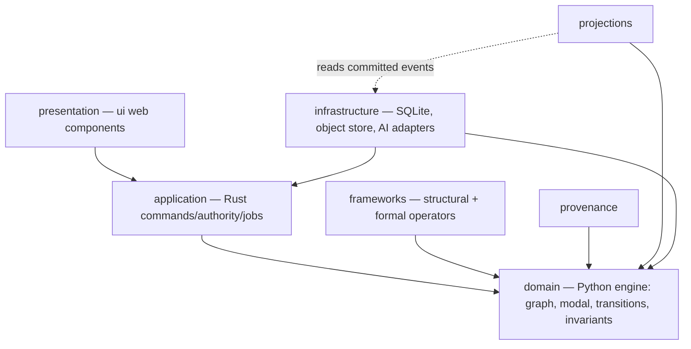
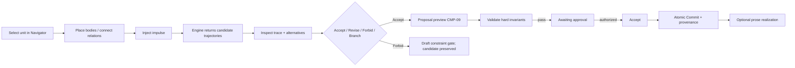

# Narrative Workbench — Implementation Plan

| Field | Value |
| --- | --- |
| Document | Implementation Plan |
| Product | Narrative Workbench |
| Version | 0.1 (Draft) |
| Date | 25 October 2026 |
| Source of truth | `Narrative_Workbench_Software_Requirements_Specification.md` (the SRS) |
| Governing spec | `Narrative_Workbench_Visual_and_Interaction_Specification.docx` |
| Binding stack | Tauri (Rust backend, JavaScript frontend) + Python engine sidecar (NetworkX) — `CLAUDE.md` C-1 |
| Requirement keywords | MUST, MUST NOT, SHOULD, MAY per RFC 2119 / RFC 8174 |

> **Scope note.** This plan turns the SRS into an implementation-ready build. It honors the repository standing rules in `CLAUDE.md`: the fixed Tauri + Python/NetworkX stack (no other frameworks, languages, or graph libraries), role-token-only visual values, the fixed state-field vocabulary (body, impulse, boundary, sink, gate, pin, ghost), and the open `[PRE]` register (every `[PRE]` item stays Proposed until its owner signs off; work depending on an open `[PRE]` item is *not accepted*). The skill's default "pure Python" shape is realized in the **engine sidecar**; the **app** is Rust + JS as required. Where the skill prescribes a tool that the stack forbids, the plan keeps the stack and says so.

---

## 1. Implementation Strategy

### 1.1 Principles

1. **State before prose, proposal before mutation.** The engine owns the typed graph and deterministic validation. The app coordinates commands and authority. No direct manipulation writes canonical state; every mutating gesture becomes a reviewable proposal (SRS REQ-070, §3.8).
2. **Deterministic core, advisory AI.** The graph kernel, invariant engine, and provenance service are deterministic and fully unit-tested. AI is proposal-only, behind a typed gateway (SRS §3.10).
3. **Two processes, one contract.** The Rust app and Python engine communicate over a single versioned JSON contract. Pydantic models define it on the Python side; `serde` structs mirror it on the Rust side. One schema file is generated from the Pydantic models and checked into both trees so drift fails CI (SRS REQ-160/161).
4. **Build in the spec's order.** Confirm `[PRE]` → tokens → shared components → state model/invariants → screens → five verification checks (spec §2). Phases below follow this and the architecture's evolutionary increments (Foundation → Critical laboratory → Scene composition → Multiscale → Experimental form → Collaboration).
5. **Tokens are the only home for visual values.** A generated CSS-variable file is the single source; a build-time test fails on any literal (SRS REQ-145/146).
6. **Append-only and reproducible.** Operations are immutable; snapshots accelerate reads but rebuild from the log (SRS NFR-030/031).

### 1.2 Technology bindings

| Concern | Choice | Basis |
| --- | --- | --- |
| Desktop app shell | Tauri 2.x (Rust backend) | C-1 |
| Frontend language | JavaScript (ES modules) | C-1 |
| Frontend component model | Native Web Components + token CSS variables (no new framework) | C-1; front-end framework is **PRE-01**, owned by developer lead — not bound here |
| Engine language | Python 3.12 | C-1 |
| Graph library | NetworkX | C-1 (no other graph library) |
| Engine contracts/validation | Pydantic v2 | skill; SRS §8 |
| Engine ↔ app transport | Local JSON over Tauri sidecar stdio (line-delimited request/response) | SRS REQ-160; **PRE-01** binds final IPC |
| Rust contract mirror | `serde` + `serde_json` | SRS REQ-161 |
| Authoritative store | SQLite (relational, embedded) for local mode; schema allows a server RDBMS later | SRS REQ-171; local-first (SRS A-4) |
| Object store | Content-addressed files on disk for local mode | SRS REQ-171 |
| Engine tests | pytest + coverage.py | skill |
| Rust tests | `cargo test` | standard |
| Frontend tests | Playwright (headless Chromium, already provisioned) + node test runner | `CLAUDE.md` cloud note; spec §10 |
| Engine docs | Sphinx docstrings + MkDocs Material | skill |

### 1.3 Assumptions

- **A-1** The spec governs where more explicit than the architecture, after `[PRE]` sign-off (SRS A-1).
- **A-2** Local single-user deployment is the first target; collaboration follows (SRS A-4).
- **A-3** SQLite and on-disk content store are acceptable for the local authoritative store; the domain exposes repository ports so a server RDBMS can replace them without domain changes (SRS REQ-171, C-5).
- **A-4** Native Web Components satisfy the component contract without a new framework; if an owner later selects a framework under PRE-01, the component layer is re-bound behind the same roles, states, and keyboard contracts.

### 1.4 Open questions carried from the SRS

OQ-01…OQ-12 (SRS §10) remain open and gate the phases that depend on them — notably OQ-10 (specialized graph storage vs. NetworkX + relational store) gates any Phase-beyond change to storage, and **OQ-12 (meaning of `ghost`)** blocks any feature that would use the term. No phase below depends on `ghost`.

---

## 2. Proposed Project Structure

```
narrative-workbench/
├─ CLAUDE.md
├─ README.md
├─ Narrative_Workbench_Software_Requirements_Specification.md
├─ Narrative_Workbench_Implementation_Plan.md
├─ Narrative_Workbench_Visual_and_Interaction_Specification.docx
├─ design-tokens/
│  ├─ tokens.dtcg.json           # single source of visual values (spec §4)
│  └─ build-tokens.mjs           # emits css-variables.css from the DTCG file
├─ app/                          # Tauri application
│  ├─ src-tauri/                 # Rust backend
│  │  ├─ Cargo.toml
│  │  └─ src/
│  │     ├─ main.rs
│  │     ├─ commands.rs          # intention-revealing commands (REQ-161)
│  │     ├─ authority.rs         # authority checks (REQ-174)
│  │     ├─ engine_client.rs     # sidecar spawn + JSON contract (REQ-160)
│  │     ├─ contract.rs          # serde mirror of engine contract (REQ-161)
│  │     ├─ repository.rs        # SQLite + object store ports (REQ-171)
│  │     └─ provenance.rs        # provenance capture (REQ-097)
│  └─ ui/                        # JavaScript frontend
│     ├─ index.html
│     ├─ styles/css-variables.css  # GENERATED from tokens (do not edit)
│     ├─ tokens.js               # read-only role-token accessors
│     ├─ state/store.js          # observable app state (SRS §8.1)
│     ├─ statecharts/            # proposal, branch, selection, job (SRS §3.8–3.11)
│     ├─ components/             # CMP-01…CMP-18 web components
│     ├─ screens/                # Screen 1–5 composition (spec §8)
│     └─ a11y/                   # keyboard model, focus order (SRS §5.2)
├─ engine/                       # Python sidecar
│  ├─ pyproject.toml
│  ├─ src/nw_engine/
│  │  ├─ __init__.py
│  │  ├─ domain/                 # entities, value objects (SRS §6)
│  │  ├─ graph/                  # NetworkX kernel + typed edges (REQ-010–016)
│  │  ├─ modal/                  # modal models, model transitions (REQ-020–026)
│  │  ├─ frameworks/             # structural frameworks, formal operators (REQ-030–035)
│  │  ├─ validation/             # hard invariants + soft goals (SRS §8.3)
│  │  ├─ transitions/            # candidate generation, trajectories (REQ-130)
│  │  ├─ provenance/             # provenance records (REQ-097)
│  │  ├─ repository/             # append-only ops, commits, branches (SRS §3.9)
│  │  ├─ projections/            # timelines, diffs, comparisons (REQ-099)
│  │  ├─ ai/                     # gateway boundary: typed proposals only (SRS §3.10)
│  │  ├─ contracts/              # Pydantic request/response models (SRS §8)
│  │  └─ rpc/                    # line-delimited JSON dispatch (REQ-160)
│  └─ tests/
├─ docs/                         # MkDocs Material
│  ├─ mkdocs.yml
│  └─ (context, design, api, diagrams)
└─ scripts/
   ├─ cloud-env-setup.sh
   ├─ session-start.sh
   └─ gen-contract.py            # emits JSON schema from Pydantic for the Rust mirror
```

```mermaid
flowchart TB
  subgraph app[app — Tauri]
    ui[ui — JS web components + generated token CSS]
    rust[src-tauri — Rust: commands, authority, repository, provenance]
  end
  subgraph engine[engine — Python sidecar]
    rpc[rpc + contracts] --> graph[graph kernel NetworkX]
    rpc --> modal[modal models]
    rpc --> val[validation]
    rpc --> trans[transitions]
    rpc --> proj[projections]
    rpc --> ai[ai gateway]
  end
  ui --> rust
  rust -- JSON contract --> rpc
  rust --> store[(SQLite + object store)]
  tokens[design-tokens/tokens.dtcg.json] -- build --> ui
```

*Purpose and coverage:* the structure diagram shows the two-process split, the one JSON contract between them, and the token file as the single source feeding the UI. It covers C-1, C-2, and SRS REQ-160/161/171.

---

## 3. Layer and Contract Model

### 3.1 Layers (normative dependency rule — SRS §7.1, C-5)



*Purpose and coverage:* presentation depends on application; application coordinates the domain; frameworks/provenance/projections depend on the domain; infrastructure implements ports owned by inner layers. The dependency direction MUST hold even across the process boundary (the Rust app is the application layer; the Python engine is the domain layer). Covers SRS REQ-170 and NFR-051.

### 3.2 Cross-process contract

- **Request** (app → engine): `{ "op": "<command>", "opId": "<idempotency key>", "context": { workId, branchId, commitId, mode, actor, authority }, "payload": {…} }`.
- **Response** (engine → app): `{ "opId", "ok": bool, "result": {…}, "proposal": {…}, "validation": {…}, "error": {code, message, scope} }`.
- The engine **never** persists canonical state; it returns typed proposals and validation results. The Rust application layer performs the atomic commit to the repository and captures provenance (SRS REQ-076/077/092). This keeps acceptance distinct from persistence across the boundary.
- `scripts/gen-contract.py` emits a JSON Schema from the Pydantic models; CI regenerates and diffs it against the committed `contract.schema.json` used by the Rust `serde` mirror. A diff fails the build (prevents contract drift).

### 3.3 Representative contracts (Pydantic, engine side)

| Model | Fields (abbreviated) | Invariants enforced |
| --- | --- | --- |
| `Proposal` | id, origin, state, payload(frozen after submit), alternatives, authorityRequired | REQ-071, REQ-192 |
| `ValidationResult` | passed, hardFailures[rule,scope,explanation,alternatives], softScores, uncertainty | REQ-073/074/075, SRS §8.3 |
| `Transition` (impulse) | id, kind(ordinary\|model), preconditions, effects, causes, constraints(gates), provenance | REQ-013, REQ-131 |
| `ModalModel` | id, scope(boundary), situations, propositions, accessibilityEdges, rules, current | REQ-020/021 |
| `EvidenceAnchor` (pin) | id, sourceEditionId, region, fingerprint, resolves:bool | REQ-051/057 |
| `Commit` | id, parentId, ops[], actor, authorityDecision, provenanceRef | REQ-090/093 |
| `ComparisonMatrix` | dimensions[7], deterministic[], hypotheses[], provenance(always) | REQ-063/066 |

### 3.4 Errors and failure behavior

| Error code | Meaning | Boundary response |
| --- | --- | --- |
| `SCHEMA_INVALID` | Proposal payload incomplete | stay `draft`; no mutation |
| `HARD_INVARIANT` | A hard invariant failed | `rejected` + rule/scope/explanation/alternatives (REQ-074) |
| `AUTHORITY_DENIED` | Actor lacks authority | no mutation + visible reason (REQ-080) |
| `PARENT_CHANGED` | Commit parent moved | open conflict resolver (REQ-078) |
| `ANCHOR_BROKEN` | Evidence anchor unresolved | publication blocked (REQ-057) |
| `UNHANDLED_EVENT` | No transition from state | no mutation + visible reason (REQ-188) |

---

## 4. Design Patterns Used

Named only where they clarify responsibility, extension, testing, or integration.

| Pattern | Where | Why |
| --- | --- | --- |
| Command | App commands (`propose`, `accept`, `commit`, `anchorEvidence`, `createBranch`) | one command identity + idempotency key (REQ-161) |
| State machine | Proposal, branch, selection, job lifecycles | only permitted transitions (SRS §3.8/3.9/3.11) |
| Repository + Port/Adapter | `repository.rs`, engine `repository/` over SQLite/object-store | swap storage without domain change (REQ-171, C-5) |
| Strategy (plugin) | Frameworks, lenses, formal operators, validators, providers, export formats | versioned extension contracts (NFR-050) |
| Proposal/Advisory object | AI gateway outputs | advisory until validated + accepted (SRS §3.10) |
| Event sourcing (append-only log + snapshots) | Versioned repository | audit, rebuild, reproducibility (NFR-030) |
| Observer | UI store → synchronized projections | selection sync without canonical mutation (REQ-002) |
| Projection/CQRS read models | `projections/` | derived views rebuildable from committed history (REQ-099) |

---

## 5. GUI Architecture

### 5.1 Component and screen model

- **18 web components** (CMP-01…CMP-18) implement the roles, states, and keyboard contracts in SRS §4.1. Each is a custom element styled only through generated token CSS variables (REQ-146).
- **5 screens** (spec §8) compose components without redefining their roles: Shell, Composition Studio, Criticism Parlor, Counterfactual Laboratory, Proposal Review.
- **State store** holds the observable variables in SRS §8.1; statecharts enforce permitted transitions and emit no mutation on unhandled events (REQ-188).

### 5.2 Responsive layout

Wide (`252px minmax(520px,1fr) 320px`, ≥1200px), Medium (inspector → drawer, 768–1199px), Narrow (CMP-17 tabs, 360–767px) per SRS REQ-150/151/152, with no outer scroll at wide/medium (REQ-153) and full function at 200% zoom / 1280px (REQ-154). All `[PRE]` dimensions remain Proposed.

### 5.3 Primary user flow (composition)



*Purpose and coverage:* the flow realizes SRS REQ-040…048 and the composition sequence (SRS §3.13), making "proposal before mutation" and "acceptance before commit" visible.

---

## 6. Documentation Plan

| Artifact | Tool | Content | SRS basis |
| --- | --- | --- | --- |
| `README.md` | Markdown | overview, quick start, build/test, architecture map | general |
| Context docs | MkDocs Material | system context, actors, trust boundaries | SRS §2, §7.3 |
| Design docs | MkDocs + Mermaid | layer model, contract, state machines, deployment | SRS §3, §6, §7 |
| API docs (engine) | Sphinx docstrings → MkDocs (mkdocstrings) | every engine service, contract, invariant | skill |
| API docs (app) | `cargo doc` + hand-written command catalog | commands, authority, repository ports | skill |
| Token reference | generated from DTCG | role tokens → CSS variables mapping | SRS §4.2 |
| Traceability | Markdown table | REQ/NFR → module → test | SRS Appendix A |
| `[PRE]` register | Markdown | PRE-01…20 disposition (all Proposed) | spec §9 |

Docstrings follow the skill's guidance: document purpose, caller contract, parameters, return, failure behavior, side effects, integration points, and extension points — as structured metadata for generated docs and diagrams.

---

## 7. Testing and Coverage Plan

### 7.1 Test layers

| Layer | Framework | Focus |
| --- | --- | --- |
| Engine unit | pytest + coverage.py | graph kernel, modal models, invariants, transitions, projections, contracts |
| Engine property | pytest (hypothesis optional, no new runtime dep) | invariant determinism, append-only guarantees |
| Contract | pytest + generated schema diff | Pydantic ↔ Rust `serde` parity (gen-contract diff) |
| App unit | `cargo test` | commands, authority, repository ports, provenance, conflict handling |
| Token test | node script | fail on any literal visual value in component code (spec §10 check 1) |
| Computed-style | Playwright (headless Chromium) | per-component properties at wide/medium/narrow (check 2) |
| Screenshot | Playwright | Screens 1–5 vs. reference wireframes (check 3) |
| Scenario | Playwright + pytest mapping | every Gherkin scenario in SRS §9 and spec §§6,8 (check 4) |
| Accessibility | Playwright + axe-core (dev-only) | keyboard, screen-reader labels, color-independence, zoom, reduced motion |

### 7.2 Coverage targets

- **Engine (Python):** line + branch coverage ≥ **90%** on `nw_engine` (the deterministic core), measured by coverage.py and enforced in CI (`--cov-fail-under=90`). The trusted core — graph kernel, invariant engine, provenance — targets **100%** branch coverage on invariant logic (SRS §8.3).
- **App (Rust):** ≥ **80%** via `cargo-llvm-cov`, with authority and commit paths at 100% of their branches.
- **Frontend:** every component state (SRS REQ-141) and every Gherkin scenario (REQ-203) mapped to one automated test; measured by a scenario-coverage matrix (scenario → test id → result).
- **Acceptance gate:** the five spec §10 checks plus the `[PRE]` disposition list (REQ-200…204). A feature depending on a still-Proposed `[PRE]` item cannot be marked accepted (C-4).

### 7.3 How coverage is measured and reported

CI runs `pytest --cov`, `cargo llvm-cov`, the token/computed-style/screenshot/scenario suites, and the contract-diff check. The Completion Report (§9) records actual coverage against targets and each implementation-table row's status.

---

## 8. Implementation Plan Table

Phases map to the spec sequence and the architecture's evolutionary increments. "Contracts" names the boundary each task must honor. Every row's completion criteria are test-verifiable.

| Phase | Task | Files | Contracts | Tests | Docs | Dependencies | Completion criteria |
| --- | --- | --- | --- | --- | --- | --- | --- |
| **0 Setup** | Workspace, toolchains, CI, contract generator | `pyproject.toml`, `app/src-tauri/Cargo.toml`, `scripts/gen-contract.py`, CI config | Build + contract-diff | CI green on empty suites | README quick start | — | `cargo test`, `pytest`, token build, and contract-diff all run in CI |
| **0** | DTCG token file + CSS-variable build + token test | `design-tokens/tokens.dtcg.json`, `build-tokens.mjs`, `ui/styles/css-variables.css` | REQ-145/146, C-2 | Token test fails on any literal | Token reference | — | 0 unresolved aliases; token test passes; no literals in component code |
| **0** | `[PRE]` register scaffold | `docs/pre-register.md` | C-4 | n/a | `[PRE]` register | — | All 20 items listed as Proposed with owners |
| **1 Foundation** | Engine: NetworkX graph kernel + typed edges + stable IDs | `engine/graph/`, `engine/domain/` | REQ-010…016 | unit: edge constraints, identity, mass(body) | API docs | Phase 0 | Kernel builds/queries a work; edge-type constraints enforced |
| **1** | Engine: append-only repository, commits, branches | `engine/repository/` | REQ-090…096 | unit: immutability, lineage, rewind-as-pointer | Design docs | Foundation kernel | Commit/branch/rewind preserve history; merge creates new commit |
| **1** | Engine: provenance records | `engine/provenance/` | REQ-097, NFR-031 | unit: all 7 provenance fields captured | API docs | repository | Every accepted op carries complete provenance + reproducibility status |
| **1** | Engine: hard-invariant validation engine | `engine/validation/` | SRS §8.3, REQ-073/074 | unit: each invariant category + response; determinism | Design docs | kernel | All 7 invariant categories enforced with stated responses |
| **1** | App: sidecar client + serde contract mirror + repository (SQLite/object store) | `engine_client.rs`, `contract.rs`, `repository.rs`, `provenance.rs` | REQ-160/161/171 | contract parity; app unit | API docs | contract generator | App drives engine over JSON; contract-diff clean; commit is atomic |
| **1** | UI: shell + CMP-01…CMP-08, state store, selection/synchronization | `ui/components/`, `ui/state/`, `ui/screens/shell` | REQ-001…008, §8.1 | computed-style; scenario: synchronized selection | Context docs | tokens, app commands | Screen 1 renders; selection syncs without canonical mutation |
| **1** | UI: proposal lifecycle + CMP-09, authority, Trace drawer | `ui/statecharts/proposal`, `ui/components/cmp-09`, `cmp-07` | REQ-070…080, §8.2 | scenarios: preview-not-commit, accept≠commit, hard-fail | Design docs | shell, validation | Proposal preview enforces lifecycle; acceptance distinct from commit |
| **2 Critical laboratory** | Engine: source ingest, fingerprint, span segmentation, pins | `engine/domain/source`, `engine/provenance/anchors` | REQ-050/051, REQ-132 | unit: immutability, anchor resolve/break | API docs | Phase 1 | Imported source frozen; spans addressable; broken anchor detected |
| **2** | Engine: AI gateway (typed, proposal-only) + extraction proposals | `engine/ai/` | REQ-100…109, REQ-106 | unit: schema bound, no mutation, metadata captured | Design docs | gateway contract | Extraction returns proposals only; prohibited-authority paths blocked |
| **2** | UI: Criticism Parlor — CMP-12/13, lenses, compare, broken-anchor block | `ui/screens/criticism`, `ui/components/cmp-12`,`cmp-13` | REQ-052…058 | scenarios: source immutable, broken anchor blocks publication, accept claim | Context docs | Phase 1 UI | Screen 3 flows pass; claim stays interpretive |
| **2** | Engine + UI: Counterfactual Laboratory, comparison matrix | `engine/projections/comparison`, `ui/screens/counterfactual`, `cmp-14` | REQ-060…067, REQ-133 | scenarios: preserve baseline, intended response, deterministic vs hypothesis | Design docs | repository, validation | Screen 4 matrix separates deterministic vs. generated across 7 dims |
| **2** | UI + engine: long jobs, CMP-15, cancel/retry | `engine/rpc/jobs`, `ui/components/cmp-15`, `ui/statecharts/job` | REQ-110…114 | scenarios: partial-not-committed, real events only | Design docs | Phase 1 | Job states driven by real events; partial never shows committed |
| **3 Scene composition** | Engine: candidate trajectory generation, soft goals, gates | `engine/transitions/` | REQ-040…046, REQ-079, REQ-130 | unit: candidate schema, soft score separate from validity | API docs | Phase 1 validation | Candidates carry traces + alternatives; forbid creates gate proposal |
| **3** | Engine: prose realization + reconciliation detector | `engine/ai/realize`, `engine/transitions/reconcile` | REQ-047/048 | scenario: reconcile prose fact | Design docs | trajectories, AI gateway | Prose follows accepted commit; new facts become reconciliation proposals |
| **3** | UI: Composition Studio — CMP-10/11 | `ui/screens/composition`, `cmp-10`, `cmp-11` | REQ-040…048 | scenarios: generate+accept, forbid, canvas has list equivalent | Context docs | Phase 1 UI | Screen 2 flows pass with keyboard equivalents |
| **3** | App: semantic conflict resolver | `ui/components/cmp-16`, app conflict path | REQ-078/098, §8.5 | scenario: override requires reason; conflict on parent change | Design docs | commit path | CMP-16 blocks commit until resolved; override needs reason |
| **4 Multiscale** | Engine: structural frameworks, hierarchy/timeline projections, episode contracts | `engine/frameworks/`, `engine/projections/` | REQ-030…033, REQ-099 | unit: framework versioning, projection rebuildable, episode contract | Design docs | Phase 1 kernel | One graph supports multiple frameworks without duplication |
| **5 Experimental form** | Engine: formal operators + reader-model transitions | `engine/frameworks/operators` | REQ-034/035, REQ-015 | unit: 8 operators (INTERRUPT…TRANSPOSE), intentional vs accidental inconsistency | API docs | frameworks | Collage/recursive work represented without forced causal edges |
| **6 Collaboration** | Permissions, reviews, plugins, portable export, optional private deployment | `app/authority`, `engine/ai/plugins`, `engine/projections/export` | REQ-093/094, REQ-120…122, NFR-020…025, NFR-050 | unit + scenario: export package, least-privilege, audit record | Context + design docs | all prior | Export includes JSON/MD/fingerprints/report; extensions cannot bypass authority |
| **All** | Accessibility pass (keyboard, SR, color-independence, zoom, reduced motion) | `ui/a11y/` | NFR-010…015 | a11y suite per spec §10 | Context docs | each UI phase | Five accessibility verification passes recorded |
| **All** | Verification + traceability | `docs/traceability.md`, CI | REQ-200…204 | five spec §10 checks | Traceability | each phase | All checks pass; every delivered `[PRE]` item Confirmed or Overridden |

---

## 9. Completion Report Template

Fill this in when implementation completes. Report status against the table and measured coverage; do not claim the desktop app was checked in a cloud session (build/test Rust+Python and serve the frontend to headless Chromium only — `CLAUDE.md`).

### 9.1 Implementation-table status

| Phase | Task | Status (Done / Partial / Blocked) | Evidence (test ids, PR) | Notes |
| --- | --- | --- | --- | --- |
| … | … | … | … | … |

### 9.2 Coverage

| Target | Goal | Actual | Tool | Pass? |
| --- | --- | --- | --- | --- |
| Engine line+branch | ≥ 90% | — | coverage.py | — |
| Engine invariant core | 100% branch | — | coverage.py | — |
| App (Rust) | ≥ 80% | — | cargo-llvm-cov | — |
| App authority/commit | 100% branch | — | cargo-llvm-cov | — |
| Scenario coverage | 100% of SRS §9 + spec §§6,8 | — | scenario matrix | — |

### 9.3 Acceptance checks (spec §10)

| Check | Result | Deviations recorded |
| --- | --- | --- |
| 1 Token / literal-value test | — | — |
| 2 Computed-style test | — | — |
| 3 Packaged screenshot comparison (Screens 1–5) | — | — |
| 4 Gherkin scenarios | — | — |
| 5 `[PRE]` confirmation (all 20) | — | — |

### 9.4 `[PRE]` dispositions and open questions

- `[PRE]` items still Proposed and the features they block: …
- Open questions (OQ-01…OQ-12) touched by this build and their status: … (OQ-12 `ghost` must stay unused until defined.)

---

## Appendix A — Phase ↔ evolutionary increment ↔ SRS mapping

| Phase | Architecture increment | Primary SRS requirements |
| --- | --- | --- |
| 1 Foundation | Foundation | REQ-001…016, 070…099 |
| 2 Critical laboratory | Critical laboratory | REQ-050…067, 100…114, 132…133 |
| 3 Scene composition | Scene composition | REQ-040…048, 078…079, 130…131 |
| 4 Multiscale | Multiscale architecture | REQ-030…033, 099 |
| 5 Experimental form | Experimental form | REQ-034…035, 015 |
| 6 Collaboration | Collaboration and ecosystem | REQ-093…094, 120…122; NFR-020…025, 050 |

*End of Implementation Plan (Draft 0.1). Every `[PRE]` item remains Proposed; acceptance of any dependent feature awaits owner sign-off and the five verification checks.*
