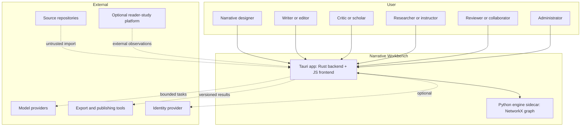
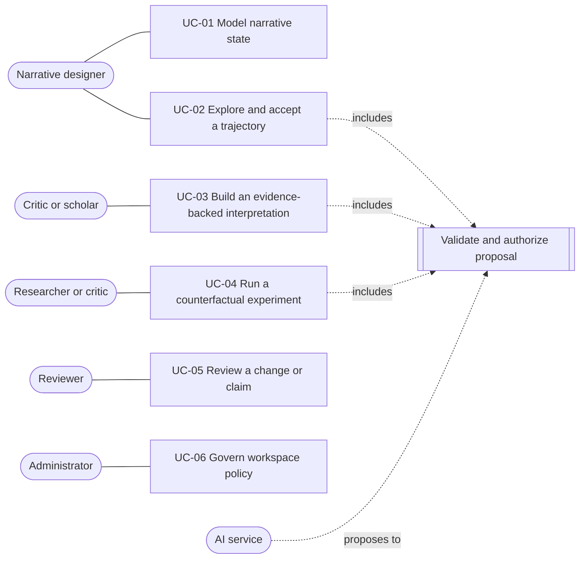
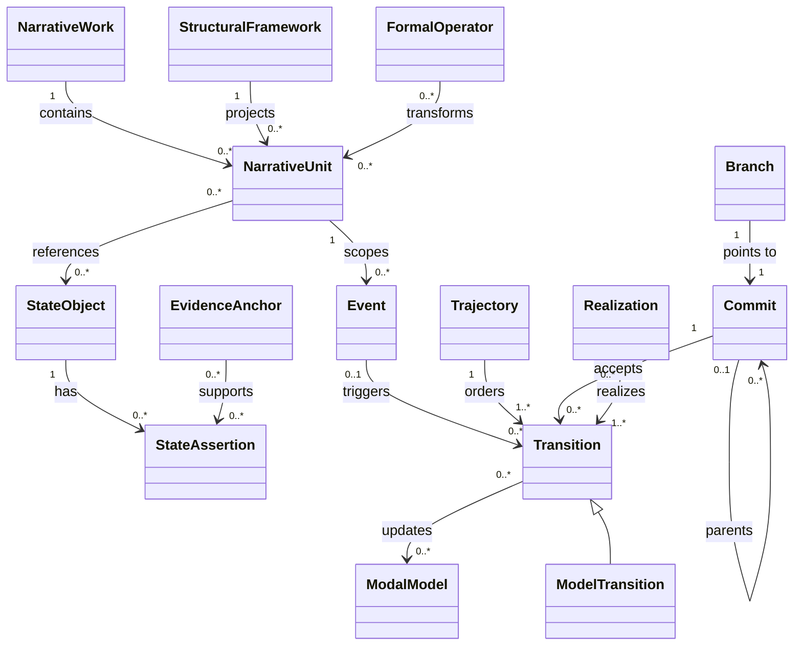
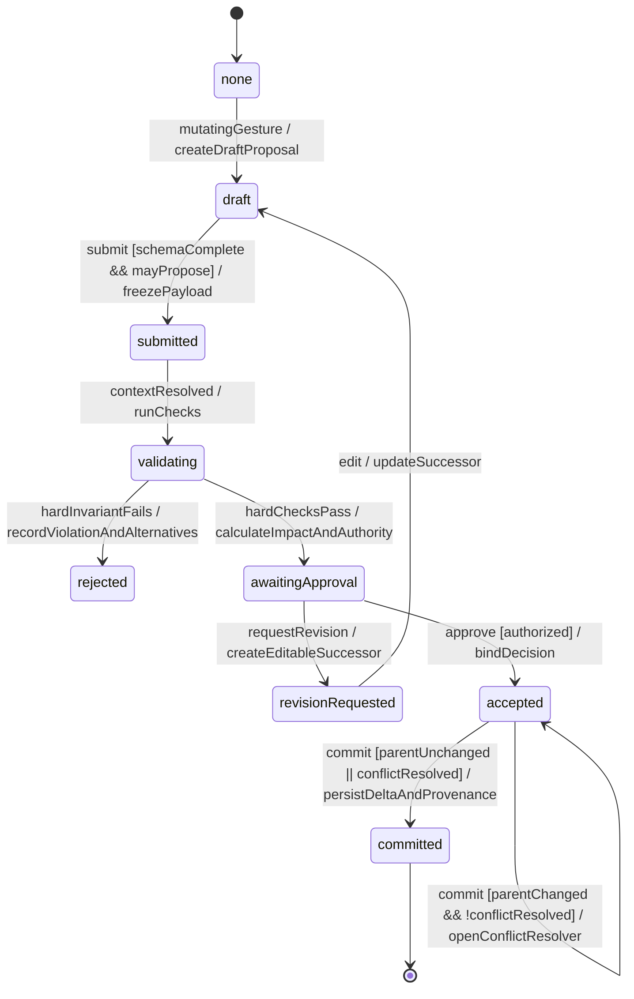
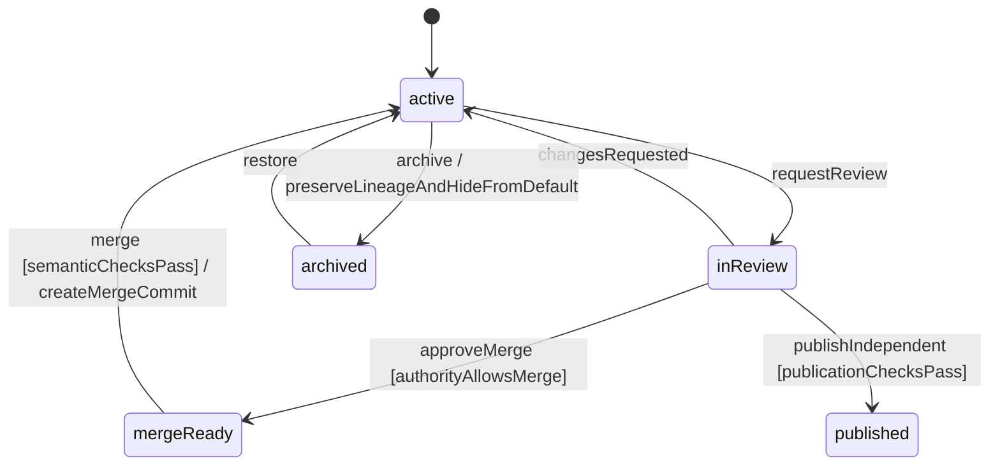
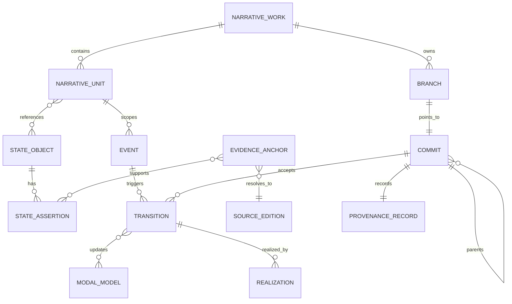
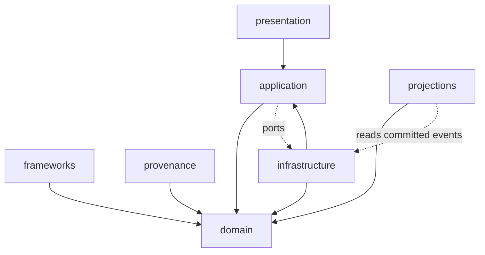
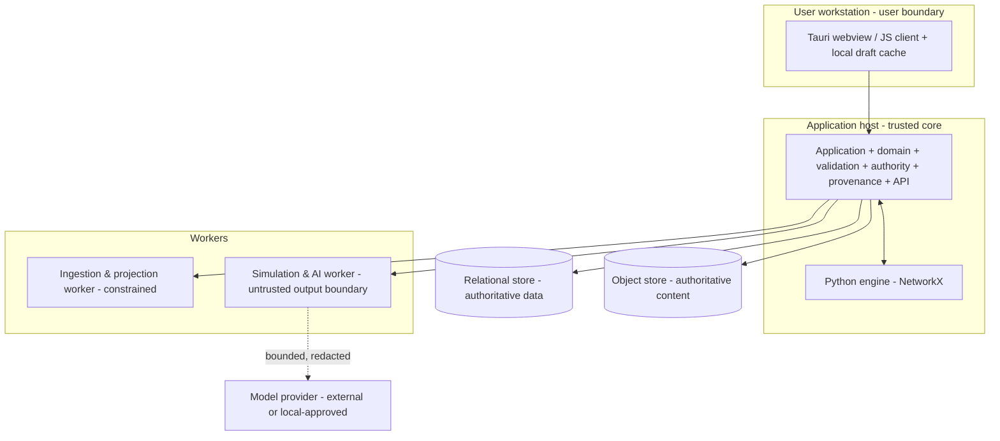

# Narrative Workbench — Software Requirements Specification

| Field | Value |
| --- | --- |
| Document | Software Requirements Specification (SRS) |
| Product | Narrative Workbench |
| Version | 0.1 (Draft) |
| Date | 25 October 2026 |
| Status | Draft for review. Depends on confirmation of every `[PRE]` item in the Visual and Interaction Specification §9 register (PRE-01 to PRE-20). |
| Governing source | `Narrative_Workbench_Visual_and_Interaction_Specification.docx` (the spec) |
| Primary architecture source | Narrative Workbench Architectural Design Document — UML and GUI, v1.1, 23 October 2026 (NW ADD v1.1) |
| Historical baseline | Narrative Workbench Architectural Design Document, v1.0, 23 October 2026 (NW ADD v1.0) |
| Conceptual source | Narrative State Model source conversation (NSM) |
| Requirement keywords | MUST, MUST NOT, SHOULD, SHOULD NOT, MAY per IETF BCP 14 (RFC 2119, RFC 8174) |

> **Provenance note.** This SRS converts the governing spec and architecture into testable software requirements. It inherits the architecture's provenance legend: **[Source]** is synthesized from the NSM; **[Proposed]** is an implementation decision introduced by the architecture or this SRS; **[PRE]** is prescribed because the design is silent or intentionally open and remains **open (Proposed)** until its owner signs it off. This document MUST NOT mark any `[PRE]` item as confirmed, closed, or accepted on behalf of an owner, and MUST NOT remove or alter a `[PRE]` provenance tag.

---

## 1. Introduction

### 1.1 Purpose

This SRS specifies the software requirements for **Narrative Workbench**, an environment for designing stories, studying existing works, and exploring how a change to one narrative condition affects the rest. It defines what the system MUST do, the constraints it MUST honor, and the criteria by which an implementation is accepted. It is written for product leaders, architects, engineers, narrative designers, literary scholars, and quality engineers.

This SRS does not prescribe endpoint contracts, physical database schemas, sprint plans, or a complete formal semantics for literature. Those belong to detailed design after the open questions in §10 are resolved.

### 1.2 Scope

Narrative Workbench treats prose as **one realization** of an underlying narrative configuration rather than as the primary source of truth. It supports three operating modes over one shared, version-aware kernel:

- **Composition Studio** — arrange narrative conditions, explore candidate trajectories, review their effects, and develop prose from an accepted trajectory.
- **Criticism Parlor** — reconstruct evidence-backed interpretations of an existing work, link claims to source evidence, and compare competing readings.
- **Counterfactual Laboratory** — branch from a narrative or interpretation, change a controlled condition, and inspect the resulting differences without overwriting the source.

The shared model records world events separately from what characters believe and what readers know. It distinguishes ordinary state changes from changes to the interpretive framework. Version history, evidence, and reviewable proposals make each change traceable.

**In scope** [Source + Proposed]:

- Authoring and importing narrative works, units, events, actors, objects, relationships, models, constraints, and formal operators.
- Representing world state alongside actor beliefs, discourse state, reader-facing information, and realization choices.
- Simulating candidate trajectories and ordinary or model-level transitions under explicit constraints.
- Constructing evidence-backed critical interpretations, including competing and theory-dependent models.
- Creating counterfactual branches that preserve the original source and document each intervention.
- Projecting the same graph as hierarchies, episodes, timelines, model comparisons, traces, fragment networks, and prose links.
- Generating prose from accepted trajectories and detecting model discrepancies introduced by prose edits.
- Exporting models, traces, evidence bundles, comparisons, and prose in durable formats.

**Out of scope** [Source]:

- Recovering an author's private intentions or the single correct interpretation of a work.
- A universal theory of narrative, a universal aesthetic score, or a guarantee of literary quality.
- Empirical measurement of reader response (requires a separate study and consent model).
- A fully autonomous author that changes canonical state without approval.
- A fixed mandatory plot structure (44-beat, three-act, quest, and the like).
- A page-layout or publishing suite that replaces specialized production tools.
- A large-scale corpus analytics platform.

### 1.3 Definitions, acronyms, and abbreviations

#### 1.3.1 State-field vocabulary (fixed terms)

These names are fixed and MUST be used as written in code, the UI, documentation, and conversation. They MUST NOT be renamed, pluralized into new terms, or given synonyms.

| Term | Meaning | Maps to architecture entity |
| --- | --- | --- |
| **body** | A narrative object; its size is its mass (resistance to change). | State object (actor, object, relationship, tension, environment, motif, voice, reader expectation, formal feature) |
| **impulse** | A change applied to the field, numbered in order. | Transition (ordinary or model) / inciting event |
| **boundary** | The edge of the active model. | Scope of the active modal model / narrative unit boundary |
| **sink** | A terminal or attracting state. | Target condition / closure state |
| **gate** | A constraint (friction). | Hard invariant or soft goal |
| **pin** | An evidence pin that ties a claim to its source. | Evidence anchor |
| **ghost** | Not yet defined in the design sources. | Undefined — see OQ-12 (§10) |

#### 1.3.2 Other terms

| Term | Meaning |
| --- | --- |
| Canonical state | Durable accepted narrative state recorded by a commit within an actor's authority. |
| Proposal | A draft, submitted, validating, rejected, awaiting-approval, revised, or accepted delta that is not durable until committed. |
| Projection | A table, graph, timeline, architecture, prose, evidence, or comparison view generated from shared versioned state. |
| Ordinary transition | A change to a value inside the current frame (for example, suspicion rises). |
| Model transition | A change to what the frame permits or means (for example, a revelation revises a belief model). |
| Epiphany | A declared model-level transformation that changes the meaning of prior states or the future possibilities available to a character or reader. |
| Modal model | A named possibility structure `M = (W, R, V)` for the world, an actor, the reader, or a critical interpretation. |
| Realization | A prose, typographic, visual, or multimodal expression linked to the transition or relation it realizes. |
| Commit | An immutable set of accepted operations against one parent commit, plus provenance metadata. |
| Branch | A movable name pointing to a commit. |
| Structural framework | A versioned set of unit types, constraints, milestones, and projections used to organize or analyze a work. |
| Formal operator | A versioned transformation over units or relations (INTERRUPT, RECURSE, REFRACT, COLLAGE, SPIRAL, WITHHOLD, REINTERPRET, TRANSPOSE). |
| Lens | A declared critical theory that foregrounds some entities and relations; it cannot rewrite source text. |
| Engine | The Python sidecar that holds the narrative graph (NetworkX) and runs deterministic graph operations. |
| App | The Tauri application: a Rust backend and a JavaScript frontend. |
| DTCG | Design Tokens Community Group format. |
| APG | WAI-ARIA Authoring Practices Guide. |

### 1.4 References

- `Narrative_Workbench_Visual_and_Interaction_Specification.docx` (the spec) — governing source for screens, components, tokens, statecharts, acceptance scenarios, and the `[PRE]` register.
- Narrative Workbench Architectural Design Document — UML and GUI (NW ADD v1.1), 23 October 2026. Governing architectural, UML, GUI, accessibility, and responsive source.
- Narrative Workbench Architectural Design Document (NW ADD v1.0), 23 October 2026. Historical baseline.
- Narrative State Model (NSM) source conversation.
- `CLAUDE.md` — repository standing rules (stack, tokens, vocabulary, `[PRE]` handling).
- IETF BCP 14 (RFC 2119, RFC 8174); W3C DTCG Format Module 2025.10+; W3C WAI-ARIA 1.2 and APG; W3C WCAG 2.2; Harel statecharts / SCXML; Cucumber Gherkin.

### 1.5 Overview

§2 describes the product context and constraints. §3 specifies system features as testable requirements. §4 defines external interfaces (GUI components, tokens, engine boundary, providers). §5 states nonfunctional requirements. §6 gives the domain model. §7 records architecture and design constraints. §8 defines data and validation contracts. §9 lists acceptance criteria. §10 records assumptions and open questions.

---

## 2. Overall Description

### 2.1 Product perspective

Narrative Workbench is a new, self-contained desktop application built around a **versioned typed graph** and an **append-only transition history**. Hierarchies, timelines, episodes, formal arrangements, and prose are projections over that shared model. Probabilistic services MAY interpret text and propose narrative changes, but **deterministic validation and explicit human authority decide what becomes durable state**.

The system is one synchronized, version-aware workbench shell. The three modes share selection, lineage, authority, provenance, validation, and job-state components. Direct manipulation always produces a reviewable proposal before durable state changes.



*Purpose and coverage:* the system-context diagram shows the human actors, the two-process product boundary (App + Engine), and the external systems that remain outside workbench authority. It covers the trust boundary requirement that no external model or publishing tool becomes a hidden system of record.

### 2.2 Product functions (summary)

1. Model narrative state as a typed graph of bodies, assertions, events, impulses, and modal models.
2. Explore candidate trajectories and accept them through a proposal lifecycle.
3. Import and freeze source editions; anchor evidence (pins); build competing interpretations.
4. Run counterfactual experiments on immutable baselines and compare consequences.
5. Validate every change against hard invariants and score soft goals separately.
6. Record provenance, version with commits and branches, and support non-destructive rewind.
7. Bound AI to proposal-only authority behind a typed gateway.
8. Project the graph into synchronized views and export durable packages.

### 2.3 User classes and characteristics

Authority is part of every use-case realization, not a separate administrative afterthought.

| Actor | Primary concern | Authority (mutation rights) |
| --- | --- | --- |
| Narrative designer | Create a coherent work while retaining creative control. | MAY define and accept canonical creative state within owned works. |
| Writer or editor | Realize a trajectory as language and revise prose. | MAY edit prose; model changes require explicit reconciliation. |
| Critic or scholar | Build and compare defensible interpretations. | MAY create claims and interpretive branches; MUST NOT alter imported source evidence. |
| Researcher or instructor | Design repeatable demonstrations and experiments. | MAY create constrained branches and publish evidence bundles. |
| Reviewer or collaborator | Challenge transitions, claims, and provenance. | MAY comment or propose changes per workspace permissions. |
| System administrator | Protect availability, policy, and data boundaries. | MAY manage service policy; MUST NOT silently rewrite narrative content. |
| AI service | Propose extraction, transitions, explanations, and prose. | Advisory only; **no independent mutation authority**. |
| Validation engine | Enforce structural and policy invariants. | MAY reject a proposed change; does not determine literary merit. |



*Purpose and coverage:* the use-case diagram maps each actor to the goals the shared kernel supports (NW ADD v1.1 Table 23, UC-01 to UC-06) and shows that every mutating use case passes through validation and authorization, where AI only proposes.

### 2.4 Operating environment

- **App:** Tauri desktop application — Rust backend, JavaScript frontend. The desktop window is verified by the user on macOS.
- **Engine:** a Python sidecar using NetworkX for the narrative graph.
- **Cloud sessions:** build and test the Rust and Python parts and serve the web frontend to headless Chromium (Playwright) for the spec's screenshot checks; cloud sessions MUST NOT claim the desktop window was checked.
- **Deployment modes:** a single-user local deployment MUST be possible for private manuscripts; a collaborative deployment MAY add identity, workspace authorization, encrypted storage, and audit retention. The same domain rules apply in both.

### 2.5 Design and implementation constraints (binding)

- **C-1** The product MUST be built with Tauri (Rust backend, JavaScript frontend) and a Python NetworkX engine sidecar. No other frameworks, languages, or graph libraries are introduced unless the owner asks. [CLAUDE.md]
- **C-2** All visual values MUST live only in the DTCG token file. Component code MUST reference **role-token aliases** (`{color.role.*}`, `{typography.role.*}`, `{dimension.role.*}`, `{radius.role.*}`, `{duration.role.*}`, `{fontFamily.role.*}`), mapped to CSS variables by replacing dots with hyphens and adding the prefix (for example `{color.role.text-primary}` → `var(--color-role-text-primary)`). Component code MUST NOT contain raw colors, spacing, dimensions, font families, or motion durations, and MUST NOT reference base tokens directly. [CLAUDE.md, spec §4]
- **C-3** The state-field vocabulary (body, impulse, boundary, sink, gate, pin, ghost) is fixed (§1.3.1). [CLAUDE.md]
- **C-4** Every `[PRE]` item stays open (Proposed) until its named owner signs it off; this document and any implementation MUST NOT confirm one on an owner's behalf, and implementations depending on an open `[PRE]` item are **not accepted**. [CLAUDE.md, spec §9]
- **C-5** The architecture is normative at the package and dependency level: Presentation → Application → Domain, with Frameworks, Provenance, Projections, and Infrastructure attached per the dependency rule (§7). Technology choices MUST NOT reverse this inward dependency direction. [NW ADD v1.1 §24.3]

### 2.6 Assumptions and dependencies

See §10. Key assumption: the spec governs where it is more explicit than the architecture sketches, once owners confirm the `[PRE]` rules.

---

## 3. System Features

Requirements use stable IDs (`REQ-###`). Each feature lists its source basis and acceptance-relevant behavior. Gherkin-style acceptance scenarios appear in §9.

### 3.1 Shared workbench shell and synchronization

*Basis: spec §5–8, CMP-01 to CMP-08, Screen 1; NW ADD v1.1 §25.1.*

- **REQ-001** The system MUST present one application shell containing a global context bar, a command bar, a work area (Navigator, Primary synchronized view, Inspector), and a Trace and validation drawer (Trace, Validation, Jobs, Provenance).
- **REQ-002** Selecting a stable identity in any region MUST synchronize all projections to that selection **without changing canonical narrative state**.
- **REQ-003** Every region MUST label the commit and projection version it represents, including while a projection is rebuilding.
- **REQ-004** The shell MUST keep mode, work, branch, commit, authority, synchronization, and job status visible at all times.
- **REQ-005** A viewport crossing a breakpoint MUST preserve context and reflow; reflow MUST NOT change canonical state.
- **REQ-006** Region focus order MUST be global bar → Navigator → Primary view → Inspector → Trace drawer. `F6` MUST cycle regions forward and `Shift+F6` backward `[PRE]`.
- **REQ-007** When a projection is rebuilding, the previous content MUST remain visible and the region MUST expose `syncState = rebuilding` with its represented commit and projection version.
- **REQ-008** A projection rebuild that fails MUST preserve the last valid projection where safe, name the failed projection, and expose a recovery action; it MUST NOT discard selection identity.

### 3.2 Narrative graph kernel and conceptual model

*Basis: NW ADD v1.1 §9–12, §24.4; NSM.*

- **REQ-010** The engine MUST represent the work as a **typed graph** whose canonical elements are narrative units, state objects (**bodies**), state assertions, events, transitions (**impulses**), modal models, model transitions, structural frameworks, formal operators, trajectories, evidence anchors (**pins**), and realizations.
- **REQ-011** Every durable object MUST have a stable identifier. Mutable content MUST be represented by versioned assertions and commits rather than by overwriting identity.
- **REQ-012** Containment (`PART OF`) MUST be a typed relation and projection, not the physical data structure, and MUST NOT imply causality.
- **REQ-013** Edges MUST declare one of the typed relationship semantics: `PART OF`, `PRECEDES`, `PRESENTED BEFORE`, `CAUSES`, `REVEALS`, `REINTERPRETS`, `REALIZES`, `SUPPORTS`, `CONTRADICTS`, `DERIVED FROM`, each with its stated constraint (for example, `CAUSES` requires an explicit causal claim and scope; `REINTERPRETS` MUST NOT alter the earlier event record).
- **REQ-014** The kernel MUST remain framework-agnostic: it MUST NOT encode that all stories require acts, that every revelation is an epiphany, or that one critical lens is authoritative. Frameworks, lenses, metrics, and formal operators MUST plug in through versioned definitions.
- **REQ-015** The system MUST record world state, actor-specific epistemic models, discourse state, reader-facing interpretation, and formal realization as **separate** layers so that dramatic irony, unreliable narration, delayed disclosure, and reader epiphany are representable without corrupting event history.
- **REQ-016** `body` size MUST represent mass (resistance to change) and MUST be an inspectable property of a state object.



*Purpose and coverage:* the conceptual class diagram specifies the stable domain identities and associations that MUST survive storage and framework choices (NW ADD v1.1 §24.4, Table 26). It covers the separation of event identity from later interpretation (Transition vs. ModelTransition) and the immutable-lineage association `Commit parents Commit`.

### 3.3 Modal and epistemic state model

*Basis: NW ADD v1.1 §11.*

- **REQ-020** Each modal model MUST contain a bounded set of situation nodes, propositions asserted or denied in each situation, weighted or categorical accessibility edges, interpretive rules, and a designated current situation.
- **REQ-021** Models MUST be able to refer to the same immutable events while assigning different motives, probabilities, obligations, or future affordances.
- **REQ-022** A `REINTERPRETS` transition MUST produce new interpretation links to existing events and MUST NOT mutate those events.
- **REQ-023** The system MUST be able to compare event classifications (motive, trust, threat, relevance, foreshadowing, predicted action) before and after a model change, and any interpretive-distance summary MUST expose its features and weights and MUST NOT present a score as aesthetic magnitude.
- **REQ-024** The system MUST label a change as an **epiphany** only when the author or critic asserts a model-level reorganization and can inspect its consequences; the system MUST NOT label every new fact as an epiphany.
- **REQ-025** The model MUST support bounded nested beliefs with a default depth of two levels; deeper nesting MUST be created explicitly. `[PRE] default depth — see OQ-05.`
- **REQ-026** Transition weights MUST be treated as confidence or salience, not mathematical truth, unless a framework defines that meaning.

### 3.4 Narrative structure, scale, and formal operators

*Basis: NW ADD v1.1 §12.*

- **REQ-030** A narrative unit MUST operate at any scale (work, act, sequence, scene, episode, movement, passage, image, custom) and MAY belong to one container while contributing to several threads, motifs, arguments, and temporal orders without duplication.
- **REQ-031** A structural framework MUST define permitted unit types, containment relations, milestones, hard constraints, soft goals, and projections, and MUST be versioned independently so the same graph can be evaluated under several frameworks.
- **REQ-032** The system MUST support bounded arcs, episodic cycles, picaresque/quest networks, and shared-world cycles, and MUST allow these forms to nest.
- **REQ-033** An episode MUST declare an episode continuity contract: inherited state, local architecture, allowed mutations, preserved invariants, potential model transition, exit effects, and closure behavior.
- **REQ-034** The system MUST provide the formal operators INTERRUPT, RECURSE, REFRACT, COLLAGE, SPIRAL, WITHHOLD, REINTERPRET, and TRANSPOSE as author-configurable, versioned definitions; each MUST declare target scale, preconditions, resulting relations, reversibility, and validation behavior.
- **REQ-035** The validator MUST distinguish intentional irresolution (deliberate ambiguity or contradiction) from accidental inconsistency.

### 3.5 Composition Studio

*Basis: spec Screen 2, CMP-09 to CMP-11; NW ADD v1.1 §13.1, §25.2.*

- **REQ-040** Composition Studio MUST let the designer define a target condition (**sink**), place narrative objects (**bodies**), establish world truth and participant beliefs, inject an inciting event or formal disturbance (**impulse**), explore candidate trajectories, and accept a sequence for realization.
- **REQ-041** Placing or connecting a narrative object MUST create a provisional object or typed relation and show affected constraints (**gates**); it MUST NOT commit until acceptance.
- **REQ-042** Injecting a disturbance MUST generate candidate changes and MUST have no commit effect until a trajectory is accepted.
- **REQ-043** Editing belief or possibility MUST show world, actor, and reader model differences and MUST propose an ordinary or model transition.
- **REQ-044** The candidate trajectory tray MUST present candidates with changed states, propagation frontier, before/after trace, and rejected alternatives, and MUST offer the actions **Accept**, **Revise**, **Forbid**, and **Branch**.
- **REQ-045** Selecting a different candidate MUST update the trace while leaving `proposalState` and `canonicalCommitId` unchanged.
- **REQ-046** Choosing **Forbid** MUST open a draft constraint proposal and MUST preserve the current candidate.
- **REQ-047** Prose realization MUST follow an accepted commit. Prose edits that introduce new facts MUST create reconciliation proposals rather than silently mutating the model.
- **REQ-048** When the discrepancy detector completes, a reconciliation proposal MUST identify the new assertion and let the author choose whether language or model is authoritative.

### 3.6 Criticism Parlor

*Basis: spec Screen 3, CMP-12 to CMP-13; NW ADD v1.1 §13.2, §25.3.*

- **REQ-050** Criticism Parlor MUST import a work, fingerprint and freeze the source edition, and segment it into stable addressable spans without changing content.
- **REQ-051** Source spans MUST remain immutable after fingerprinted import and MUST carry edition and region anchors (**pins**).
- **REQ-052** Machine extraction MUST return proposals only; a critic MUST accept classifications and evidence links before any interpretation commits.
- **REQ-053** Accepted observations MUST require at least one resolved supporting evidence anchor; interpretive leaps and uncertainty MUST be marked explicitly.
- **REQ-054** The system MUST support three assertion levels — **Observation**, **Finding**, **Claim** — and MUST display proposer, acceptance state, evidence coverage, uncertainty, lens, supporting and contradicting evidence, and branch identity as applicable.
- **REQ-055** Several lenses MUST be able to coexist; a lens MUST NOT rewrite source text or erase another reading.
- **REQ-056** The system MUST support comparing competing models that share a frozen source edition, listing lens assumptions, differences, unresolved conflicts, and supporting or contradicting anchors.
- **REQ-057** A broken evidence anchor MUST set `publicationStatus = blocked`, label the span **"Broken anchor"**, and offer a **"Realign anchor"** action; publication MUST remain blocked until realigned.
- **REQ-058** An accepted claim MUST remain interpretive: it MUST show its interpretation branch and an Accepted badge and MUST NOT be relabeled as a Source fact.

### 3.7 Counterfactual Laboratory

*Basis: spec Screen 4, CMP-14; NW ADD v1.1 §13.3, §25.4.*

- **REQ-060** The laboratory MUST operate on an immutable baseline commit; every intervention MUST create or update an experiment branch.
- **REQ-061** The declared intervention and preserved variables (controls) and recomputation scope MUST be visible before simulation runs.
- **REQ-062** If a requested preservation is impossible, the system MUST say why.
- **REQ-063** The comparison matrix MUST separate **deterministic consequences** from **generated hypotheses** across seven dimensions: World, Epistemic, Affective, Structural, Formal, Reader model, and Provenance.
- **REQ-064** Every changed value in the matrix MUST be labeled Added, Removed, Changed, or Invariant in text.
- **REQ-065** The reader-model dimension MUST be labeled **"Intended response"** and MUST NOT assert an empirical effect when no measured reader data exists.
- **REQ-066** Results MUST retain baseline, intervention, controls, versions, generators, and unresolved constraints, and MUST NOT be presented as empirical proof or as a source replacement.
- **REQ-067** Editing an intervention on an active experiment branch MUST leave `baselineCommitId` unchanged and MUST create a draft experiment proposal.

### 3.8 Proposal lifecycle, validation, and authority

*Basis: spec §7, CMP-09, CMP-16, Screen 5; NW ADD v1.1 §15, §24.5.*

- **REQ-070** Every mutating gesture MUST create a draft proposal and MUST open a reviewable preview before any durable change.
- **REQ-071** The proposal MUST advance only through the permitted lifecycle: `none → draft → submitted → validating → {rejected | awaitingApproval} → [revisionRequested → draft] → accepted → committed`. An event with no permitted transition MUST cause no state mutation and MUST announce a visible reason when the user initiated it `[PRE]`.
- **REQ-072** Submission MUST require a complete schema and `mayPropose` authority and MUST freeze the proposal payload.
- **REQ-073** Validation MUST run deterministic structural, semantic, policy, and authority checks and MUST record validator versions, inputs, and findings.
- **REQ-074** A hard invariant failure MUST block the mutation and return the violated rule, scope, explanation, and alternatives (`rejected`).
- **REQ-075** On passing hard checks, the system MUST calculate impact and required authority and move to `awaitingApproval`, recording soft-goal warnings and uncertainty.
- **REQ-076** Acceptance MUST be distinct from persistence: an accepted proposal MUST NOT be represented as committed, and `canonicalCommitId` MUST remain unchanged until the atomic Commit step completes.
- **REQ-077** The Commit step MUST be atomic and MUST persist the validated delta, authority decision, and provenance together; it MUST prevent duplicate submission and show the parent commit.
- **REQ-078** If the parent commit changed after acceptance and is unresolved, the system MUST open the semantic conflict resolver (CMP-16) and MUST leave canonical state unchanged.
- **REQ-079** Soft goals MUST be scored separately from validity; divergent candidates MUST be preserved rather than collapsed into one answer.
- **REQ-080** A disabled command MUST expose `aria-disabled=true` and a visible reason (for example, "Commit requires narrative designer authority") `[PRE]`.



*Purpose and coverage:* the proposal-lifecycle state machine defines the only permitted route from draft intent or machine output to durable state (spec §7, NW ADD v1.1 Figure 10 / Table 26). It covers the separation of acceptance from commit (REQ-076) and the conflict-resolution loop (REQ-078).

### 3.9 Persistence, versioning, branching, and provenance

*Basis: NW ADD v1.1 §16.5, §17, §24.5; spec branch lifecycle.*

- **REQ-090** A commit MUST be an immutable set of accepted operations against one parent commit plus metadata explaining purpose and authority. A merge MUST create a new commit after semantic conflict review and MUST NOT rewrite either parent.
- **REQ-091** Source imports MUST create root commits whose evidence payload is immutable.
- **REQ-092** Every accepted mutation MUST emit a versioned domain event containing work, branch, parent commit, actor, command, validated delta, authority decision, and provenance references.
- **REQ-093** The branch lifecycle MUST follow: `active → inReview → {changesRequested → active | mergeReady → (merge) → active | published} ; active → archived → (restore) → active`.
- **REQ-094** Only an owned creative branch MAY merge an accepted counterfactual trajectory into canonical composition; a critical branch MAY be published or compared but MUST NOT mutate its frozen source.
- **REQ-095** Archival MUST preserve commit lineage, evidence anchors, intervention records, and publication references; physical deletion MUST be an explicit administrative retention operation outside the ordinary branch state machine.
- **REQ-096** Undo before commit MUST edit the draft proposal only. Rewind after commit MUST create or move a branch pointer and MUST NOT silently delete accepted history.
- **REQ-097** Each provenance record MUST capture Origin, Actor and authority, Inputs, Decision, Alternatives, Model metadata (for probabilistic output), and Reproducibility status.
- **REQ-098** The merge validator MUST evaluate invariants and model assumptions across the combined delta and MUST present conflicts at the narrative level (for example, one branch says an actor lacks a fact while another makes them act on it).
- **REQ-099** Projections (timelines, hierarchies, traces, diffs, evidence indexes, metrics) MUST remain derivable from committed history and versioned definitions, and MUST NOT become an alternate source of truth.



*Purpose and coverage:* the branch-lifecycle state machine makes non-destructive experimentation a domain behavior (NW ADD v1.1 Figure 11). It covers merge authority (REQ-094) and archival lineage preservation (REQ-095).

### 3.10 Artificial intelligence boundary

*Basis: NW ADD v1.1 §18; spec CMP-15.*

- **REQ-100** AI services MAY extract candidate entities, events, propositions, temporal relations, focalization, and evidence spans; propose ordinary and model transitions, formal relations, and alternative trajectories; generate explanations that cite stored preconditions, rules, and evidence; realize an accepted trajectory as prose under constraints; and detect prose/model discrepancies.
- **REQ-101** No model may overwrite imported evidence or an accepted event history.
- **REQ-102** No model may convert its inference into fact merely because a schema validates.
- **REQ-103** No model may approve its own high-impact proposal, change workspace policy, or conceal conflicting evidence.
- **REQ-104** No model may claim measured reader response from an intended reader model.
- **REQ-105** No model may imitate a living author's voice as a hidden default; style constraints MUST describe structural and linguistic properties instead.
- **REQ-106** Every AI task MUST have a narrow schema, a declared context window, a maximum mutation scope, and a failure policy; outputs MUST separate extracted evidence, observation, inference, speculation, and recommendation.
- **REQ-107** Free-form prose MAY accompany a proposal but MUST NOT substitute for the typed delta.
- **REQ-108** The AI gateway MUST store provider metadata and response fingerprints and MUST apply workspace privacy policy (allowlists, local-only workspaces, redacted prompts).
- **REQ-109** The system MUST track acceptance and correction rates by task, model, framework, and content type; sample accepted low-risk proposals for review; route repeated uncertainty to humans; and make bulk operations previewable and reversible.

### 3.11 Long-running jobs

*Basis: spec CMP-15; NW ADD v1.1 Table 34.*

- **REQ-110** Extraction, simulation, realization, and comparison MUST run as asynchronous, cancellable jobs with the states queued, running, partial, failed, cancelled, and complete.
- **REQ-111** Job state changes MUST come from real job events, never a simulated timer.
- **REQ-112** Partial job output MUST NOT display an Accepted or Committed state and MUST leave `canonicalCommitId` unchanged.
- **REQ-113** A retry MUST create a new job attempt linked to the prior failure.
- **REQ-114** Progress MUST use determinate `progressbar` semantics only when the event source provides measured progress; otherwise a non-blocking `status` MUST be used, and an `alert` only for actionable failure.

### 3.12 Export and portability

*Basis: NW ADD v1.1 §19.4; spec §1.2.*

- **REQ-120** Export packages MUST include open JSON, plain text or Markdown, source fingerprints, and a human-readable report.
- **REQ-121** Each export MUST record the source commit and MUST warn when it is a lossy projection.
- **REQ-122** Deleting a derived index (search or vector) MUST NOT delete the work.

### 3.13 Core processing flows

The following sequences are normative in responsibility order (NW ADD v1.1 §24.6).

```mermaid
sequenceDiagram
  actor Designer
  participant UI as Frontend (JS)
  participant App as Application (Rust)
  participant Eng as Engine (Python/NetworkX)
  participant Val as Validator
  participant Repo as Versioned repository
  participant AI as AI gateway
  Designer->>UI: Inject disturbance / request generation
  UI->>App: Command (propose trajectory)
  App->>Eng: Assemble minimal state slice
  App->>AI: Bounded candidate request (typed)
  AI-->>App: Typed candidate transitions (proposal)
  App->>Val: Validate hard invariants
  Val-->>App: Checks + soft-goal scores + alternatives
  App-->>UI: Present candidates with traces
  Designer->>UI: Accept validated candidate
  UI->>App: Accept + Commit
  App->>Repo: Atomically persist delta + provenance
  Repo-->>App: Commit id
  App-->>UI: Committed; schedule optional prose realization
```

*Purpose and coverage:* the composition sequence makes "state before prose" enforceable (NW ADD v1.1 Figure 12). The validator returns checks rather than choosing, and repository mutation follows explicit human acceptance. Criticism (Figure 13) and counterfactual (Figure 14) sequences follow the same mutation boundary: ingest/fingerprint → evidence pins → machine proposals → human acceptance → validation → commit for criticism; select baseline → declare intervention and controls → simulate → validate → projected comparison for counterfactual.

- **REQ-130** Candidate generation MUST (1) resolve work, branch, commit, unit, framework, and authority; (2) assemble a minimal state slice; (3) request typed candidates stating preconditions, effects, uncertainty, and rationale; (4) reject malformed proposals and evaluate hard invariants; (5) score soft goals separately; (6) present candidates with causal and interpretive traces; and (7) commit only the accepted delta and schedule optional realization.
- **REQ-131** A model transition MUST name the trigger, affected model, invalidated or reweighted possibilities, revised interpretive rules, reclassified prior events, newly available or impossible actions, and expected observable consequences, and MUST compute an explicit before/after comparison.
- **REQ-132** Critical reconstruction MUST require evidence anchors for accepted observations and MUST publish an interpretation bundle containing source fingerprint, evidence anchors, model commit, assumptions, and unresolved contradictions.
- **REQ-133** A counterfactual experiment MUST record which results are deterministic consequences of the model and which are generated hypotheses.

---

## 4. External Interface Requirements

### 4.1 User interfaces — shared components

The system composes 18 stable component IDs (CMP-01 to CMP-18). A screen MAY set content and placement but MUST NOT redefine a component's roles, states, keyboard contract, or source provenance.


*Purpose and coverage:* the GUI block diagram sketches the persistent shell (spec §5, Screen 1). Component composition per mode: Composition Studio adds CMP-10 (object/relationship canvas) and CMP-11 (candidate tray); Criticism Parlor adds CMP-12 (evidence span) and CMP-13 (interpretive assertion card); Counterfactual Laboratory adds CMP-14 (comparison matrix); proposal review overlays CMP-09 and conditionally CMP-16.

| Component | Role requirement |
| --- | --- |
| CMP-01 Application shell | `application` landmark; grid rows `44px 36px minmax(0,1fr) auto`; `box-sizing:border-box`. |
| CMP-02 Global context bar | `banner` with labeled `toolbar`; roving `tabindex`. |
| CMP-03 Command bar | `toolbar` "Workbench commands"; APG toolbar pattern. |
| CMP-04 Navigator | `navigation` with APG `tree`; selection is non-mutating. |
| CMP-05 Primary synchronized view | named `main` region with a non-spatial list/table equivalent. |
| CMP-06 Inspector | `complementary` region; medium view uses a resizable modeless drawer. |
| CMP-07 Trace drawer | `region` with disclosure; `tablist` Trace/Validation/Jobs/Provenance. |
| CMP-08 Provenance and lifecycle badge | status text + icon; interactive badge opens Provenance tab. |
| CMP-09 Proposal preview | modal `dialog` "Review proposed change"; focus trap; Escape cancels only before acceptance. |
| CMP-10 Object and relationship canvas | composite `group` with keyboard-operable object and relation lists plus optional spatial canvas. |
| CMP-11 Candidate trajectory tray | `listbox` of trajectory options with a comparison `table` alternative. |
| CMP-12 Evidence span | read-only `article`/`row` with edition and region metadata (a pin). |
| CMP-13 Interpretive assertion card | `article` grouped by Observation/Finding/Claim. |
| CMP-14 Counterfactual comparison matrix | accessible `table` with the seven dimensions as row/column headers. |
| CMP-15 Long job status | `status` for non-blocking updates; `alert` only for actionable failure. |
| CMP-16 Semantic conflict resolver | modal `dialog` "Resolve semantic conflict". |
| CMP-17 Responsive region tabs | APG `tablist` Navigator/Work/Inspector/Trace below 768px. |
| CMP-18 Pane state message | `status`/`alert`/explanatory region for loading, empty, error, disabled, permission, offline. |

- **REQ-140** Each component MUST implement the ARIA or native role, keyboard contract, and state coverage defined in the spec's component record `[PRE: PRE-07, PRE-11]`.
- **REQ-141** Each component's visible states MUST be reachable and verifiable (default, hover, focus-visible, disabled, selected, loading, empty, error, and the component-specific states).

### 4.2 Design tokens

- **REQ-145** The DTCG token file MUST be the only home for visual values and MUST serialize with every alias resolved (0 unresolved aliases) `[PRE: PRE-02]`.
- **REQ-146** Component code MUST reference role-token CSS variables only, per the mapping in C-2; the token test MUST fail the build on any literal color, spacing, dimension, font family, or motion duration in component code (spec §10, check 1).
- **REQ-147** Loaded interface weights MUST be 400, 600, and 650; if the chosen font lacks 650 the implementation MUST resolve it to 600 and record the deviation `[PRE: PRE-03]`.
- **REQ-148** Focus MUST use a 3px ring with a 2px outer offset and MUST remain visible on a selected item; hover and selection MUST be independent `[PRE]`.
- **REQ-149** Panel animation MUST last the panel duration token and feedback the feedback duration token; with reduced motion, duration MUST become 0ms with no loss of information `[PRE]`.

### 4.3 Layout and responsive interface

- **REQ-150** The wide layout (≥1200px; reference 1440×900) MUST use work-area columns `252px minmax(520px,1fr) 320px` with a 220px default trace drawer `[PRE: PRE-04, PRE-05]`.
- **REQ-151** The medium layout (768–1199px) MUST collapse the Inspector into a resizable drawer that opens at `min(420px, 90vw)`.
- **REQ-152** The narrow layout (360–767px) MUST present Navigator, Work, Inspector, and Trace as explicit tabs (CMP-17) while preserving context labels and scroll position on tab switch.
- **REQ-153** The outer application MUST NOT scroll at wide and medium widths; Navigator, Primary view, Inspector, and Trace MUST each manage internal overflow `[PRE: PRE-06]`.
- **REQ-154** At 200% zoom and a 1280 CSS px viewport, all functions MUST remain available without two-dimensional page scrolling.

### 4.4 Software interfaces — engine and providers

- **REQ-160** The App (Rust backend) and the Python engine sidecar MUST communicate over a defined local interprocess contract; the frontend MUST NOT write graph records directly.
- **REQ-161** Commands MUST be intention-revealing actions (propose transition, accept trajectory, apply operator, anchor evidence, create branch) each with one command identity and idempotency key.
- **REQ-162** External model providers MUST be reached only through the AI gateway with timeout, circuit break, provider allowlist, and redaction policy; providers MUST hold no durable workbench state.
- **REQ-163** Imported source material MUST be treated as untrusted content; parsers MUST be isolated and MUST NOT treat imported text or model responses as executable instructions.

### 4.5 Communication interfaces

- **REQ-165** Streaming updates MUST carry commit and projection status; batch export and simulation jobs MUST expose stable job resources with cancel, retry, and provenance.

---

## 5. Nonfunctional Requirements

### 5.1 Performance

- **NFR-001** Interactive graph selection, state inspection, and local branch operations MUST feel immediate for a novel-scale work.
- **NFR-002** The first implementation MUST be measured on works up to several thousand units and hundreds of thousands of typed relations before any specialized graph infrastructure is chosen.
- **NFR-003** Long-running extraction, simulation, and full-work comparison MUST be asynchronous and cancellable and MUST NOT block interactive selection.

### 5.2 Accessibility

- **NFR-010** The product MUST meet WCAG 2.2 AA for text and control contrast; focus indicators MUST meet 1.4.11 and 2.4.11 `[PRE: PRE-20]`.
- **NFR-011** Every visual graph operation (place, connect, branch, compare, inspect) MUST have a named keyboard command and a non-spatial list or table equivalent sharing the same selection.
- **NFR-012** Color MUST NOT be the only carrier of source status, authority, lifecycle, confidence, or diff direction; text and an icon MUST also communicate the state.
- **NFR-013** Opening a drawer MUST move focus to its heading; closing it MUST return focus to the invoking control.
- **NFR-014** Reduced motion MUST remove transitions without removing state feedback.
- **NFR-015** Large graphs MUST remain navigable through a searchable textual outline and non-spatial table/list equivalents with the same selection.

### 5.3 Security and privacy

- **NFR-020** Source artifacts and databases MUST be encrypted at rest and all service traffic in transit.
- **NFR-021** Access MUST apply least privilege by workspace, work, branch, and mode-sensitive action.
- **NFR-022** Imported documents MUST be isolated and scanned; the parser boundary MUST contain untrusted content.
- **NFR-023** The system MUST support provider allowlists, local-model-only workspaces, retention controls, and redacted prompts.
- **NFR-024** An audit record MUST be kept for export, share, merge, source replacement, policy change, and destructive archival actions.
- **NFR-025** Service telemetry MUST be separable from literary content; private projects MUST be able to disable content logging.

### 5.4 Reliability and reproducibility

- **NFR-030** The append-only log MUST support audit and reconstruction; current snapshots MAY accelerate reads but MUST be rebuildable from committed history.
- **NFR-031** The system MUST store inputs, provider metadata, output, fingerprints, and the accepted delta so a proposal's reproducibility status (replayable, approximable, or auditable only) is recorded.
- **NFR-032** Projection lag MUST be visible to the client and MUST NOT block the authoritative commit unless a required invariant depends on it.

### 5.5 Observability

- **NFR-040** Operational telemetry MUST record command latency, validation failures, projection lag, model cost, token and context use, retry patterns, acceptance rate, override rate, broken evidence anchors, branch divergence, and reconciliation findings.
- **NFR-041** Narrative explanations MUST draw only from stored facts, constraints, and provenance; logs MUST avoid manuscript content unless explicitly enabled and protected.

### 5.6 Maintainability and extensibility

- **NFR-050** Frameworks, lenses, formal operators, validators, model providers, and export formats MUST be pluggable through versioned contracts; extensions MUST run with declared capabilities and MUST NOT bypass source immutability or mutation policy.
- **NFR-051** The package dependency rule (§7) MUST hold even when several packages share one process; any service extraction MUST preserve the inward dependency direction and mutation authority.

---

## 6. Domain Model

### 6.1 Core entities, value objects, and services

| Element | Kind | Responsibility / notes |
| --- | --- | --- |
| NarrativeWork | Entity (aggregate root) | Durable identity of a designed or imported work; owns branches and source associations. |
| NarrativeUnit | Entity | Scale-neutral container or fragment. |
| StateObject (**body**) | Entity | An entity whose properties may change; size = mass. |
| StateAssertion | Value object | Time-, model-, and scope-qualified value. |
| Event | Entity (immutable) | A disturbance or occurrence in story, discourse, authoring, or analysis time. |
| Transition (**impulse**) | Entity | A proposed or accepted change with preconditions, effects, causes, constraints, alternatives, provenance. |
| ModalModel | Entity | Named possibility structure for world, actor, reader, or interpretation. |
| ModelTransition | Entity | Change to a modal model, its accessibility relations, rules, or classification of earlier events. |
| StructuralFramework | Entity (versioned) | Unit types, constraints, milestones, projections, validation rules. |
| FormalOperator | Entity (versioned) | Transformation over units or relations. |
| Trajectory | Value object | Ordered candidate sequence of transitions. |
| EvidenceAnchor (**pin**) | Value object (immutable) | Stable reference to a source span, region, passage, or image. |
| Assertion levels | Value objects | Observation, Finding, Claim. |
| Realization | Entity | Prose/typographic/visual expression linked to a transition. |
| Commit | Entity (immutable) | Accepted operations + lineage + authority. |
| Branch | Entity | Movable pointer to a commit. |
| ProvenanceRecord | Value object | Origin, actor/authority, inputs, decision, alternatives, model metadata, reproducibility. |
| GraphKernel | Service (Engine) | Owns identities, typed relations, scopes, graph queries. |
| TransitionEngine | Service (Engine) | Produces candidate ordinary and model transitions; retains rejected alternatives. |
| ValidationEngine | Service | Enforces hard invariants and policy; rejects, never ranks merit. |
| ProvenanceService | Service | Anchors claims/assertions to sources, actions, model runs, commits. |
| ProjectionEngine | Service | Builds hierarchies, timelines, diffs, comparisons, indexes. |
| ProseReconciliationService | Service | Generates prose from accepted trajectories; detects prose/model discrepancies. |
| AIGateway | Service (boundary) | Normalizes provider access; typed outputs; metadata and redaction. |
| VersionedRepository | Repository | Immutable sources, append-only operations, commits, branches, snapshots, indexes. |

### 6.2 Relationship vocabulary

The typed relationships in REQ-013 (`PART OF`, `PRECEDES`, `PRESENTED BEFORE`, `CAUSES`, `REVEALS`, `REINTERPRETS`, `REALIZES`, `SUPPORTS`, `CONTRADICTS`, `DERIVED FROM`) constitute the complete edge vocabulary; each carries the constraint listed in NW ADD v1.1 Table 8.

### 6.3 Entity–relationship view



*Purpose and coverage:* the ER view expresses the persistence-facing shape of the domain for the relational authoritative store and content-addressed object store (NW ADD v1.1 §16.4). It covers the immutable `EVIDENCE_ANCHOR resolves_to SOURCE_EDITION` constraint behind REQ-057 and the `COMMIT parents COMMIT` lineage behind REQ-090.

---

## 7. Architecture and Design Constraints

### 7.1 Component and package architecture



*Purpose and coverage:* the component/package diagram states the normative dependency rule (NW ADD v1.1 §24.3, Table 25): presentation depends on application; application coordinates the domain; frameworks, provenance, and projections depend on the domain; infrastructure implements ports owned by inner packages. It covers C-5 and NFR-051. Package responsibilities and prohibitions:

| Package | May depend on | Must not do |
| --- | --- | --- |
| presentation | application contracts, projection DTOs | write graph/repository records directly |
| application | domain, provenance ports, policy | embed UI or provider-specific behavior |
| domain | versioned framework contracts | depend on storage, UI, or model vendors |
| frameworks | domain extension contracts | override source immutability or authority |
| provenance | domain identities, repository ports | convert inference into source fact |
| projections | committed events, read storage | become authoritative narrative state |
| infrastructure | ports declared by inner packages | leak vendor schemas into the domain |

### 7.2 Initial technical shape (binding + proposed)

- **REQ-170** The product MUST be delivered as the Tauri App (Rust + JS) with the Python NetworkX engine sidecar (C-1). The architecture's "modular monolith with workers" guidance (NW ADD v1.1 §16.1) applies within this binding: the engine, command handling, validation, provenance, and projections form the trusted core, while model calls, ingestion, simulation batches, and large comparisons run as asynchronous jobs.
- **REQ-171** The authoritative store MUST use immutable operation records, versioned entity snapshots, and adjacency structures for typed graph relations; source editions, images, large realizations, and export packages MUST be content-addressed. Graph traversal MUST be exposed through the domain layer so a dedicated graph engine MAY be added later only if measured workloads justify it `[Proposed, see OQ-10]`.

### 7.3 Deployment



*Purpose and coverage:* the deployment diagram defines the recommended initial topology and trust boundaries (NW ADD v1.1 §24.7, Table 29). The browser/webview talks only to the application host; the host owns transactions and authority; the AI worker is the untrusted output boundary; model providers hold no durable state. The topology supports a private single-workstation mode and a collaborative hosted mode without changing the domain model.

- **REQ-172** The browser/webview client MUST reconnect by commit and projection cursor and MUST NOT become authoritative.
- **REQ-173** External inference MUST be disable-able or replaceable by a local provider per workspace policy.

### 7.4 Cross-view consistency rules

- **REQ-174** Every mutating use case MUST name the actor who may propose, validate, approve, execute, and override.
- **REQ-175** Every message that changes a proposal or branch MUST correspond to a permitted state-machine transition (§3.8, §3.9).
- **REQ-176** Every terminal or externally visible lifecycle transition MUST record actor, time, policy, reason, and parent identity.
- **REQ-177** No association, sequence, state transition, or screen action MAY overwrite a frozen source edition or accepted event history.
- **REQ-178** World, actor, reader, discourse, formal, and critical models MUST retain separate identity, scope, and ownership.
- **REQ-179** Every experiment MUST record baseline, intervention, preserved variables, framework versions, and comparison dimensions.

---

## 8. Data and Validation Contracts

### 8.1 Global application state (observable contract)

The variables below are the minimum observable contract; implementation names MAY differ if tests expose equivalent values.

| Variable | Type / domain | Initial |
| --- | --- | --- |
| mode | composition \| criticism \| counterfactual | composition |
| workId / branchId / commitId | stable / stable / immutable id | null |
| projectionVersion | id | null |
| selectedId / selectedKind | stable identity / domain kind | null |
| proposalState | none \| draft \| submitted \| validating \| rejected \| awaitingApproval \| revisionRequested \| accepted \| committing \| committed | none |
| validationState | idle \| running \| passed \| failed | idle |
| authorityState | allowed \| approvalRequired \| denied | denied |
| branchState | active \| inReview \| mergeReady \| published \| archived | active |
| jobState | idle \| queued \| running \| partial \| failed \| cancelled \| complete | idle |
| syncState | current \| rebuilding \| stale \| failed | current |
| drawerState | closed \| trace \| validation \| jobs \| provenance | closed |
| viewportClass | wide \| medium \| narrow | wide |
| criticalLensId / baselineCommitId / interventionId | id | null |
| preservedVariableIds | set of ids | empty |
| sourceEditionId | fingerprinted id | null |

- **REQ-180** The system MUST expose these state variables (or test-equivalent values) to automated verification.

### 8.2 Global invariants

- **REQ-181** Changing selection or projection MUST NOT change canonical narrative state.
- **REQ-182** Source evidence in Criticism Parlor MUST remain immutable after fingerprinted import.
- **REQ-183** A validated proposal MUST NOT be represented as accepted; an accepted proposal MUST NOT be represented as committed until persistence succeeds.
- **REQ-184** Rewind and undo MUST NOT silently delete accepted history; post-commit rewind moves or creates a branch pointer.
- **REQ-185** Counterfactual results MUST retain baseline, intervention, controls, versions, generators, and unresolved constraints.
- **REQ-186** Partial job output MUST NOT display an Accepted or Committed state.
- **REQ-187** Mode transitions MUST preserve authority boundaries: criticism cannot mutate frozen source, and laboratory results cannot replace source or canonical history.
- **REQ-188** An event with no transition from the current state MUST cause no state mutation and MUST announce a visible reason when user-initiated `[PRE: PRE-18]`.

### 8.3 Core narrative invariants (validation engine)

| Category | Example check | Required response |
| --- | --- | --- |
| Knowledge | An actor cannot act on a proposition before acquiring or inferring it. | Reject, or require a disclosed inference path. |
| Location and time | An object cannot occupy incompatible places at the same story time. | Reject, or identify the missing transition. |
| Disclosure | A concealed fact cannot become public without a mechanism. | Reject, or propose a disclosure event. |
| Motivation | A durable motivation cannot vanish without an accepted cause or model change. | Warn for review (framework chooses strictness). |
| Discourse | Point of view and narrative time must follow the active contract unless an operator changes them. | Reject, or apply a formal transition. |
| Source integrity | Evidence anchors must resolve to the frozen source edition. | Block publication of broken claims. |
| Mode authority | A laboratory branch cannot overwrite an imported source or canonical composition. | Block the mutation; offer fork or export. |

- **REQ-190** The validation engine MUST implement these categories as hard invariants with the stated responses, and MUST let frameworks set severity for framework-specific checks.
- **REQ-191** Hard invariants MUST be deterministic and reproducible from stored inputs and validator versions.

### 8.4 Proposal and provenance contract

- **REQ-192** A submitted proposal payload MUST be frozen (immutable) for the remainder of its lifecycle; a revision MUST create an editable successor linked to the preserved predecessor.
- **REQ-193** A commit MUST record commit id, parent id, and the accepted alternatives considered but not accepted.
- **REQ-194** Every proposal of probabilistic origin MUST carry model metadata (provider, model, configuration, timestamp, response fingerprint).

### 8.5 Preconditions, postconditions, and error states (representative)

| Operation | Precondition | Postcondition | Error states |
| --- | --- | --- | --- |
| Accept trajectory | `proposalState=awaitingApproval` and actor authorized | `proposalState=accepted`; `canonicalCommitId` unchanged | denied authority → no change + visible reason |
| Commit | `proposalState=accepted` and (parent unchanged or conflict resolved) | new commit; provenance persisted; projections scheduled | parent changed → open CMP-16; persistence failure → remain `accepted`, surface recovery |
| Import source | fingerprintable edition supplied | root commit with immutable evidence payload | parse/scan failure → isolated error, no partial canonical state |
| Realign anchor | evidence anchor broken | anchor resolves to frozen edition; publication unblocked | still unresolved → `publicationStatus=blocked` |
| Override conflict | override authority and non-empty reason | conflict `resolved`; action and actor recorded | empty reason → remain `unresolved`, "Reason is required" |

---

## 9. Acceptance Criteria

Implementation acceptance requires the five verification checks in spec §10 against the **packaged application**: (1) token test, (2) computed-style test, (3) packaged screenshot comparison for Screens 1–5, (4) every Gherkin scenario mapped to a test, (5) every delivered `[PRE]` item Confirmed or Overridden by its owner.

- **REQ-200** All token and literal-value tests MUST pass (no literal visual values in component code).
- **REQ-201** Computed-style tests MUST pass at wide, medium, and narrow reference sizes for every component property and state.
- **REQ-202** Packaged-application screenshots of Screens 1–5 MUST be compared to the reference wireframes with every deviation recorded.
- **REQ-203** Every Gherkin scenario below and in the spec MUST map to one automated or manual test with recorded result and evidence.
- **REQ-204** Every delivered `[PRE]` item MUST be listed with its owner's Confirmed or Overridden disposition; a still-Proposed item on which the implementation depends MUST block acceptance.

### 9.1 Representative acceptance scenarios

```gherkin
Scenario: Synchronized selection does not mutate canonical state
  Given workId, branchId, and commitId are visible
  When the user selects an actor in Navigator
  Then the same selectedId appears in Primary view, Inspector, and Trace
  And canonicalCommitId is unchanged

Scenario: Direct manipulation opens a preview, not a commit
  Given the user may propose changes
  When the user connects two narrative objects
  Then proposalState becomes draft
  And canonicalCommitId is unchanged
  And the Proposal preview (CMP-09) opens

Scenario: Acceptance does not imply commit
  Given proposalState is awaitingApproval and the actor is authorized
  When the actor chooses Accept
  Then proposalState becomes accepted
  And canonicalCommitId remains unchanged until Commit completes

Scenario: Hard validation failure is explained
  Given a submitted proposal violates a hard invariant
  When validation completes
  Then proposalState is rejected
  And the dialog lists the violated rule, scope, explanation, and alternatives

Scenario: Semantic conflict opens the resolver
  Given the parent commit changed after acceptance
  When the user requests Commit
  Then canonical state remains unchanged
  And CMP-16 names the incompatible assertions, scopes, models, and commits

Scenario: Source span is immutable in Criticism Parlor
  Given mode is Criticism Parlor and a source span is selected
  When the user opens Inspector
  Then source text controls are read-only
  And visible text reads "Fingerprint source edition cannot be edited"

Scenario: Broken anchor blocks publication
  Given an evidence anchor no longer resolves
  When the branch enters review
  Then the span shows "Broken anchor"
  And publicationStatus is blocked
  And a "Realign anchor" action is present

Scenario: Preserve the counterfactual baseline
  Given an experiment branch is active
  When the user edits the intervention
  Then baselineCommitId remains unchanged
  And the edit creates a draft experiment proposal

Scenario: Intended reader response is not empirical
  Given reader-model results exist without measured reader data
  When the matrix renders the Reader model dimension
  Then the label reads "Intended response"
  And no empirical effect is asserted

Scenario: Partial job output is never committed
  Given jobState is partial
  When the result preview renders
  Then it shows "Partial"
  And it has no Accepted badge
  And canonicalCommitId is unchanged

Scenario: Color-independent lifecycle
  Given a machine proposal is shown
  When color is removed
  Then the visible text still reads "Machine proposal"
  And an icon plus accessible label communicate the same state

Scenario: Rewind preserves accepted history
  Given a committed change exists on the active branch
  When the user rewinds after commit
  Then a branch pointer moves or is created
  And no accepted commit is deleted

Scenario: Unhandled event produces no mutation
  Given an event has no transition from the current state
  When the user initiates that event
  Then no state mutation occurs
  And a visible reason is announced
```

---

## 10. Open Questions and Assumptions

### 10.1 Assumptions

- **A-1** The spec governs the implementation where it is more explicit than the architecture sketches, once owners confirm the `[PRE]` rules (spec §2).
- **A-2** The binding stack is Tauri (Rust + JS) plus a Python NetworkX engine (C-1); the architecture's technology-neutral guidance is realized within that binding.
- **A-3** Sample story names and conceptual record examples define data shape only and MUST NOT ship as product content.
- **A-4** Single-user local deployment is the first target; collaborative deployment follows with identity and audit added.

### 10.2 Open questions

The `[PRE]` register (spec Table 40, PRE-01 to PRE-20) is the authoritative list of prescribed rules awaiting owner sign-off; each remains **open (Proposed)**. The questions below extend that register with design-level unknowns from NW ADD v1.1 §23.

| ID | Question | Why open | Validation approach | Owner / source |
| --- | --- | --- | --- | --- |
| OQ-01 | How expressive should the modal logic be? | Finite possibility graphs may suffice; some works need richer temporal/deontic/paraconsistent semantics. | Model several works with different logic demands before selecting a formal engine. | Architecture |
| OQ-02 | How should uncertainty be represented? | Probabilities, qualitative confidence, and contested labels imply different meanings. | Test whether users understand and correctly use each representation. | UX / Architecture |
| OQ-03 | Which invariants are universal? | Many apparent inconsistencies are deliberate literary strategies. | Separate a minimal source-integrity core from framework-specific validators. | Architecture |
| OQ-04 | How far should prose reconciliation reach? | Sentence-level edits can imply facts without stating them. | Measure discrepancy detection on author-reviewed revisions. | Architecture |
| OQ-05 | What default nested-belief depth is right? | Unbounded higher-order belief is costly; the default of two is a proposed threshold (REQ-025). | Validate against real analyses. | Architecture |
| OQ-06 | What is a useful interpretive-distance measure? | A scalar may obscure which classifications changed and why. | Start with transparent feature diffs; add scores only if interpretable. | Architecture |
| OQ-07 | How should page geometry be modeled? | Some experimental works need spatial relations beyond ordered spans. | Prototype region and layer anchors on one spatially complex work. | Architecture |
| OQ-08 | How should nested narratives inherit truth? | Embedded worlds may quote, contradict, fictionalize, or transform their container. | Define explicit world and narrator scopes; test recursive cases. | Architecture |
| OQ-09 | When may low-risk proposals auto-commit? | Automation reduces friction but aggregate error threatens long works. | Start with derived projections only; expand by measured, reversible policy. | Architecture / Product |
| OQ-10 | When is specialized graph storage justified over NetworkX + relational store? | Only measured load should drive the change (REQ-171). | Measure at several thousand units and hundreds of thousands of relations. | Developer lead |
| OQ-11 | How should collaborative disagreement appear? | A merge conflict may be a productive critical disagreement, not an error. | Design comparison and publication flows that retain incompatible models. | UX / Architecture |
| OQ-12 | What does **ghost** denote in the state-field vocabulary? | The term is fixed but undefined in the design sources (§1.3.1, CLAUDE.md). | Define with the owner before any feature depends on it; do not invent a meaning. | Owner (Matt Briggs) |

### 10.3 `[PRE]` register status

All twenty `[PRE]` items (PRE-01 to PRE-20) remain **Proposed**. This SRS treats any feature that depends on an open `[PRE]` item as **not accepted** (C-4). The register's owners are: developer lead (PRE-01, PRE-17, PRE-18, PRE-08 jointly), lead UX designer (PRE-02 to PRE-06, PRE-12 to PRE-14, PRE-16), information architect (PRE-07, PRE-10, PRE-11, PRE-15), and product manager (PRE-08 jointly, PRE-09, PRE-19, PRE-20).

---

## Appendix A — Requirement traceability (summary)

| Requirement area | Primary source | SRS location |
| --- | --- | --- |
| Shared synchronized shell | NW ADD v1.1 §25.1; spec CMP-01–08, Screen 1 | §3.1, §4.1 |
| Graph kernel and conceptual model | NW ADD v1.1 §9–12, §24.4 | §3.2, §6 |
| Modal / epistemic model | NW ADD v1.1 §11 | §3.3 |
| Structure, scale, operators | NW ADD v1.1 §12 | §3.4 |
| Composition workflow | NW ADD v1.1 §13.1, §25.2; spec CMP-09–11, Screen 2; NSM | §3.5 |
| Criticism evidence and assertions | NW ADD v1.1 §13.2, §25.3; spec CMP-12–13, Screen 3 | §3.6 |
| Counterfactual comparison | NW ADD v1.1 §13.3, §25.4; spec CMP-14, Screen 4 | §3.7 |
| Proposal and branch lifecycle | NW ADD v1.1 §15, §17, §24.5; spec §7, Screen 5 | §3.8, §3.9, §8 |
| AI boundary | NW ADD v1.1 §18 | §3.10 |
| Responsive and accessibility | NW ADD v1.1 §25.5; spec §4–10 | §4.2–§4.3, §5.2 |
| Provenance and security | NW ADD v1.1 §17.3, §19.5 | §3.9, §5.3 |
| Tokens and verification | spec §4, §10 | §4.2, §9 |

---

*End of Software Requirements Specification (Draft 0.1). Readiness depends on owner confirmation or override of every `[PRE]` item and completion of the five verification checks in §9.*
