# Narrative Workbench Architectural Design Document (v1.1, UML and GUI)

> Converted from `Narrative_Workbench_Architectural_Design_Document_UML_GUI.docx` on 2026-10-25. This Markdown file is now the source of record; the Word file was removed and can be recovered from git commit 5048b95. Figures are redrawn as Mermaid diagrams from the original images.

Conceptual Technical UML and Interface Architecture

A narrative workbench should model how events alter worlds, beliefs, interpretations, forms, and reader expectations before it asks a language model to produce prose. This document defines an architecture that preserves that principle across composition, criticism, and counterfactual experimentation.

| **Document field** | **Value**                                                                                          |
|--------------------|----------------------------------------------------------------------------------------------------|
| Version            | 1.1                                                                                                |
| Date               | 23 October 2026                                                                                    |
| Status             | Conceptual architecture with proposed UML and interface specifications                             |
| Primary audience   | Product leaders, architects, senior engineers, narrative designers, and literary scholars          |
| Design authority   | Narrative State Model source conversation, with new implementation decisions explicitly identified |

**Decision provenance**

Source concept means the idea is synthesized from the supplied Narrative State Model. Proposed decision means the document selects an implementation approach not fixed by the source. Open decision marks a choice that needs validation through prototypes, scholarship, or user research.

## Contents

| **Sections 1 to 14**                              | **Sections 15 to Appendices**           |
|---------------------------------------------------|-----------------------------------------|
| 1 Document Purpose and Design Status              | 15 Core Processing Flows                |
| 2 Executive Summary                               | 16 Technical Architecture               |
| 3 Source Concept Baseline                         | 17 Persistence Versioning and Branching |
| 4 Architecture Method and Viewpoints              | 18 Artificial Intelligence Boundary     |
| 5 Scope and System Boundary                       | 19 Quality Security and Operations      |
| 6 Stakeholders Actors and Authority               | 20 Key Architectural Decisions          |
| 7 Architectural Principles                        | 21 Risks Failure Modes and Controls     |
| 8 System Context                                  | 22 Validation and Evolution             |
| 9 Functional Architecture                         | 23 Open Questions                       |
| 10 Conceptual Information Model                   | 24 UML Specification                    |
| 11 Modal and Epistemic State Model                | 25 GUI Block Diagram Specification      |
| 12 Narrative Structure and Scale                  | Appendix A Source Traceability          |
| 13 Composition Criticism and Counterfactual Modes | Appendix B Conceptual Record Examples   |
| 14 Interaction Model                              | Appendix C Glossary                     |

## 1 Document Purpose and Design Status

***Basis Source concept and proposed decisions** The narrative vision comes from the supplied source. The component boundaries, persistence strategy, authority model, and deployment shape are proposed here.*

This document defines the conceptual and technical architecture of a narrative modeling workbench. The system treats prose as one realization of an underlying narrative configuration rather than as the primary source of truth. It supports authors who design new works, critics who reconstruct evidence-backed interpretations of existing works, and researchers who test counterfactual changes without overwriting the original.

The design sits between product intent and detailed implementation. It establishes system boundaries, conceptual entities, state and transition semantics, human and automated authority, major processing flows, persistence and versioning, and the qualities that must survive later technology choices. It does not prescribe endpoint contracts, database tables, sprint plans, or a complete formal semantics for literature.

### 1.1 Provenance conventions

*Table 1 Decision provenance legend*

| **Classification** | **Meaning**                                                                     | **How it is used**                                          |
|--------------------|---------------------------------------------------------------------------------|-------------------------------------------------------------|
| Source concept     | A concept stated or clearly developed in the supplied Narrative State Model.    | Preserved as a design constraint or conceptual requirement. |
| Proposed decision  | An implementation or governance choice introduced by this document.             | Recorded with rationale, implications, and alternatives.    |
| Open decision      | A question for which the source and current evidence do not justify one answer. | Kept visible for prototype or research validation.          |

### 1.2 Architectural conclusion

The workbench should be built around a versioned typed graph and an append-only transition history. Hierarchies, timelines, episodes, formal arrangements, and prose are projections over that shared model. Probabilistic services may interpret text and propose narrative changes, but deterministic validation and explicit authority decide what becomes durable state. This division preserves continuity, supports multiple interpretations, and makes every critical or creative branch inspectable and reversible.

## 2 Executive Summary

***Basis Source concept** The source advances from a billiard-table scene metaphor to a general-purpose literary modeling environment with composition, criticism, and counterfactual uses.*

The Narrative Workbench models narrative as changes within and between representations of a world. At scene scale, an inciting event perturbs actors, objects, relationships, tension, reader expectations, and formal choices. At larger scales, scenes participate in sequences, acts, episodes, cycles, fragments, and custom structures. A work may follow a bounded arc, extend episodically, or derive its meaning from interruption, recursion, collage, typography, or other formal operators.

The central distinction is between an ordinary state transition and a model transition. An ordinary transition changes a value inside the current frame: a character becomes more suspicious, a door closes, or tension rises. A model transition changes what the frame permits or means. A revelation may preserve the event history while revising a character's interpretation of those events and the futures they consider possible. The architecture therefore records world state, actor-specific epistemic models, discourse state, reader-facing interpretation, and formal realization separately.

The system uses one shared kernel for three modes. Composition begins with models and explores trajectories before producing prose. Criticism begins with source text and builds interpretations linked to evidence. Counterfactual work branches from either and documents controlled changes. Each mode grants different mutation rights while preserving the same underlying entities, transitions, and provenance.

### 2.1 Dominant architectural principles

-   Narrative state precedes prose realization. Prose may reveal defects in a model but cannot silently redefine it.

-   The event history and its interpretations are separate, versioned records.

-   A typed graph is canonical; a hierarchy is one projection among several.

-   Epistemic, causal, affective, structural, formal, and reader-model changes remain distinguishable.

-   Source evidence is immutable; critical claims and experiments branch from it.

-   AI output is advisory until deterministic checks and an authorized actor accept it.

-   The system explains what changed, why it changed, which alternatives were available, and who approved it.

### 2.2 Major risk

The dominant risk is false formalization: the interface may make one contestable interpretation appear to be the work itself. The architecture counters this by preserving competing models, recording evidence and interpretive assumptions, displaying uncertainty, and preventing generated confidence from masquerading as textual fact. These controls do not make literary interpretation objective; they make its commitments visible.

## 3 Source Concept Baseline

***Basis Source concept** This section synthesizes the supplied PDF without adding implementation commitments.*

### 3.1 Narrative workbench vision

The source describes a narrative simulation workbench rather than a conventional writing application. A designer arranges conditions, introduces a disturbance, inspects proposed consequences, selects or revises a trajectory, and realizes the selected changes as prose. The table metaphor supplies an interaction model for local state changes, but the final vision extends beyond a scene simulator into a multiscale literary environment.

### 3.2 Narrative objects and interactions

The billiard balls represent stateful narrative variables rather than only characters or physical objects. Candidate objects include actors, environment, relationships, concealed facts, tension, intended reader response, prose behavior, voices, fragments, images, documents, motifs, and competing frames. Collisions represent typed interactions. A collision may be causal, epistemic, affective, formal, or interpretive and can propagate to several objects.

### 3.3 Story and discourse

Story state describes what exists and happens in the fictional world. Discourse state describes how that material is ordered, focalized, disclosed, and expressed. An actor may change before the reader learns about it; a reader may reinterpret an unchanged past after a disclosure. Intended reader response is part of the design model, while actual reader response requires observation outside the narrative engine.

### 3.4 Modal change and epiphany

The source treats an epiphany as a change to the model that gives states their meaning. Learning a fact may eliminate possible worlds without changing the interpretive framework. A deeper transformation may revise accessibility relations, causal explanations, self-conception, or the class of future actions a character can imagine. Such a change can reach backward by reclassifying earlier events and forward by opening or closing possibilities.

### 3.5 Hierarchy graph and open form

The workbench must operate across scene, sequence, act, work, episode, cycle, and world scales without making any one hierarchy universal. A scene can belong to one container while contributing to several threads, motifs, critical arguments, and temporal orders. Episodic and picaresque structures may preserve a stable protagonist while accumulating reader-level knowledge. Experimental works may organize themselves through interruption, recursion, collage, spiral recurrence, or page geometry rather than continuous plot.

### 3.6 Shared modes

Composition, criticism, and counterfactual analysis share the same narrative representation. Composition moves from model to transitions to prose. Criticism moves from prose and other evidence toward an explicit model. Counterfactual analysis changes a controlled property and compares the consequences. These directions are not perfectly reversible, and the system must preserve that asymmetry rather than claim a unique recovery of authorial intent.

### 3.7 Conceptual boundaries inherited from the source

*Table 2 Conceptual distinctions that constrain the architecture*

| **Distinction**                            | **Why it matters**                                                                                   |
|--------------------------------------------|------------------------------------------------------------------------------------------------------|
| Event history and interpretation history   | A revelation can change meaning without changing what happened.                                      |
| World truth and actor belief               | Dramatic irony depends on incompatible models of the same events.                                    |
| Character model and reader model           | Characters and readers can transform at different times or in different ways.                        |
| Diegetic and formal causality              | Juxtaposition may create meaning without implying an in-world cause.                                 |
| Structural framework and narrative content | A work can be reorganized without duplicating its underlying events and evidence.                    |
| Intended and measured reader response      | The workbench may model a design intention but cannot claim an empirical effect without reader data. |
| Ordinary update and model transition       | The system must not label every new fact as an epiphany.                                             |
| Source fact and critical inference         | Plausible interpretation is not textual evidence.                                                    |

## 4 Architecture Method and Viewpoints

***Basis Proposed decision** This document applies several views so no single diagram is mistaken for the whole system.*

*Table 3 Architecture viewpoints*

| **Viewpoint**          | **Architectural question**                                                                       | **Primary readers**                  |
|------------------------|--------------------------------------------------------------------------------------------------|--------------------------------------|
| Context                | Who interacts with the system and which external authorities remain outside it?                  | Product, architecture, governance    |
| Conceptual information | Which identities, states, models, transitions, evidence, and branches must persist?              | Architecture, domain experts         |
| Functional             | Which responsibilities must remain separate even if deployed together?                           | Engineering, product                 |
| State and sequence     | How does a proposal become an authorized and traceable change?                                   | Engineering, governance              |
| Interaction            | How do users move among table, model, trace, architecture, evidence, and prose views?            | Design, research, product            |
| Deployment             | What is the smallest technical shape that preserves integrity and can evolve?                    | Engineering, operations              |
| Risk and assurance     | How are interpretive overclaiming, model drift, and irreversible mutation prevented or detected? | Scholarship, governance, engineering |

The views describe one system from different concerns. Component boundaries are logical responsibilities, not a mandate for microservices. Conceptual entities are stable identities and relationships, not physical tables. UI views are synchronized projections, not separate data stores.

## 5 Scope and System Boundary

***Basis Source concept with proposed boundary** The source defines the workbench's intellectual scope. This section translates it into a system boundary.*

### 5.1 In scope

-   Authoring and importing narrative works, units, events, actors, objects, relationships, models, constraints, and formal operators.

-   Representing objective or asserted world state alongside actor beliefs, discourse state, reader-facing information, and realization choices.

-   Simulating candidate trajectories and ordinary or model-level transitions under explicit constraints.

-   Constructing evidence-backed critical interpretations, including competing and theory-dependent models.

-   Creating counterfactual branches that preserve the original source and document each intervention.

-   Projecting the same graph as hierarchies, episodes, timelines, model comparisons, traces, fragment networks, and prose links.

-   Generating prose from accepted trajectories and detecting model discrepancies introduced by prose edits.

-   Exporting models, traces, evidence bundles, comparisons, and prose in durable formats.

### 5.2 Out of scope

-   A claim to recover the author's private intentions or the single correct interpretation of a literary work.

-   A universal theory of narrative, a universal aesthetic score, or a guarantee of literary quality.

-   Empirical measurement of reader response without a separate study, consent model, and data collection system.

-   A fully autonomous author that may change canonical state without approval.

-   A fixed 44-beat, three-act, quest, or other mandatory structure.

-   A page-layout or publishing suite that replaces specialized typography and production tools.

-   A large-scale corpus analytics platform; cross-corpus analysis is adjacent but does not shape the first architecture.

**Adjacent systems** Language models, embedding services, source repositories, publishing tools, identity providers, and optional reader-study platforms remain external. The workbench records their outputs and provenance but does not treat any external model as an authority over narrative truth or critical interpretation.

## 6 Stakeholders Actors and Authority

***Basis Source concept with proposed governance** Human roles are implied by the modes. Explicit authority boundaries are proposed here.*

*Table 4 Actors and mutation authority*

| **Actor**                | **Primary concern**                                       | **Authority**                                                                       |
|--------------------------|-----------------------------------------------------------|-------------------------------------------------------------------------------------|
| Narrative designer       | Create a coherent work while retaining creative control.  | May define and accept canonical creative state within owned works.                  |
| Writer or editor         | Realize a trajectory as language and revise the prose.    | May edit prose; model changes require explicit reconciliation.                      |
| Critic or scholar        | Build and compare defensible interpretations.             | May create claims and interpretive branches; cannot alter imported source evidence. |
| Researcher or instructor | Design repeatable demonstrations and experiments.         | May create constrained branches and publish evidence bundles.                       |
| Reviewer or collaborator | Challenge transitions, claims, and provenance.            | May comment or propose changes according to workspace permissions.                  |
| System administrator     | Protect availability, policy, and data boundaries.        | May manage service policy but not silently rewrite narrative content.               |
| AI service               | Propose extraction, transitions, explanations, and prose. | Advisory only; no independent mutation authority.                                   |
| Validation engine        | Enforce structural and policy invariants.                 | May reject a proposed change; does not determine literary merit.                    |

### 6.1 Authority rule

An interpretation may be proposed by a human or a model, validated by deterministic rules, and accepted by an authorized human. A machine may automatically accept only low-risk derived artifacts whose policy has been explicitly configured, such as rebuilding a timeline projection from an unchanged graph. It may never silently convert an inference into source fact, overwrite imported text, or merge a counterfactual branch into canonical state.

## 7 Architectural Principles

***Basis Source concept and proposed elaboration** The first six principles are directly rooted in the source. The remaining principles translate them into implementable safeguards.*

*Table 5 Architectural principles*

| **Principle**                        | **Rationale**                                                                                | **Architectural consequence**                                                                                                |
|--------------------------------------|----------------------------------------------------------------------------------------------|------------------------------------------------------------------------------------------------------------------------------|
| P1 State before prose                | Narrative coherence depends on modeled conditions and transitions.                           | Prose generation consumes an accepted trajectory. New facts introduced during prose editing become reconciliation proposals. |
| P2 Models are plural                 | World truth, actor beliefs, discourse, reader interpretation, and form evolve independently. | Each model has identity, scope, owner, time, and relationships to other models.                                              |
| P3 History and meaning are separate  | Epiphany can reinterpret the past without rewriting it.                                      | Events are immutable records; interpretations and model transitions version their meaning.                                   |
| P4 Graph first hierarchy second      | Works contain cross-cutting threads, motifs, frames, and temporal orders.                    | Containment is a typed relation and projection rather than the physical data structure.                                      |
| P5 Typed causality                   | Formal juxtaposition must not be mistaken for diegetic cause.                                | Edges declare semantics such as CAUSES, REVEALS, REINTERPRETS, REALIZES, or SUPPORTS.                                        |
| P6 Form is programmable              | Experimental architecture can be the literary event.                                         | Formal operators are versioned, inspectable objects that act across selected scales.                                         |
| P7 Evidence remains immutable        | Critical claims are contestable and must remain traceable.                                   | Source spans are content-addressed anchors; annotations and claims branch around them.                                       |
| P8 Proposals are not mutations       | Probabilistic output can be plausible and wrong.                                             | All generated changes pass schema checks, invariants, policy, authorization, and provenance capture.                         |
| P9 Branching is a first-class action | Creative exploration and counterfactual criticism require alternatives without loss.         | Every experiment names its parent commit, intervention, preserved variables, and comparison basis.                           |
| P10 Explanation travels with change  | The designer must inspect what changed, why, and what else was possible.                     | Transitions retain causes, constraints, rejected alternatives, evidence, and approver.                                       |

## 8 System Context

***Basis Proposed decision** The source identifies the workbench and modes; external boundaries are clarified here.*

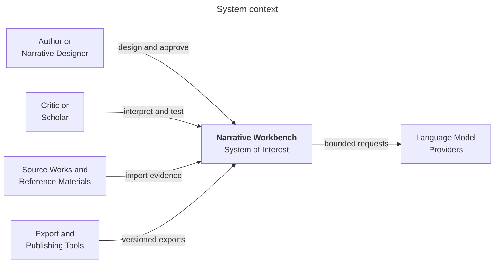

*Figure 1 System context*

**Purpose** Shows the workbench's human and technical neighbors.

**Interpretation** Authors and critics retain judgment. Source repositories supply evidence. AI providers receive bounded tasks. Export tools consume versioned results.

**Architectural significance** The boundary prevents language models and publishing tools from becoming hidden systems of record.

### 8.1 Trust boundaries

-   Imported source material is untrusted content. Parsing and model prompts must not treat it as executable instruction.

-   External language-model responses are untrusted proposals even when they conform to a schema.

-   Export targets may lose graph semantics. Each export records the source commit and warns when it is a lossy projection.

-   Collaborators may have different permissions for source evidence, interpretive branches, canonical creative state, and publication.

## 9 Functional Architecture

***Basis Proposed decision** These components implement the source vision while keeping responsibilities separable.*

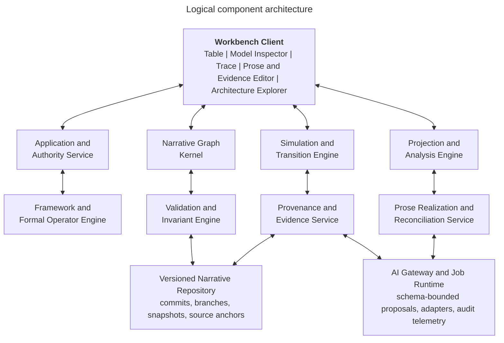

*Figure 2 Logical component architecture*

**Purpose** Shows the responsibilities needed to support all three modes.

**Interpretation** The graph kernel, invariant engine, and provenance service form the trusted core. Simulation, analysis, and prose services may use probabilistic assistance through the AI gateway.

**Architectural significance** The first release can deploy these modules together, but their boundaries preserve testability and allow selective scaling.

*Table 6 Logical component responsibilities*

| **Responsibility**                           | **Boundary**                                                                                                                                                                 |
|----------------------------------------------|------------------------------------------------------------------------------------------------------------------------------------------------------------------------------|
| Workbench client                             | Synchronized table, model inspector, trace, architecture explorer, prose editor, evidence viewer, and comparison views.                                                      |
| Application and authority service            | Coordinates commands, checks permissions, resolves workspace policies, and records approvals.                                                                                |
| Narrative graph kernel                       | Owns identities, typed relationships, scopes, references, and graph queries independent of any one framework.                                                                |
| Simulation and transition engine             | Produces candidate ordinary and model-level transitions, branches trajectories, and retains rejected alternatives.                                                           |
| Framework and formal operator engine         | Applies configurable hierarchies, episode contracts, constraints, and operations such as INTERRUPT, RECURSE, REFRACT, COLLAGE, SPIRAL, WITHHOLD, REINTERPRET, and TRANSPOSE. |
| Validation and invariant engine              | Checks knowledge, time, location, disclosure, characterization, continuity, framework, and policy constraints.                                                               |
| Provenance and evidence service              | Anchors claims and state assertions to source spans, user actions, model runs, and prior commits.                                                                            |
| Projection and analysis engine               | Builds hierarchies, timelines, model comparisons, interpretive-distance summaries, episode views, and structural diagnostics.                                                |
| Prose realization and reconciliation service | Generates language from accepted trajectories and detects facts or beliefs introduced by prose edits.                                                                        |
| Versioned narrative repository               | Stores immutable source artifacts, append-only operations, commits, branches, snapshots, and derived indexes.                                                                |
| AI gateway and job runtime                   | Normalizes provider access, redacts content by policy, requires typed outputs, captures model metadata, and supports asynchronous work.                                      |

### 9.1 Why the kernel remains small

The kernel should know that a transition changes state and that an edge has a declared type. It should not know that all stories require acts, that every revelation is an epiphany, or that one critical lens is authoritative. Frameworks, lenses, metrics, and formal operators plug into the kernel through versioned definitions. This keeps the representation expressive without converting a literary theory into a hard-coded law.

## 10 Conceptual Information Model

***Basis Source concept with proposed normalization** The source names most entities informally. This section gives them durable identities and boundaries.*

### 10.1 Core entities

*Table 7 Conceptual entities*

| **Entity**                | **Conceptual responsibility**                                                                                                                  |
|---------------------------|------------------------------------------------------------------------------------------------------------------------------------------------|
| Narrative work            | The durable identity of a designed or imported work. Owns branches and source associations but not one mandatory structure.                    |
| Narrative unit            | A scale-neutral container or fragment: work, act, sequence, scene, episode, movement, passage, image, or custom unit.                          |
| State object              | An entity whose properties may change: actor, object, relationship, tension, environment, motif, voice, reader expectation, or formal feature. |
| State assertion           | A time- and scope-qualified value such as location, belief, trust, secrecy, or narrative status.                                               |
| Event                     | A disturbance or occurrence in story time, discourse time, authoring time, or analysis time.                                                   |
| Transition                | A proposed or accepted change with preconditions, effects, causes, constraints, alternatives, and provenance.                                  |
| Modal model               | A named possibility structure for the world, an actor, the reader, or a critical interpretation.                                               |
| Model transition          | A change to a modal model, its accessibility relations, its interpretive rules, or the classification of earlier events.                       |
| Structural framework      | A versioned definition of unit types, constraints, milestones, projections, and validation rules.                                              |
| Formal operator           | A versioned transformation over units or relations that affects arrangement, recurrence, interruption, presentation, or medium.                |
| Trajectory                | An ordered candidate sequence of transitions considered together.                                                                              |
| Evidence anchor           | A stable reference to a source span, page region, passage, image, or other immutable evidence.                                                 |
| Observation finding claim | Three levels that separate direct description, synthesized pattern, and contestable critical assertion.                                        |
| Branch and commit         | A reproducible version lineage recording parent state, changes, author, time, policy, and purpose.                                             |
| Episode contract          | A declaration of inherited state, allowed mutations, preserved invariants, exit effects, and closure behavior.                                 |
| Realization               | A prose, typographic, visual, or multimodal expression linked to the transition or formal relation it realizes.                                |

### 10.2 Identity and mutable content

Each durable object has a stable identifier. Mutable content is represented by versioned assertions and commits rather than by overwriting identity. Two interpretations may refer to the same event while classifying its motive differently. Two structural projections may contain the same scene without cloning it. A later prose revision may create a new realization while retaining the transition it was meant to express.

### 10.3 Relationship vocabulary

*Table 8 Typed relationship vocabulary*

| **Relationship** | **Meaning**                                                            | **Important constraint**                                  |
|------------------|------------------------------------------------------------------------|-----------------------------------------------------------|
| PART OF          | Organizational containment in a chosen projection.                     | May vary by framework and must not imply causality.       |
| PRECEDES         | Order in story time.                                                   | Distinct from presentation order.                         |
| PRESENTED BEFORE | Order encountered by the reader.                                       | May cross or reverse story time.                          |
| CAUSES           | Contributes to an in-world event or state change.                      | Requires an explicit causal claim and scope.              |
| REVEALS          | Changes knowledge or belief through disclosure.                        | Names the recipient model and disclosed proposition.      |
| REINTERPRETS     | Changes the meaning assigned to an earlier event or relation.          | Must not alter the earlier event record.                  |
| REALIZES         | Links prose or form to a modeled transition or relation.               | Many realizations may express the same transition.        |
| SUPPORTS         | Links evidence to an observation, finding, or claim.                   | Does not imply that the claim is uniquely entailed.       |
| CONTRADICTS      | Marks incompatible assertions or models.                               | Contradiction may be deliberate and need not be repaired. |
| DERIVED FROM     | Records provenance across imports, model runs, revisions, or branches. | Must resolve to a specific source version.                |

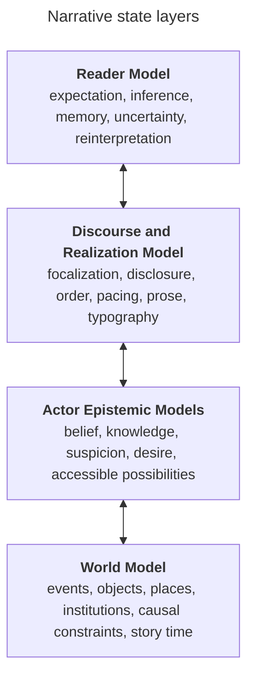

*Figure 3 Narrative state layers*

**Purpose** Shows the independently evolving models that the workbench must represent.

**Interpretation** World state constrains actors, but actors may believe falsely. Discourse controls disclosure and form. The reader model records intended expectations and reinterpretations rather than empirical response.

**Architectural significance** Separating the layers makes dramatic irony, unreliable narration, delayed disclosure, and reader epiphany representable without corrupting the event history.

## 11 Modal and Epistemic State Model

***Basis Source concept with proposed operational semantics** The modal distinction comes from the source. The finite operational representation is proposed.*

### 11.1 Conceptual model

The source uses the familiar modal tuple M = (W, R, V): W is a set of possible worlds, R is an accessibility relation, and V assigns propositions to worlds. The workbench does not need a general theorem prover to preserve the insight. It needs a finite, inspectable representation of which situations an actor, reader, or critical interpretation treats as possible and why.

```text
A local transition can be written as S next = T under M of the current state and event. A model transition can be written as M next = U of the current model, event, and state. These expressions are conceptual, not a commitment to one logic library.
```

### 11.2 Proposed operational representation

Each modal model contains a bounded set of situation nodes, propositions asserted or denied in each situation, weighted or categorical accessibility edges, interpretive rules, and a designated current situation. Models can refer to the same immutable events while assigning different motives, probabilities, obligations, or future affordances. Weights express confidence or salience; they are not mathematical truth unless a framework defines that meaning.

*Table 9 Transition classes*

| **Transition class** | **Changes**                                                | **Does not necessarily change**                         | **Example**                                                      |
|----------------------|------------------------------------------------------------|---------------------------------------------------------|------------------------------------------------------------------|
| Causal               | World event or physical state.                             | Belief or reader knowledge.                             | A letter arrives.                                                |
| Epistemic            | Knowledge, belief, suspicion, or accessible possibilities. | Objective event history.                                | An actor recognizes an ally as a deceiver.                       |
| Affective            | Emotional or dramatic configuration.                       | Facts or beliefs.                                       | Trust becomes dread after an unchanged gesture.                  |
| Structural           | How units are grouped or understood as a work.             | The units themselves.                                   | A continuous story is recognized as incompatible fragments.      |
| Formal               | Medium, typography, voice, ordering, or arrangement.       | In-world causality.                                     | Narration shifts into marginal annotations.                      |
| Reader model         | Expected genre, inference, memory, or interpretive frame.  | Character awareness.                                    | Interruptions become recognized as the governing device.         |
| Ontological          | Rules or available possibilities in the fictional world.   | Prior narration unless retroactively changed by design. | A world formerly thought naturalistic permits impossible events. |

### 11.3 Epiphany as model transition

The system should label a change as an epiphany only when the author or critic asserts a model-level reorganization and can inspect its consequences. Useful evidence includes reclassification of prior events, altered future affordances, changed self- or other-models, a materially different response to a repeated stimulus, and later behavior that makes the revision observable. These are diagnostic dimensions rather than universal criteria.

### 11.4 Retrospective reinterpretation

A REINTERPRETS transition produces new interpretation links to existing events. It does not mutate those events. The system can then compare event classifications before and after the model change: motive, trust, threat, relevance, foreshadowing, and predicted action. An interpretive-distance view may summarize how many high-salience classifications changed, but it must expose its features and weights and must not present the score as aesthetic magnitude.

### 11.5 Nested belief

The model may represent bounded nested beliefs, such as one actor believing that another considers them trustworthy. Unrestricted nesting is computationally and cognitively expensive. The proposed default is two levels, with deeper nesting created explicitly when a work depends on it. This is an open threshold to validate through real analyses.

## 12 Narrative Structure and Scale

***Basis Source concept with proposed graph implementation** The source requires both hierarchical zoom and graph relations.*

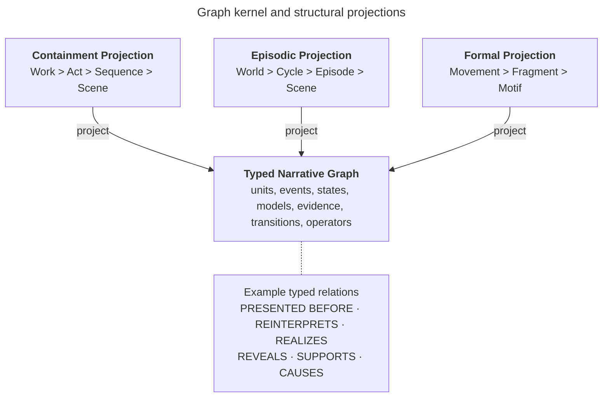

*Figure 4 Graph kernel and structural projections*

**Purpose** Explains how one work can support several incompatible but useful organizations.

**Interpretation** Units and relationships live in the typed graph. A bounded dramatic arc, episodic cycle, or formal movement is a projection with its own constraints.

**Architectural significance** The workbench can change frameworks or compare critical organizations without duplicating scenes, events, or evidence.

### 12.1 Multiscale narrative node

At each scale, a narrative unit can have state, events, allowable transitions, relevant models, and architectural constraints. A scene may resolve a local objective; a sequence may erode confidence; an act may close a possibility; a work may transform its governing form. The machinery is recursive, but the semantics of each scale remain explicit.

### 12.2 Structural framework

A structural framework defines permitted unit types, containment relations, milestones, hard constraints, soft goals, and projections. A McKee-inspired hierarchy, a 44-plot-point Contour framework, a custom movement structure, and an open fragment network are configurations, not engine code. The framework is versioned independently so the same narrative graph can be evaluated under several organizations.

### 12.3 Open-ended narrative cycles

A bounded arc converges toward a terminal condition. An episodic cycle returns near a recognizable configuration while permitting local change. A picaresque or quest network accumulates encounters without requiring one final resolution. A shared-world cycle distributes change across characters and threads. These forms may nest: a bounded scene belongs to an episode, the episode to a cycle, and the cycle to an open world.

### 12.4 Episode continuity contract

*Table 10 Episode continuity contract*

| **Contract element**       | **Question answered**                                                         |
|----------------------------|-------------------------------------------------------------------------------|
| Inherited state            | Which world, character, thematic, and narrative assertions enter the episode? |
| Local architecture         | Which framework and operators govern this episode?                            |
| Allowed mutations          | Which inherited entities or relations may change?                             |
| Preserved invariants       | What must survive regardless of local trajectory?                             |
| Potential model transition | Whose world model may reorganize, and under what trigger?                     |
| Exit effects               | Which changes persist into the shared ledger?                                 |
| Closure behavior           | Does the episode resolve, restore, accumulate, expand, or recontextualize?    |

### 12.5 Formal operators

*Table 11 Initial formal operator vocabulary*

| **Operator** | **Defined behavior**                                              | **Typical effect**                                      |
|--------------|-------------------------------------------------------------------|---------------------------------------------------------|
| INTERRUPT    | Suspend one unit and introduce another.                           | Frustrates continuity or redirects expectation.         |
| RECURSE      | Embed a unit in itself or another unit.                           | Creates nested frames or self-reference.                |
| REFRACT      | Present an event through competing consciousnesses or forms.      | Makes perspectival difference legible.                  |
| COLLAGE      | Juxtapose fragments without a required causal edge.               | Produces association, contradiction, or cultural field. |
| SPIRAL       | Return to a motif or event with changed context.                  | Accumulates meaning through recurrence.                 |
| WITHHOLD     | Restrict information by actor, reader, or discourse channel.      | Creates uncertainty, suspense, or irony.                |
| REINTERPRET  | Apply a model change to earlier events and relations.             | Reclassifies the past without changing it.              |
| TRANSPOSE    | Express a narrative pattern in another medium or formal register. | Tests what survives a change of realization.            |

Operators are author-configurable definitions, not universal laws. Each operator declares its target scale, preconditions, resulting relations, reversibility, and validation behavior. An operator may deliberately preserve ambiguity or contradiction; the validator must distinguish intentional irresolution from accidental inconsistency.

## 13 Composition Criticism and Counterfactual Modes

***Basis Source concept with proposed permissions** The three modes and their shared representation come from the source. Mutation rules are proposed.*

*Table 12 Mode behavior and authority*

| **Mode**                  | **Starting point**                              | **Primary operation**                                   | **Mutation rule**                                                                       | **Result**                                                            |
|---------------------------|-------------------------------------------------|---------------------------------------------------------|-----------------------------------------------------------------------------------------|-----------------------------------------------------------------------|
| Composition Studio        | Designed states, models, architecture, or form. | Explore trajectories and realize selected changes.      | Authorized creators may change canonical state; generated proposals require acceptance. | A versioned narrative model and one or more realizations.             |
| Criticism Parlor          | Immutable source work and evidence anchors.     | Reconstruct and compare interpretations.                | Source is read-only; claims and models live on named interpretive branches.             | Evidence-backed observations, findings, claims, and competing models. |
| Counterfactual Laboratory | A selected creative or critical commit.         | Change a controlled condition and compare consequences. | Every intervention creates a branch and records preserved variables.                    | A reproducible comparison, not a replacement for the source.          |

### 13.1 Composition Studio

The designer defines a purpose or target condition, places narrative objects, establishes what is true and what each participant believes, injects an event, explores possible trajectories, and accepts a sequence for realization. The designer can forbid a transition, mark a characterization constraint, or change the modal model. Accepted decisions become durable artifacts with provenance.

### 13.2 Criticism Parlor

The critic imports a work, segments it into addressable evidence, records observations, proposes states and transitions, and connects claims to supporting and contradicting passages. Several theoretical lenses may coexist. A lens changes which entities and relations are foregrounded; it cannot silently rewrite source text or erase another reading.

### 13.3 Counterfactual Laboratory

The laboratory asks what structural consequences follow if one declared condition changes while selected variables remain fixed. Removing a revelation, equalizing two actors' knowledge, changing focalization, or moving an interruption can reveal which later effects depend on that feature. Results are arguments about a modeled system, not empirical proof of reader response or artistic value.

### 13.4 Mode transitions

A critical interpretation can be copied into a laboratory branch. A counterfactual trajectory may inspire a new composition, but it must be forked into a separately owned creative work rather than merged into the imported source. A composition may enter criticism mode by freezing a source edition and creating interpretive branches around it. These explicit transitions prevent authority from leaking between modes.

## 14 Interaction Model

***Basis Source concept with proposed interface consolidation** The source identifies synchronized table, model, timeline, prose, evidence, and architecture views.*

### 14.1 Unified workspace

The user remains in one workspace while changing scale and representation. Selecting an actor highlights its world-state assertions, private model, relationships, relevant events, prose realizations, and evidence. Selecting a transition highlights the before and after states, validation results, alternatives, and supporting passages. Zoom changes abstraction rather than loading a separate copy of the work.

*Table 13 Synchronized workbench views*

| **View**                  | **Primary question**                                                                           | **Direct manipulation**                                                      |
|---------------------------|------------------------------------------------------------------------------------------------|------------------------------------------------------------------------------|
| Narrative table           | What objects and relationships are interacting now?                                            | Place, connect, constrain, inject, and select narrative objects.             |
| Model inspector           | What is true, believed, possible, or uncertain for each participant?                           | Compare models, edit propositions, and define model transitions.             |
| Narrative trace           | What changed, why, and what alternatives existed?                                              | Set breakpoints, rewind, branch, accept, reject, or explain transitions.     |
| Prose and evidence editor | How is the model realized or supported?                                                        | Edit prose, anchor evidence, reconcile new facts, and inspect claim support. |
| Architecture explorer     | How does this unit participate in hierarchy, episode, timeline, motif, and formal arrangement? | Change projection, move units, apply operators, and compare frameworks.      |
| Comparison view           | What differs between models, commits, or counterfactual branches?                              | Choose baselines, preserved variables, and dimensions of comparison.         |

### 14.2 Scene composition workflow

> 1\. Define the intended transformation or unresolved pressure. This is a target condition, not a prose prompt.
>
> 2\. Place actors, objects, environment, relationships, tension, reader expectations, and relevant formal elements.
>
> 3\. Define world truth, actor models, discourse permissions, and reader knowledge. Contradictions remain visible.
>
> 4\. Introduce an inciting event or formal disturbance.
>
> 5\. Generate candidate trajectories. Pause at any decision to inspect causes, alternatives, and constraint effects.
>
> 6\. Accept, revise, or branch a trajectory. A designated model transition may reorganize prior interpretations.
>
> 7\. Realize the accepted trajectory as prose or another form. Reconcile any new assertions introduced during editing.

### 14.3 Interaction safeguards

-   The interface distinguishes source evidence, human assertion, machine proposal, validated result, and accepted state. It also labels heuristic metrics, uncertainty, and critical-lens dependencies.

-   A generated explanation links to concrete preconditions, rules, evidence, and model metadata; it is not a free-form post hoc story.

-   Rewind creates or moves a branch pointer. It never deletes later work without an explicit archival action.

-   An automatic discrepancy detector may propose model changes from prose edits, but the author chooses whether language or model is authoritative.

## 15 Core Processing Flows

***Basis Source concept with proposed control flow** The simulate then realize sequence comes from the source. Approval, provenance, and exception routing are added here.*

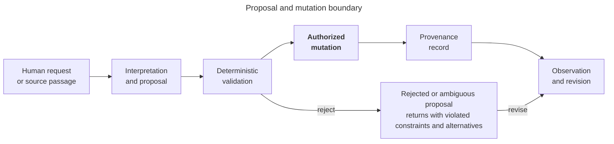

*Figure 5 Proposal and mutation boundary*

**Purpose** Shows how user intent or source evidence becomes durable narrative state.

**Interpretation** Interpretation is a proposal. Deterministic validation checks invariants and policy. Authorized mutation records the accepted delta and its provenance. Rejected proposals remain explainable alternatives.

**Architectural significance** This sequence contains probabilistic error and prevents fluent output from acquiring hidden authority.

### 15.1 Candidate trajectory generation

> 1\. Resolve the active work, branch, commit, narrative unit, framework, and user authority.
>
> 2\. Assemble a minimal state slice: relevant objects, models, prior transitions, constraints, and target condition.
>
> 3\. Ask one or more planners for typed candidate transitions. The planner must state preconditions, effects, uncertainty, and narrative rationale.
>
> 4\. Reject malformed proposals and evaluate hard invariants deterministically.
>
> 5\. Score soft goals separately from validity. Preserve divergent candidates rather than collapsing them into one answer.
>
> 6\. Present candidates with their causal and interpretive traces. The user may accept, revise, forbid, or branch.
>
> 7\. Commit the accepted delta, update derived projections, and schedule optional prose realization.

### 15.2 Model transition

A model transition names the trigger, affected model, invalidated or reweighted possibilities, revised interpretive rules, reclassified prior events, newly available or impossible actions, and expected observable consequences. The transition engine computes an explicit before and after comparison. The invariant engine ensures that reinterpretation does not silently rewrite events or disclose information to actors who have not received it.

### 15.3 Critical reconstruction

> 1\. Ingest and fingerprint the source edition. Segment it into stable addressable spans without changing content.
>
> 2\. Extract candidate entities, events, ordering, focalization, propositions, and relations as machine proposals.
>
> 3\. Require evidence anchors for accepted observations. Mark interpretive leaps and uncertainty explicitly.
>
> 4\. Build one or more named models under declared lenses. Conflicts may coexist.
>
> 5\. Evaluate internal consistency and later textual behavior without treating consistency as proof of correctness.
>
> 6\. Publish an interpretation bundle containing the source fingerprint, evidence anchors, model commit, assumptions, and unresolved contradictions.

### 15.4 Counterfactual experiment

> 1\. Select an immutable baseline commit and state the critical or creative question.
>
> 2\. Declare the intervention and the variables to preserve. If preservation is impossible, the system must say why.
>
> 3\. Create a branch, apply the intervention, validate it, and simulate downstream changes.
>
> 4\. Compare event, epistemic, affective, structural, formal, and reader-model consequences.
>
> 5\. Record which results are deterministic consequences of the model and which are generated hypotheses.

## 16 Technical Architecture

***Basis Proposed implementation decision** The source does not choose technologies or deployment boundaries.*

### 16.1 Recommended initial shape

Begin with a modular monolith and asynchronous workers. The interactive application, graph kernel, command handling, validation, provenance, and projections share one deployable service and one transactional database. Model calls, document ingestion, simulation batches, and large comparisons run through a job queue. This shape preserves atomic commits and reduces operational complexity while the domain is still changing.

The modules use explicit internal ports and versioned domain events. If a workload later requires independent scaling, the AI gateway, ingestion pipeline, or projection service can move behind those ports without changing the core narrative model. Microservices are not justified until measurement shows a real isolation or scaling need.

### 16.2 Client architecture

A web client maintains a local read model for the active work and receives incremental projection updates. Commands are intention-revealing actions such as propose transition, accept trajectory, apply operator, anchor evidence, or create branch. The client never writes graph records directly. Optimistic previews are marked provisional until the server returns a committed version.

### 16.3 Service layers

*Table 14 Service layers*

| **Layer**      | **Responsibilities**                                                                    | **Technology-neutral constraint**                           |
|----------------|-----------------------------------------------------------------------------------------|-------------------------------------------------------------|
| Presentation   | Synchronized views, direct manipulation, comparison, accessibility, offline draft cues. | No business rule exists only in the client.                 |
| Application    | Commands, authorization, transactions, policy, job orchestration.                       | Each mutation has one command identity and idempotency key. |
| Domain         | Graph identities, states, transitions, models, frameworks, operators, invariants.       | No dependency on a language-model provider or UI framework. |
| Infrastructure | Database, object storage, queue, search, model adapters, export adapters.               | Provider-specific data is translated at the boundary.       |
| Read models    | Timelines, hierarchies, traces, diffs, evidence indexes, metrics.                       | Derived views can be rebuilt from committed history.        |

### 16.4 Data storage

Use a relational database as the initial authoritative store, with immutable operation records, versioned entity snapshots, and adjacency tables for typed graph relations. JSON fields may hold framework-specific state whose schema is versioned and validated. This supports transactions, authorization, branching metadata, and provenance with familiar operational tooling. Graph traversal is exposed through the domain layer so a dedicated graph engine can be added if measured workloads justify it.

Store source editions, images, large prose realizations, and export packages in content-addressed object storage. Store extracted text and search indexes as derived artifacts linked to the source fingerprint. A full-text or vector index can accelerate retrieval, but neither becomes authoritative. Deleting an index must not delete the work.

### 16.5 Event history and read models

Every accepted mutation emits a versioned domain event containing the work, branch, parent commit, actor, command, validated delta, authority decision, and provenance references. Current snapshots accelerate reads, while the append-only log supplies audit and reconstruction. Projection workers update timelines, hierarchies, model diffs, and search indexes. Projection lag is visible to the client and never blocks the authoritative commit unless a required invariant depends on it.

### 16.6 Interfaces

Expose commands and queries through a versioned application API. Streaming updates carry commit and projection status. Batch export and simulation jobs use stable job resources with cancel, retry, and provenance. Plugin contracts allow new critical lenses, structural frameworks, formal operators, validators, model providers, and export formats. Extensions run with declared capabilities and cannot bypass source immutability or mutation policy.

### 16.7 Deployment and isolation

A single-user local deployment should be possible for private manuscripts and scholarship. A collaborative deployment adds identity, workspace authorization, encrypted object storage, managed queues, and audit retention. The same domain rules apply in both. External model use is opt-in by workspace, and sensitive projects may restrict processing to approved local or private providers.

## 17 Persistence Versioning and Branching

***Basis Source concept with proposed implementation** Durable trajectories and preserved originals come from the source. Commit semantics are proposed.*

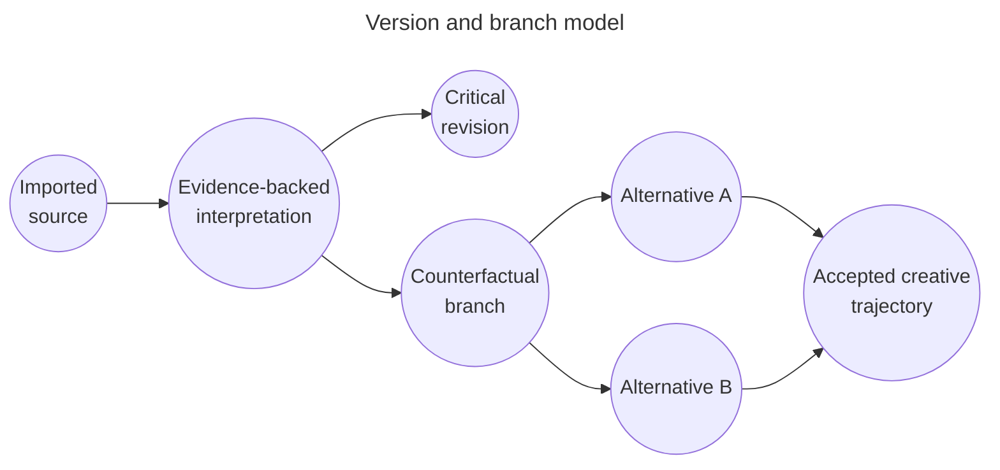

*Figure 6 Version and branch model*

**Purpose** Shows how imported source, interpretation, and counterfactual work coexist without overwrite.

**Interpretation** An evidence-backed interpretation branches from a frozen source edition. Critical revisions and laboratory alternatives have independent lineage. A creative trajectory may accept one alternative only within an owned composition.

**Architectural significance** Lineage makes experiments reproducible and protects mode authority.

### 17.1 Commit model

A commit is an immutable set of accepted operations against one parent commit, plus metadata that explains its purpose and authority. A branch is a movable name pointing to a commit. A merge creates a new commit after semantic conflict review; it never rewrites either parent. Source imports create root commits whose evidence payload is immutable.

### 17.2 Semantic conflicts

Textual merge rules are insufficient. Two branches may edit different records yet conflict semantically: one says an actor lacks a fact while another makes them act on it; one moves a disclosure while another relies on its original timing. The merge validator evaluates invariants and model assumptions across the combined delta and presents conflicts at the narrative level.

### 17.3 Provenance record

*Table 15 Provenance fields*

| **Field**              | **Purpose**                                                                                                      |
|------------------------|------------------------------------------------------------------------------------------------------------------|
| Origin                 | Human action, imported source, deterministic rule, model proposal, or derived projection.                        |
| Actor and authority    | Who proposed, validated, accepted, rejected, or overrode the change.                                             |
| Inputs                 | Source anchors, prior states, framework version, policy version, and prompt or tool parameters where applicable. |
| Decision               | Accepted delta, rejection reason, override reason, or unresolved status.                                         |
| Alternatives           | Candidate transitions considered but not accepted.                                                               |
| Model metadata         | Provider, model, configuration, timestamp, and response fingerprint for probabilistic output.                    |
| Reproducibility status | Whether the exact result can be replayed, approximated, or only audited.                                         |

## 18 Artificial Intelligence Boundary

***Basis Source concept with proposed controls** The source requires a deterministic state core, probabilistic planning, validation, and traceability.*

### 18.1 Permitted uses

-   Extract candidate entities, events, propositions, temporal relations, focalization, and evidence spans from a source.

-   Propose ordinary transitions, model transitions, formal relations, and alternative trajectories.

-   Generate explanations that cite stored preconditions, rules, and evidence.

-   Realize an accepted trajectory as prose under discourse and style constraints.

-   Detect potential discrepancies between edited prose and the accepted model.

-   Suggest, but not decide, critical observations, findings, claims, and counterfactual consequences.

### 18.2 Prohibited authority

-   No model may overwrite imported evidence or an accepted event history.

-   No model may convert its inference into fact merely because a schema validates.

-   No model may approve its own high-impact proposal, change workspace policy, or conceal conflicting evidence.

-   No model may claim measured reader response from an intended reader model.

-   No model may imitate a living author's voice as a hidden default; style constraints should describe structural and linguistic properties instead.

### 18.3 Output contract

Every AI task has a narrow schema, a declared context window, a maximum mutation scope, and a failure policy. Outputs separate extracted evidence, observation, inference, speculation, and recommendation. The gateway stores provider metadata and fingerprints while applying workspace privacy policy. Free-form prose may accompany a proposal, but it cannot substitute for the typed delta.

### 18.4 Aggregate error

A one-percent extraction or transition error becomes material across a long novel and many branches. The system therefore tracks acceptance and correction rates by task, model, framework, and content type; samples accepted low-risk proposals for later review; routes repeated uncertainty to humans; and makes bulk operations previewable and reversible. Human review is targeted by risk and novelty rather than applied as a vague universal control.

## 19 Quality Security and Operations

***Basis Proposed decision** These qualities protect the source vision under real use.*

### 19.1 Narrative integrity

*Table 16 Core invariants and responses*

| **Invariant category** | **Example check**                                                                                 | **Response**                                       |
|------------------------|---------------------------------------------------------------------------------------------------|----------------------------------------------------|
| Knowledge              | An actor cannot act on a proposition before acquiring or inferring it.                            | Reject or require a disclosed inference path.      |
| Location and time      | An object cannot occupy incompatible places at the same story time.                               | Reject or identify missing transition.             |
| Disclosure             | A concealed fact cannot become public without a mechanism.                                        | Reject or propose a disclosure event.              |
| Motivation             | A durable motivation cannot vanish without an accepted cause or model change.                     | Warn for review; frameworks may choose strictness. |
| Discourse              | Point of view and narrative time must follow the active contract unless an operator changes them. | Reject or apply a formal transition.               |
| Source integrity       | Evidence anchors must resolve to the frozen source edition.                                       | Block publication of broken claims.                |
| Mode authority         | A laboratory branch cannot overwrite an imported source or canonical composition.                 | Block the mutation and offer fork or export.       |

### 19.2 Performance targets

Interactive graph selection, state inspection, and local branch operations should feel immediate for a novel-scale work. Long-running extraction, large simulation sets, and full-work comparisons are asynchronous and cancellable. The first implementation should measure works up to several thousand units and hundreds of thousands of typed relations before choosing specialized graph infrastructure.

### 19.3 Explainability and observability

Operational telemetry records command latency, validation failures, projection lag, model cost, token and context use, retry patterns, acceptance rate, override rate, broken evidence anchors, branch divergence, and reconciliation findings. Narrative explanations draw only from stored facts, constraints, and provenance. Logs avoid manuscript content unless explicitly enabled and protected.

### 19.4 Accessibility and portability

Every visual graph operation requires a keyboard and text equivalent. Color never carries provenance or state alone. Diagrams expose structured descriptions, and comparisons are navigable as lists and tables. Export packages include open JSON, plain text or Markdown, source fingerprints, and human-readable reports so users can leave the system without losing their intellectual work.

### 19.5 Security and privacy

-   Encrypt source artifacts and databases at rest and all service traffic in transit.

-   Apply least privilege by workspace, work, branch, and mode-sensitive action.

-   Treat imported documents as untrusted; isolate parsers and scan attachments.

-   Support provider allowlists, local-model-only workspaces, retention controls, and redacted prompts.

-   Keep an audit record for export, share, merge, source replacement, policy change, and destructive archival actions.

-   Separate service telemetry from literary content and allow private projects to disable content logging.

## 20 Key Architectural Decisions

***Basis Proposed implementation decisions** These decisions are not fixed by the source and should be revisited through evidence.*

*Table 17 Architectural decision register*

| **ID** | **Decision**                                                       | **Rationale**                                                            | **Implications**                                                          | **Alternative**                              |
|--------|--------------------------------------------------------------------|--------------------------------------------------------------------------|---------------------------------------------------------------------------|----------------------------------------------|
| AD 01  | Use a typed graph as the canonical domain model.                   | Cross-cutting narrative relations cannot be contained by one tree.       | Hierarchies and timelines become rebuildable projections.                 | Document tree as canonical store.            |
| AD 02  | Keep event history separate from interpretation history.           | Epiphany and criticism reclassify meaning without changing events.       | Retrospective changes add links and model versions.                       | Overwrite event annotations in place.        |
| AD 03  | Use append-only operations plus snapshots.                         | The system needs audit, branching, undo, and reproducibility.            | Storage grows, but compaction and snapshots preserve speed.               | Mutable current-state records only.          |
| AD 04  | Begin as a modular monolith with workers.                          | Domain boundaries are emerging and transactions are central.             | Simpler operations; modules can split behind stable ports.                | Immediate microservices.                     |
| AD 05  | Use a relational authoritative store first.                        | Transactions, branching, authorization, and provenance are primary.      | Graph access is abstracted; specialized graph storage remains optional.   | Graph database as the only system of record. |
| AD 06  | Make AI output proposal-only.                                      | Language models are probabilistic and may misread intent or evidence.    | Typed proposals require validation and authority before commit.           | Direct model writes.                         |
| AD 07  | Freeze source editions with content fingerprints.                  | Critical evidence must remain stable and citable.                        | A changed edition imports as a new root or explicit replacement workflow. | Mutable source text.                         |
| AD 08  | Treat frameworks and formal operators as versioned plugins.        | No plot structure or literary theory is universal.                       | Works declare versions and can compare several frameworks.                | Hard-code initial frameworks.                |
| AD 09  | Use branches for all counterfactual changes.                       | Experiments must preserve the baseline and remain repeatable.            | Comparisons have explicit parentage and intervention records.             | Temporary in-memory what-if state.           |
| AD 10  | Separate hard invariants from soft goals.                          | Global structure should guide scenes without forcing implausible action. | Hard failures block; goals rank and explain candidates.                   | One undifferentiated score.                  |
| AD 11  | Represent intended reader state separately from measured response. | Design intention is not empirical evidence.                              | Reader studies, if added, attach as external observations.                | Single reader-response field.                |
| AD 12  | Limit default nested belief depth.                                 | Unbounded higher-order belief is expensive and difficult to use.         | Two levels by default; explicit deeper models where required.             | Unlimited automatic nesting.                 |

## 21 Risks Failure Modes and Controls

***Basis Source concept and proposed risk treatment** Interpretive uncertainty and probabilistic error are source concerns. Detection and containment mechanisms are proposed.*

*Table 18 Specific failure modes*

| **Failure mode**             | **Consequence**                                                              | **Detection and containment**                                                                  | **Residual risk**                                        |
|------------------------------|------------------------------------------------------------------------------|------------------------------------------------------------------------------------------------|----------------------------------------------------------|
| Interpretive overclaiming    | One plausible model is presented as the work itself.                         | Competing branches, evidence coverage, lens labels, uncertainty, and contradiction display.    | Users may still prefer the most fluent account.          |
| Silent state invention       | Generated prose adds facts, beliefs, or actions absent from the model.       | Reconciliation diff, generation constraints, and blocked auto-commit.                          | Subtle implications may escape detection.                |
| Causal conflation            | Juxtaposition or association becomes a false CAUSES edge.                    | Typed edges, relation-specific evidence, and review of inferred causality.                     | Causality in literature may remain contestable.          |
| Epiphany inflation           | Every revelation is labeled a model transformation.                          | Before and after model diff plus explicit diagnostic dimensions.                               | Definitions vary across critical traditions.             |
| Framework coercion           | A preferred plot template distorts an open or experimental work.             | Frameworks remain projections; open graph and alternative lenses stay available.               | Interface defaults can still bias users.                 |
| Branch explosion             | Experiments produce an unmanageable version graph.                           | Named experiments, archival policy, comparison summaries, and lineage filters.                 | Valuable alternatives may still become hard to navigate. |
| Model drift                  | Repeated AI proposals gradually violate characterization or source evidence. | Commit-time invariants, aggregate quality monitoring, and periodic full-model audits.          | Soft characterization remains difficult to formalize.    |
| Broken evidence anchors      | Reimport or edition changes invalidate claims.                               | Content fingerprints, edition-aware anchors, and publication gates.                            | OCR and layout changes may need manual realignment.      |
| False precision              | Trust scores or interpretive distance imply scientific measurement.          | Expose features, units, assumptions, and heuristic labels; permit qualitative states.          | Numbers may still attract undue authority.               |
| Sensitive manuscript leakage | Private text reaches an unapproved provider or log.                          | Workspace provider policy, redaction, local execution, encryption, and content-safe telemetry. | Provider and operator failures remain external risks.    |
| Validator rigidity           | Rules eliminate deliberate ambiguity, contradiction, or impossibility.       | Framework-specific severity, intentional-exception records, and human override with reason.    | Too many overrides can weaken assurance.                 |
| Non-reproducible generation  | A later model cannot repeat the same proposal.                               | Store inputs, provider metadata, output, fingerprints, and accepted delta.                     | Exact stochastic replay may remain impossible.           |

## 22 Validation and Evolution

***Basis Source concept with proposed sequence** The source recommends a bounded prototype and later suggests validating criticism against an existing short work before autonomous generation.*

### 22.1 Architectural validation scenarios

*Table 19 Validation scenarios*

| **Scenario**                      | **What it tests**                                                                                          | **Pass condition**                                                                          |
|-----------------------------------|------------------------------------------------------------------------------------------------------------|---------------------------------------------------------------------------------------------|
| Two actors and a concealed letter | Local state, asymmetric knowledge, tension, discourse, alternative trajectories, and prose reconciliation. | Two distinct trajectories preserve invariants and remain traceable to accepted transitions. |
| Late betrayal revelation          | Dramatic irony, model transition, retrospective reinterpretation, and event-history preservation.          | Earlier events remain fixed while interpretations and future affordances change visibly.    |
| Short story criticism             | Source anchoring, competing claims, evidence coverage, and internal consistency.                           | A critic can challenge a claim and inspect all supporting and contradicting passages.       |
| Removed revelation counterfactual | Branching, intervention scope, and downstream comparison.                                                  | The baseline remains unchanged and every reported consequence names its dependency.         |
| Episodic quest cycle              | Episode contracts, persistent world state, restorative and cumulative effects.                             | Episodes close independently while selected changes propagate to the shared ledger.         |
| Interrupted or collage work       | Formal causality, fragment relationships, and reader-model change without forced diegetic links.           | The model represents juxtaposition and interruption without inventing causal events.        |

### 22.2 Evolutionary increments

The architecture should evolve by demonstrating the shared kernel, not by building every mode independently.

*Table 20 Evolutionary architecture increments*

| **Increment**               | **Capability**                                                                                          | **Architectural evidence**                                                                          |
|-----------------------------|---------------------------------------------------------------------------------------------------------|-----------------------------------------------------------------------------------------------------|
| Foundation                  | Manual graph, evidence anchors, branches, states, transitions, synchronized trace and inspector.        | The representation can explain one existing short work without generated prose.                     |
| Critical laboratory         | Assisted extraction, competing interpretations, counterfactual branches, comparison reports.            | Machine proposals remain evidence-linked and a removed revelation produces an auditable comparison. |
| Scene composition           | Candidate trajectories, hard and soft constraints, accepted commits, prose realization, reconciliation. | A writer can branch a scene and revise prose without hidden state mutation.                         |
| Multiscale architecture     | Framework editor, hierarchy projections, episode contracts, state propagation across units.             | One graph supports bounded and episodic projections without duplication.                            |
| Experimental form           | Formal operators, fragment networks, page or media relations, reader-model transitions.                 | A collage or recursive work is represented without reducing it to generic plot beats.               |
| Collaboration and ecosystem | Permissions, reviews, plugins, portable exports, optional private deployment.                           | External extensions cannot bypass provenance or mutation authority.                                 |

### 22.3 Measures

-   Narrative integrity: hard-constraint violation rate before and after validation, plus escaped defects found later.

-   Provenance coverage: proportion of accepted critical assertions and generated mutations with complete origin and evidence records.

-   Branch reproducibility: proportion of experiments that can rebuild the same accepted state and comparison.

-   Reconciliation quality: precision and recall of model discrepancies introduced by prose edits, evaluated on curated cases.

-   Interpretive usability: whether users can explain why a transition or claim exists without reading system logs.

-   Creative control: acceptance, revision, rejection, and override patterns, interpreted qualitatively rather than optimized blindly.

## 23 Open Questions

***Basis Open decisions** These questions need prototypes, scholarship, or user research.*

*Table 21 Open architectural questions*

| **Question**                                    | **Why it remains open**                                                                                                                   | **Validation approach**                                                                       |
|-------------------------------------------------|-------------------------------------------------------------------------------------------------------------------------------------------|-----------------------------------------------------------------------------------------------|
| How expressive should the modal logic be?       | Finite possibility graphs may be sufficient for practice, while some works require richer temporal, deontic, or paraconsistent semantics. | Model several works with different logic demands before selecting a formal engine.            |
| How should uncertainty be represented?          | Probabilities, qualitative confidence, and contested labels imply different meanings.                                                     | Test whether users understand and correctly use each representation.                          |
| Which invariants are universal?                 | Many apparent inconsistencies are deliberate literary strategies.                                                                         | Separate a minimal source-integrity core from framework-specific validators.                  |
| How far should prose reconciliation reach?      | Sentence-level edits can imply facts without stating them directly.                                                                       | Measure discrepancy detection on author-reviewed revisions.                                   |
| What is a useful interpretive-distance measure? | A scalar may obscure which classifications changed and why.                                                                               | Begin with transparent feature diffs; add scores only if users can interpret them accurately. |
| How should page geometry be modeled?            | Some experimental works require spatial relations beyond ordered text spans.                                                              | Prototype region and layer anchors on one spatially complex work.                             |
| How should nested narratives inherit truth?     | Embedded worlds may quote, contradict, fictionalize, or transform their containing world.                                                 | Define explicit world and narrator scopes and test recursive cases.                           |
| When may low-risk proposals auto-commit?        | Automation can reduce friction but aggregate error threatens long works.                                                                  | Start with derived projections only; expand by measured error and reversible policy.          |
| How should collaborative disagreement appear?   | A merge conflict may be a productive critical disagreement rather than an error.                                                          | Design comparison and publication flows that retain incompatible models.                      |

## 24 UML Specification

***Basis Proposed implementation specification** The source establishes narrative concepts and modes but does not prescribe UML classifiers, interfaces, states, or deployment nodes. Every element in this section is a proposed architectural realization unless explicitly traced to a source concept.*

This specification uses an architecture-level subset of UML 2.x. It is complete for the responsibilities, domain identities, major lifecycles, architecturally significant interactions, and deployment boundaries defined by this document. It intentionally stops short of method signatures, transport contracts, physical database fields, and framework-specific classes. Those belong in detailed design after the open questions and validation scenarios have been tested.

### 24.1 UML notation and model inventory

*Table 22 UML model inventory*

| **View**   | **UML construct**                                      | **Question answered**                                                   | **Status**                      |
|------------|--------------------------------------------------------|-------------------------------------------------------------------------|---------------------------------|
| Use case   | Actors associations and use cases                      | Who accomplishes which goals and under what authority?                  | Normative at architecture level |
| Package    | Packages and directed dependencies                     | Which responsibilities may depend on which others?                      | Normative dependency rule       |
| Class      | Conceptual classifiers associations and multiplicities | Which durable identities and relationships must exist?                  | Normative concept model         |
| State      | Proposal and branch state machines                     | Which lifecycle transitions are permitted?                              | Normative lifecycle             |
| Sequence   | Composition criticism and counterfactual interactions  | How do responsibilities collaborate across the mutation boundary?       | Normative responsibility order  |
| Deployment | Nodes execution environments and communication paths   | Where do responsibilities initially run and where are trust boundaries? | Recommended initial topology    |
| Interface  | Block diagram sketches and synchronized view behavior  | How does a user encounter the architectural model?                      | Proposed interaction design     |

**Stereotypes** aggregate marks a transactional consistency boundary; immutable marks content that receives a new version rather than an in-place edit; external marks a system outside workbench authority; worker marks asynchronous execution; proposal marks an advisory object that cannot mutate canonical state. Solid arrows show directed interaction or association. Gray arrows show return, dependency, rejection, or recovery paths. Multiplicity is stated in the relationship table where line density would make the diagram less legible.

### 24.2 UML use case model

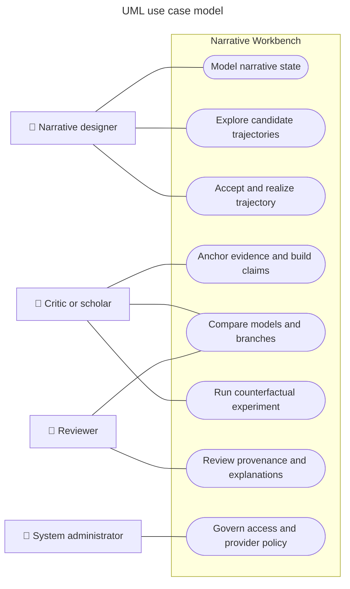

*Figure 7 UML use case model*

**Purpose** Defines the actor goals supported by the shared kernel without assigning UI controls or service endpoints.

**Interpretation** Designers model and realize narrative state. Critics anchor evidence and compare interpretations. Researchers use the same comparison machinery for controlled experiments. Reviewers inspect provenance, while administrators govern access and provider policy without literary mutation authority.

**Architectural significance** The use cases share entities and lineage but differ in mutation rights. Authorization is therefore part of every use-case realization rather than a separate administrative afterthought.

*Table 23 Use case specifications*

| **ID** | **Primary actor**    | **Goal**                                | **Precondition**                                     | **Success result**                                              |
|--------|----------------------|-----------------------------------------|------------------------------------------------------|-----------------------------------------------------------------|
| UC 01  | Narrative designer   | Model narrative state                   | Owned work and selected framework                    | Versioned objects assertions models and constraints             |
| UC 02  | Narrative designer   | Explore and accept a trajectory         | Valid starting commit and target condition           | Accepted transition commit with alternatives retained           |
| UC 03  | Critic or scholar    | Build an evidence-backed interpretation | Frozen source edition with stable anchors            | Named interpretive branch with observations findings and claims |
| UC 04  | Researcher or critic | Run a counterfactual experiment         | Baseline commit intervention and preserved variables | Reproducible branch and multidimensional comparison             |
| UC 05  | Reviewer             | Review a change or claim                | Accessible proposal commit evidence and policy       | Approval rejection revision request or comment with rationale   |
| UC 06  | Administrator        | Govern workspace policy                 | Administrative authority                             | Versioned access provider retention and audit policy            |

### 24.3 UML package and component model

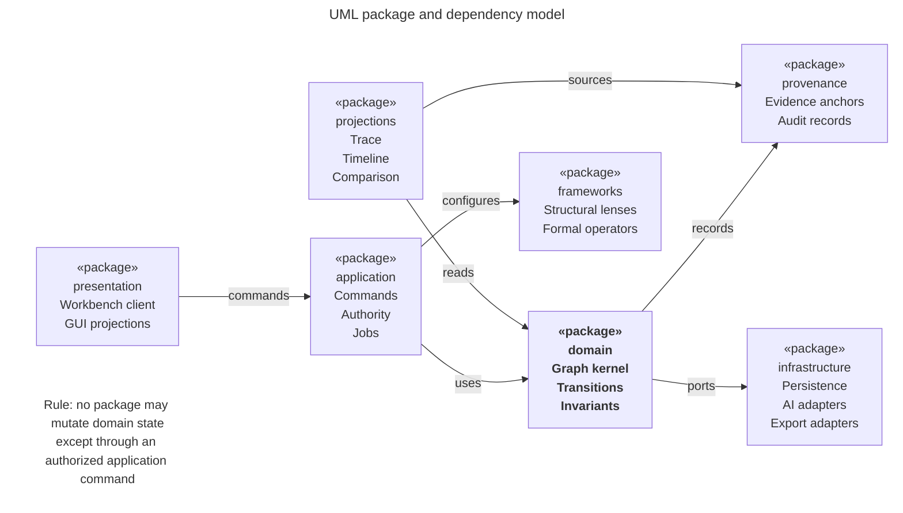

*Figure 8 UML package and dependency model*

**Purpose** Defines source-code and ownership boundaries without requiring separate deployment units.

**Interpretation** Presentation depends on application commands. Application coordinates the domain. Frameworks configure domain behavior through declared contracts. Provenance records domain decisions. Infrastructure implements ports owned by the inner packages. Projections read committed history rather than becoming an alternate source of truth.

**Architectural significance** The dependency rule protects the graph kernel and authority model from user-interface, provider, and storage choices. It also provides seams for later extraction of workers or adapters if measured load justifies it.

*Table 24 Package contracts*

| **Package**    | **Public responsibility**                                            | **May depend on**                         | **Must not do**                            |
|----------------|----------------------------------------------------------------------|-------------------------------------------|--------------------------------------------|
| presentation   | Render synchronized views and emit intention-revealing commands      | application contracts and projection DTOs | Write graph or repository records directly |
| application    | Authorize commands coordinate transactions and jobs                  | domain provenance ports and policy        | Embed UI or provider-specific behavior     |
| domain         | Own narrative identities relations transitions models and invariants | Versioned framework contracts             | Depend on storage UI or model vendors      |
| frameworks     | Define structural lenses formal operators and validators             | domain extension contracts                | Override source immutability or authority  |
| provenance     | Anchor evidence and record proposal validation decision and lineage  | domain identities and repository ports    | Convert inference into source fact         |
| projections    | Build timelines traces hierarchies comparisons and indexes           | committed events and read storage         | Become authoritative narrative state       |
| infrastructure | Implement persistence queues model adapters and exports              | ports declared by inner packages          | Leak vendor schemas into the domain        |

The logical component architecture in Figure 2 realizes these packages inside an initial modular monolith. The package model is normative even when several packages share one process. An extraction into a service is valid only if the same inward dependency direction and mutation authority remain intact.

### 24.4 UML conceptual class model

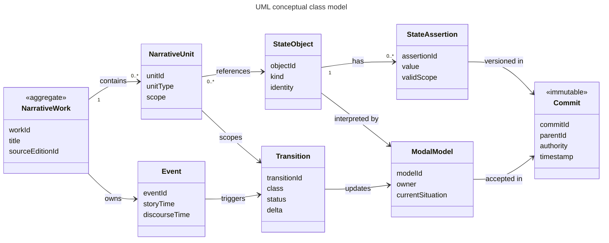

*Figure 9 UML conceptual class model*

**Purpose** Specifies the stable domain identities and the associations that must survive storage and framework choices.

**Interpretation** A work contains units. Units scope events, state objects, and assertions. Transitions consume and produce assertions under a modal model. Commits record accepted transitions and lineage. The class model separates the identity of an event from later interpretations of that event.

**Architectural significance** The classifier boundaries prevent in-place reinterpretation from erasing history. They also let several structural projections and critical models refer to the same durable narrative material.

*Table 25 Conceptual associations and multiplicities*

| **Association**                            | **Multiplicity**       | **Semantics**                                                      | **Invariant**                                                             |
|--------------------------------------------|------------------------|--------------------------------------------------------------------|---------------------------------------------------------------------------|
| NarrativeWork contains NarrativeUnit       | 1 to 0 or more         | A unit belongs to the identity of one work edition or composition  | Containment does not imply narrative causality                            |
| NarrativeUnit scopes Event                 | 1 to 0 or more         | An event occurs or is presented within an addressable unit         | Story and discourse ordering remain distinct                              |
| NarrativeUnit references StateObject       | 0 or more to 0 or more | A unit concerns actors objects relations motifs or formal features | Reference does not clone identity                                         |
| StateObject has StateAssertion             | 1 to 0 or more         | Assertions give time model and scope qualified values              | Conflicting assertions require separate scope or explicit contradiction   |
| Event triggers Transition                  | 0 or 1 to 0 or more    | A disturbance may produce candidate or accepted changes            | A formal relation is not silently typed as diegetic cause                 |
| Transition updates ModalModel              | 0 or more to 0 or more | Ordinary and model transitions name affected models                | Retrospective links do not mutate prior events                            |
| Commit accepts Transition                  | 1 to 0 or more         | A commit records an authorized delta                               | Every accepted transition has authority and provenance                    |
| Commit parents Commit                      | 0 or 1 to 0 or more    | Immutable lineage supports branches and merges                     | A merge creates a new commit and never rewrites a parent                  |
| EvidenceAnchor supports assertion or claim | 0 or more to 0 or more | Source spans justify observations findings and claims              | Anchor resolves to one frozen source edition                              |
| Realization realizes Transition            | 0 or more to 1 or more | Prose visual or formal output expresses accepted model content     | Editing a realization proposes rather than silently performs model change |

### 24.5 UML state models

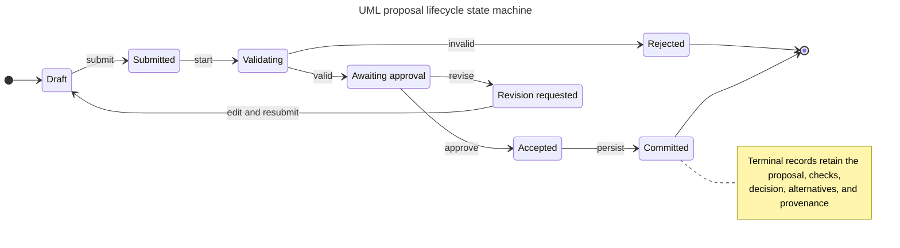

*Figure 10 UML proposal lifecycle state machine*

**Purpose** Defines the only permitted route from draft intent or machine output to durable narrative state.

**Interpretation** A proposal can be revised after validation or review. Rejection preserves the proposal and reasons. Acceptance is not yet persistence; the commit step atomically records the validated delta, authority decision, and provenance.

**Architectural significance** Separating acceptance from commitment keeps conversational approval, deterministic validation, and transactional durability observable and testable.

*Table 26 Proposal state transitions*

| **Transition**                          | **Guard**                                    | **Action**                                          | **Recorded evidence**                         |
|-----------------------------------------|----------------------------------------------|-----------------------------------------------------|-----------------------------------------------|
| Draft to Submitted                      | Schema complete and actor may propose        | Freeze proposal payload                             | Origin context and proposal fingerprint       |
| Submitted to Validating                 | Required context resolves                    | Run structural semantic policy and authority checks | Validator versions inputs and findings        |
| Validating to Rejected                  | Hard invariant fails                         | Block mutation and return alternatives              | Violation rule scope and explanation          |
| Validating to Awaiting approval         | Hard checks pass                             | Calculate impact and required authority             | Soft goals warnings and uncertainty           |
| Awaiting approval to Revision requested | Reviewer asks for change                     | Return editable successor proposal                  | Reviewer rationale and preserved predecessor  |
| Awaiting approval to Accepted           | Authorized actor approves                    | Bind decision to validated payload                  | Actor role policy and timestamp               |
| Accepted to Committed                   | Parent commit unchanged or conflict resolved | Atomically persist delta and provenance             | Commit id parent id and accepted alternatives |

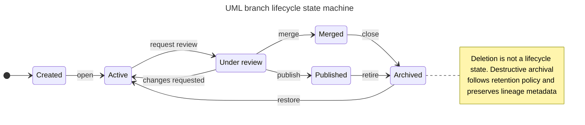

*Figure 11 UML branch lifecycle state machine*

**Purpose** Defines how creative critical and counterfactual branches advance without deleting lineage.

**Interpretation** An active branch may enter review repeatedly. Review can lead to a merge within permitted authority or to publication as an independent interpretation or experiment. Archive hides a branch from ordinary work while restore returns it to active use.

**Architectural significance** A separate branch lifecycle makes non-destructive experimentation a domain behavior rather than a user-interface convenience.

**Branch state invariants** Only an owned creative branch may merge an accepted counterfactual trajectory into canonical composition. A critical branch may be published or compared but cannot mutate its frozen source. Archival preserves commit lineage, evidence anchors, intervention records, and publication references. Physical deletion is an administrative retention operation outside the ordinary branch state machine.

### 24.6 UML interaction sequences

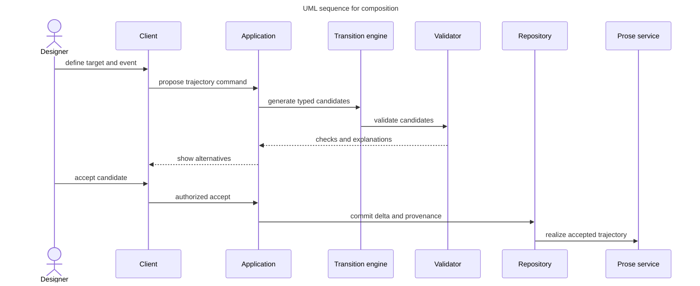

*Figure 12 UML sequence for composition*

**Purpose** Shows responsibility order for candidate generation, validation, human selection, commit, and realization.

**Interpretation** The transition engine produces typed candidates. The validator returns checks rather than choosing. The application presents alternatives and receives explicit acceptance before repository mutation. Prose is generated only from the accepted commit.

**Architectural significance** The sequence makes the source principle of state before prose enforceable and gives each probabilistic step a deterministic and human-controlled boundary.

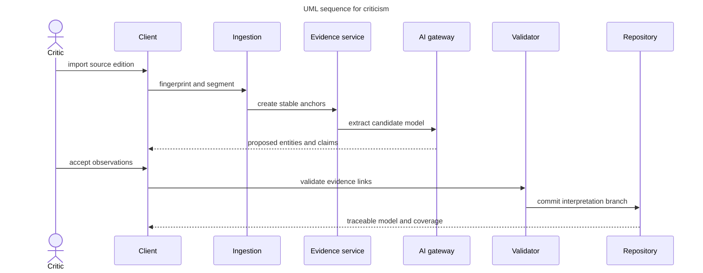

*Figure 13 UML sequence for criticism*

**Purpose** Shows how a source edition becomes a traceable interpretive model without losing evidentiary boundaries.

**Interpretation** Ingestion fingerprints and segments the source. Evidence anchors precede model extraction. Machine output returns as proposals. A critic accepts observations, validation checks links and classifications, and the repository commits an interpretation branch.

**Architectural significance** The sequence prevents generated claims from appearing as source facts and makes source coverage, contradiction, and lens dependence inspectable.

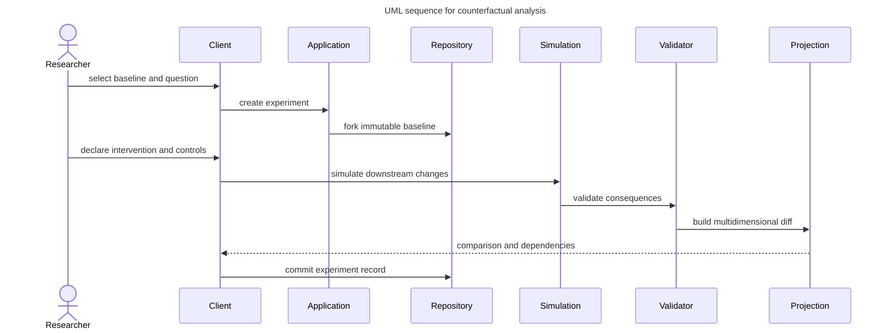

*Figure 14 UML sequence for counterfactual analysis*

**Purpose** Shows how an experiment preserves its baseline and distinguishes modeled consequence from generated hypothesis.

**Interpretation** The researcher selects an immutable baseline, declares an intervention and controls, and then invokes simulation. Validation checks the consequences before a projection service creates a comparison. The experiment record stores dependencies and unresolved constraints.

**Architectural significance** Explicit controls and lineage make the comparison reproducible and prevent the branch from masquerading as a replacement source or canonical history.

*Table 27 Interaction sequence controls*

| **Sequence**   | **Transaction boundary**   | **Probabilistic step**                           | **Authority point**                                 | **Failure return**                                                     |
|----------------|----------------------------|--------------------------------------------------|-----------------------------------------------------|------------------------------------------------------------------------|
| Composition    | Accepted transition commit | Candidate trajectory and prose proposal          | Designer accepts a validated candidate              | Invalid candidate or reconciliation proposal                           |
| Criticism      | Interpretation commit      | Extraction observation finding or claim proposal | Critic accepts classifications and evidence links   | Missing anchor contradiction or unsupported claim                      |
| Counterfactual | Experiment commit          | Generated downstream hypothesis                  | Researcher accepts experiment definition and report | Unsatisfied control invalid intervention or unresolved hard constraint |

### 24.7 UML deployment model

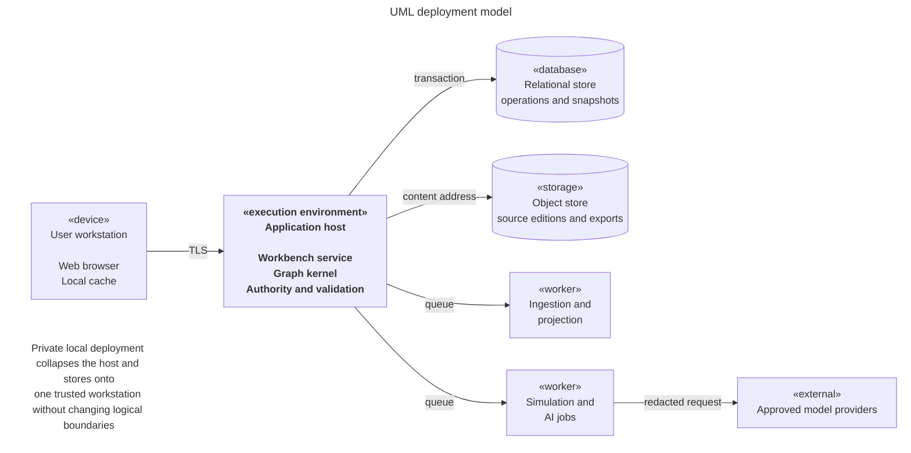

*Figure 15 UML deployment model*

**Purpose** Defines the recommended initial runtime topology and the trust boundaries that must remain visible in local and collaborative deployments.

**Interpretation** The browser talks only to the application host. The host owns transactions and authority. Workers consume bounded jobs. The relational store contains operations and snapshots, while object storage contains source editions and exports. Approved model providers remain external.

**Architectural significance** The topology supports a private single-workstation mode and a collaborative hosted mode without changing the domain model. External inference can be disabled or replaced by a local provider per workspace policy.

*Table 28 Deployment node specification*

| **Node**                        | **Artifacts deployed**                                             | **Trust classification**     | **Scaling and failure behavior**                                        |
|---------------------------------|--------------------------------------------------------------------|------------------------------|-------------------------------------------------------------------------|
| User workstation                | Browser client local draft cache and rendered projections          | User boundary                | Reconnects by commit and projection cursor; never becomes authoritative |
| Application host                | Application domain validation authority provenance and API modules | Trusted core                 | Scale vertically first; preserve atomic commit and idempotency          |
| Ingestion and projection worker | Parsers source indexing and derived view builders                  | Constrained worker           | Retryable and rebuildable from source fingerprints and commits          |
| Simulation and AI worker        | Candidate generation comparison and prose jobs                     | Untrusted output boundary    | Cancellable rate limited and schema bounded                             |
| Relational store                | Operations commits branches snapshots policy and job state         | Authoritative data           | Transactional backup point-in-time recovery and migration control       |
| Object store                    | Frozen source editions images realizations and export packages     | Authoritative content        | Content addressed encrypted and retention governed                      |
| Model provider                  | No durable workbench state                                         | External or locally approved | Timeout circuit break provider allowlist and redaction policy           |

### 24.8 UML consistency and completeness rules

*Table 29 UML cross-view consistency rules*

| **Rule**                  | **Required consistency**                                                                                                              |
|---------------------------|---------------------------------------------------------------------------------------------------------------------------------------|
| Classifier to package     | Every conceptual classifier belongs to the domain or provenance package. Persistence representations may realize but not redefine it. |
| Use case to authority     | Every mutating use case names the actor who may propose validate approve execute and override.                                        |
| Sequence to state         | Every message that changes a proposal or branch corresponds to a permitted state-machine transition.                                  |
| State to provenance       | Every terminal or externally visible lifecycle transition records actor time policy reason and parent identity.                       |
| Component to deployment   | Every logical component is assigned to the application host a worker the client or an external adapter.                               |
| Interface to command      | Every direct manipulation emits an intention-revealing application command and shows provisional versus committed state.              |
| Source immutability       | No association sequence state transition or screen action may overwrite a frozen source edition or accepted event history.            |
| Projection rebuildability | Hierarchy timeline trace comparison search and metrics remain derivable from committed history and versioned definitions.             |
| Model plurality           | World actor reader discourse formal and critical models retain separate identity scope and ownership.                                 |
| Counterfactual lineage    | Every experiment records baseline intervention preserved variables framework versions and comparison dimensions.                      |

**Model governance** The UML package, class, state, sequence, and deployment views form one architectural model. A detailed design may add classifiers and interactions, but any change that violates a consistency rule requires an architectural decision record and an update to the affected views. Diagram files are explanatory renderings; the normative content is the combination of figures, tables, invariants, and decision register.

## 25 GUI Block Diagram Specification

***Basis Proposed interaction design** The source specifies a narrative table, model inspector, trace, prose and evidence views, and an architecture explorer. The page arrangements, persistent shell, commands, and responsive behavior are proposed here.*

The graphical interface is a synchronized workbench rather than a set of disconnected editors. Every view presents the same selected work, branch, commit, unit, model, and evidence context. Changing selection in one region updates the others without changing canonical state. A visible mode label, branch identity, commit status, authority state, and provenance drawer prevent users from confusing a proposal, projection, experiment, or interpretation with accepted narrative truth.

### 25.1 Shared workbench shell

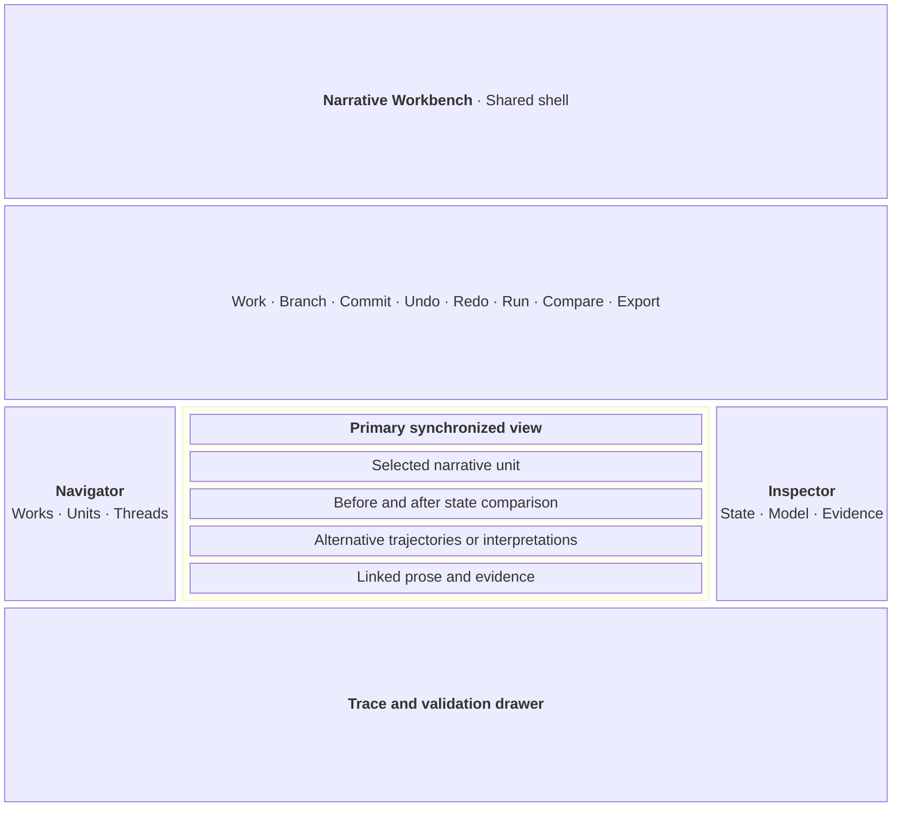

*Figure 16 GUI block sketch for the shared workbench*

**Purpose** Defines the persistent frame shared by composition, criticism, and counterfactual modes.

**Interpretation** The navigator establishes scope. The central region hosts the dominant mode-specific representation. The inspector explains the selected object or transition. The bottom drawer exposes trace, validation, jobs, and provenance. Global controls act on work, branch, commit, history, comparison, and export.

**Architectural significance** Keeping context and authority visible reduces mode leakage and makes synchronized projections feel like different views of one model rather than separate documents.

*Table 30 Shared GUI regions*

| **Region**   | **Persistent content**                                                 | **Primary actions**                           | **Safety behavior**                                                   |
|--------------|------------------------------------------------------------------------|-----------------------------------------------|-----------------------------------------------------------------------|
| Global bar   | Work branch commit mode sync and job status                            | Undo redo run compare export and share        | Shows provisional dirty validated and committed states                |
| Navigator    | Units threads motifs evidence sets experiments and saved views         | Select filter reorder and change projection   | Selection never mutates narrative state                               |
| Primary view | Table graph timeline architecture prose evidence or comparison         | Direct manipulation appropriate to mode       | Every mutation opens a proposal preview                               |
| Inspector    | Identity state model evidence constraints alternatives and permissions | Edit assert challenge accept reject or branch | Labels source human machine derived and accepted provenance           |
| Trace drawer | Before and after state causes checks alternatives jobs and audit       | Step rewind inspect retry and explain         | Rewind creates or moves a branch pointer rather than deleting history |

### 25.2 Composition Studio

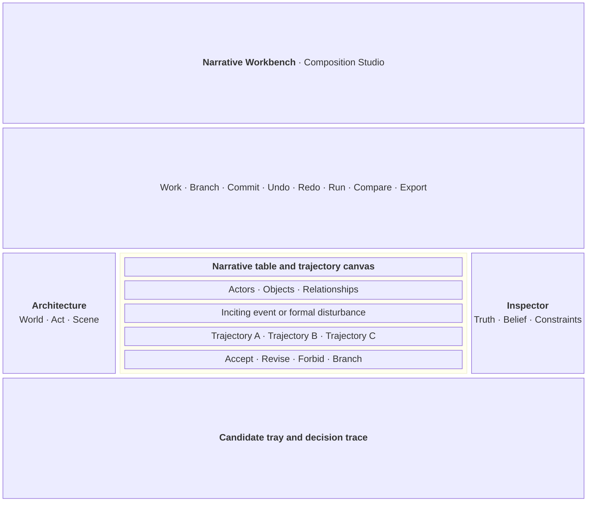

*Figure 17 GUI block sketch for Composition Studio*

**Purpose** Shows the model-first authoring workspace for designing a scene or larger narrative unit.

**Interpretation** The navigator chooses architectural scale. The primary canvas contains stateful narrative objects, the disturbance, and candidate trajectories. The inspector separates world truth, actor belief, reader expectation, constraints, and formal choices. The bottom tray explains and compares candidates before acceptance.

**Architectural significance** Prose is downstream from the selected trajectory. The interface makes this dependency visible and treats prose edits that introduce new facts as reconciliation proposals.

*Table 31 Composition interactions*

| **Interaction**                   | **Immediate feedback**                               | **Command produced**                    | **Commit effect**                                              |
|-----------------------------------|------------------------------------------------------|-----------------------------------------|----------------------------------------------------------------|
| Place or connect narrative object | Provisional object relation and affected constraints | Propose object or typed relation        | Creates versioned identity or edge after acceptance            |
| Inject disturbance                | Candidate changed states and propagation frontier    | Propose event and trajectory generation | None until a trajectory is accepted                            |
| Edit belief or possibility        | World actor and reader model diff                    | Propose ordinary or model transition    | Versions the affected model after validation                   |
| Accept trajectory                 | Before and after trace plus rejected alternatives    | Accept validated proposal               | Creates commit and schedules projections                       |
| Generate or edit prose            | Realization links and discrepancy markers            | Realize trajectory or reconcile prose   | Creates realization; model changes require separate acceptance |

### 25.3 Criticism Parlor

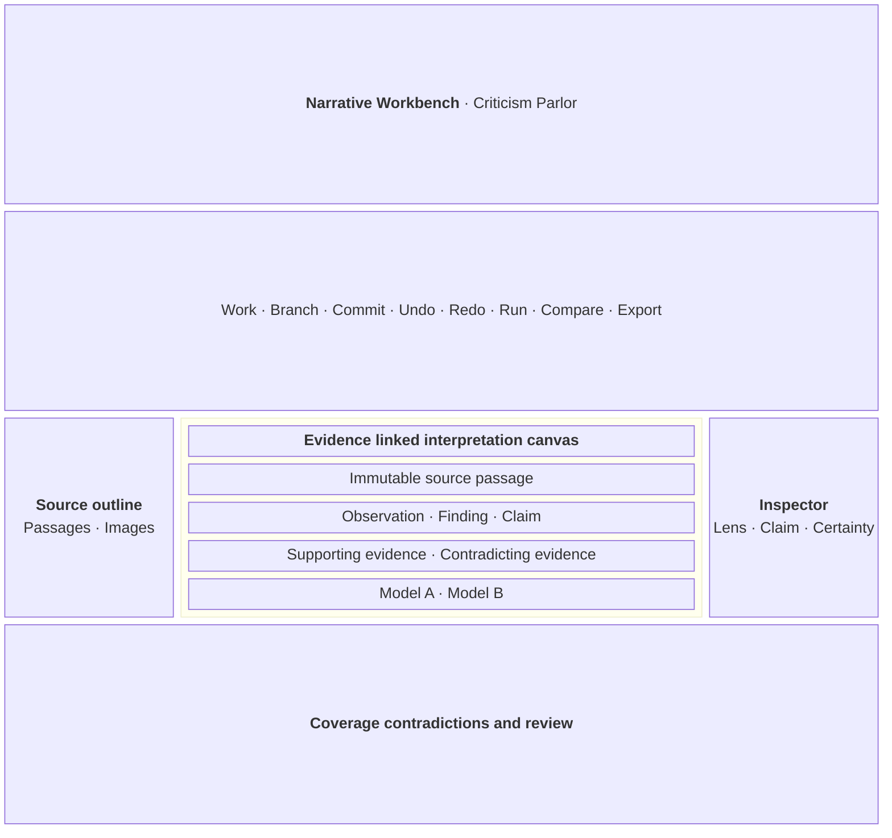

*Figure 18 GUI block sketch for Criticism Parlor*

**Purpose** Shows how immutable evidence, interpretive layers, and competing claims remain visible together.

**Interpretation** The left region navigates the frozen source. The center aligns passages with observations, findings, claims, and alternative models. The inspector states lens, certainty, support, contradiction, and permissions. The bottom drawer reports evidence coverage and unresolved disagreements.

**Architectural significance** The layout resists interpretive overclaiming by requiring the user to see where each assertion came from and which other readings remain viable.

*Table 32 Criticism visual semantics*

| **Visual state** | **Meaning**                                    | **Required label or cue**                                   |
|------------------|------------------------------------------------|-------------------------------------------------------------|
| Source span      | Immutable content from a fingerprinted edition | Edition identifier page or region anchor and source icon    |
| Observation      | Direct description of evidence                 | Human or machine proposer and acceptance state              |
| Finding          | Pattern synthesized from observations          | Evidence coverage uncertainty and lens dependence           |
| Claim            | Contestable critical assertion                 | Supporting and contradicting evidence plus branch identity  |
| Competing model  | An alternative coherent interpretation         | Named lens assumptions differences and unresolved conflicts |
| Broken anchor    | Evidence reference that no longer resolves     | Blocking publication status and realignment action          |

### 25.4 Counterfactual Laboratory

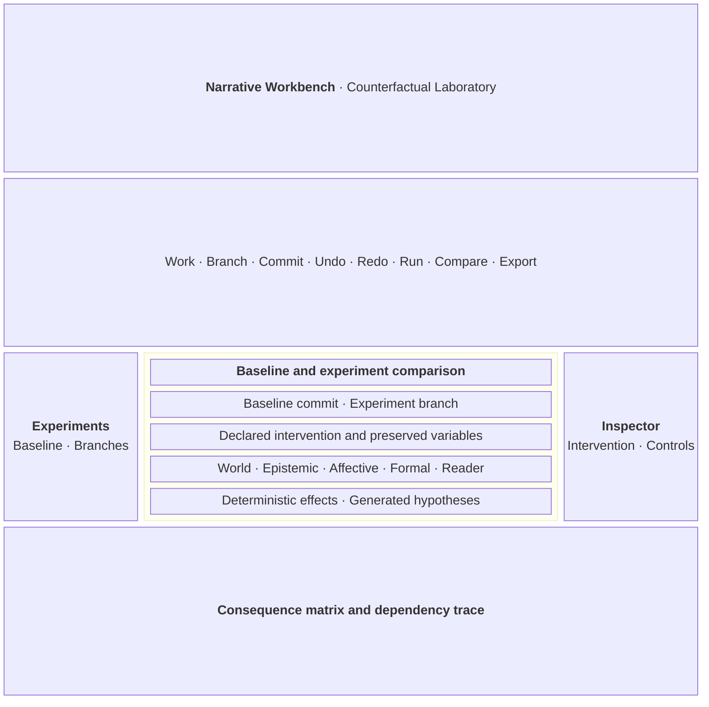

*Figure 19 GUI block sketch for Counterfactual Laboratory*

**Purpose** Shows the baseline, intervention, controls, and consequences on one comparison surface.

**Interpretation** The navigator selects an experiment and its lineage. The center pairs the immutable baseline with the experiment branch. The inspector edits only the declared intervention and preserved variables. The bottom matrix separates deterministic model consequences from generated hypotheses across world, epistemic, affective, structural, formal, and reader dimensions.

**Architectural significance** The interface makes causal assumptions and recomputation scope visible, preventing a persuasive alternative from being mistaken for empirical proof or source replacement.

*Table 33 Counterfactual comparison dimensions*

| **Comparison dimension** | **Examples**                                               | **Display requirement**                                    |
|--------------------------|------------------------------------------------------------|------------------------------------------------------------|
| World                    | Events locations objects institutions and causal rules     | Added removed changed and invariant assertions             |
| Epistemic                | Knowledge belief suspicion and accessible possibilities    | Actor-specific before and after model with disclosure path |
| Affective                | Trust fear desire tension and dramatic pressure            | Feature changes with framework and confidence labels       |
| Structural               | Containment episodes threads milestones and closure        | Projection diff without duplicating the graph              |
| Formal                   | Ordering focalization interruption recurrence and medium   | Formal relation diff distinct from diegetic cause          |
| Reader model             | Expected inference memory uncertainty and reinterpretation | Intended response label distinct from measured reader data |
| Provenance               | Baseline intervention controls versions and generators     | Always visible and exportable with the comparison          |

### 25.5 GUI behavior accessibility and responsive rules

*Table 34 GUI behavior rules*

| **Concern**             | **Specification**                                                                                                                                                                                                  |
|-------------------------|--------------------------------------------------------------------------------------------------------------------------------------------------------------------------------------------------------------------|
| Synchronized selection  | Selection has one stable identity and shared scope token. Views may lag while rebuilding, but each displays the commit and projection version it represents.                                                       |
| Proposal preview        | Every mutating gesture shows the proposed delta, affected models, hard checks, soft goals, authority requirement, uncertainty, and alternatives before commit.                                                     |
| Undo and rewind         | Undo before commit edits the draft proposal. Rewind after commit creates or moves a branch pointer. Neither silently deletes accepted history.                                                                     |
| Keyboard access         | Every graph placement connection branch comparison and inspector action has a named keyboard command and a non-spatial list or table equivalent.                                                                   |
| Color independence      | Color may group or emphasize but never carries source status authority lifecycle state confidence or diff direction without text and icon cues.                                                                    |
| Focus and reading order | The order is global bar navigator primary view inspector trace drawer. Opening a drawer moves focus to its heading and closing it returns focus to the invoking control.                                           |
| Responsive layout       | Wide screens show five regions. Medium screens collapse the inspector into a resizable drawer. Narrow screens present navigator primary view inspector and trace as explicit tabs while preserving context labels. |
| Large graphs            | Progressive disclosure clustering filtering and semantic zoom reduce density. The textual outline and search remain available and share the same selection.                                                        |
| Long jobs               | Extraction simulation realization and comparison show queued running partial failed cancelled and complete states with retry and provenance. Partial output cannot appear committed.                               |
| Conflict display        | Semantic conflicts name the incompatible assertions scopes models and commits. The interface offers fork revise override with reason or cancel according to authority.                                             |

**Prototype boundary** These sketches specify information hierarchy, synchronized regions, safety cues, and mode-specific work surfaces. They do not fix brand styling, final iconography, detailed component dimensions, or a front-end framework. The next validation step is a keyboard-operable interactive prototype covering one composition flow, one evidence-backed critical flow, and one counterfactual comparison.

## Appendix A Source Traceability

***Basis Source traceability** Page references point to the supplied Narrative State Model PDF.*

*Table 35 Source to architecture traceability*

| **Source concept**                                                | **Source location** | **Architectural treatment** |
|-------------------------------------------------------------------|---------------------|-----------------------------|
| Narrative objects as stateful variables and billiard interactions | Pages 1 to 3        | Sections 3 9 10 14          |
| Story state and discourse state                                   | Pages 3 to 4        | Sections 3 10 11            |
| Simulate before prose and deterministic validation                | Page 4              | Sections 7 15 18            |
| Narrative invariants                                              | Pages 4 to 5        | Sections 7 19               |
| Causal epistemic and affective change                             | Page 5              | Sections 10 11              |
| Model transition and epiphany                                     | Pages 6 to 9        | Sections 2 11 15            |
| Actor world and reader models with dramatic irony                 | Pages 9 to 11       | Sections 10 11              |
| Table inspector trace and prose views                             | Pages 11 to 15      | Sections 9 14 15            |
| Composition criticism and counterfactual modes                    | Pages 15 to 19      | Sections 6 13 17            |
| Evidence observation finding and claim                            | Pages 17 to 19      | Sections 10 13 17           |
| Malleable multiscale structure and graph relations                | Pages 19 to 24      | Sections 10 12              |
| State propagation and retrospective reinterpretation              | Pages 21 to 23      | Sections 11 12 15           |
| Episodic picaresque and shared world structures                   | Pages 24 to 27      | Section 12                  |
| World architecture realization and reader layers                  | Pages 28 to 30      | Sections 10 11 12           |
| Formal operators and experimental narrative                       | Pages 30 to 32      | Sections 9 12 13            |
| Typed diegetic and formal causality                               | Pages 31 to 32      | Sections 7 10 12            |

## Appendix B Conceptual Record Examples

***Basis Proposed illustration** The examples show information boundaries. They are not API contracts or physical schemas.*

### B.1 Ordinary transition

```text
Transition T 0147
Scope Scene 04 The Letter Precondition Actor B notices Actor A turn the envelope face down Proposed effect Actor B suspicion changes from low to moderate Relation OBSERVATION CONTRIBUTES TO SUSPICION Hard checks Actor B is present and can see the gesture Soft goal Increase tension without disclosing the letter contents Status Accepted by narrative designer Realization links Passage P 0082
```

### B.2 Model transition

```text
Model transition MT 0031
Affected model Actor B belief model Trigger The letter names Actor A as the informant Invalidated belief Actor A is a reliable ally Reinterpretations Three earlier acts of guidance become candidate deception New affordances Confront withdraw conceal or test the relationship Preserved history All prior events and dialogue Status Proposed pending designer approval
```

### B.3 Critical claim

```text
Critical claim C 0044
Claim Delayed disclosure sustains dramatic irony by keeping the actor and reader models asymmetric Lens Structural narratology plus modal logic Evidence Source spans E 012 E 019 E 027 Supporting finding The actor repeatedly interprets strategic guidance as loyalty Contradicting evidence E 021 permits an alternative reading of partial suspicion Certainty Contestable interpretation Branch criticism modal reading 2
```

### B.4 Counterfactual intervention

```text
Experiment X 0009
Baseline Commit 8f2c Intervention Move identity disclosure from final scene to midpoint Preserve Event history before disclosure actor goals and world rules Recompute Actor beliefs discourse tension reader expectation and later choices Comparison Original versus early disclosure Status Complete with two unresolved soft constraint conflicts
```

## Appendix C Glossary

*Table 36 Glossary*

| **Term**               | **Meaning in this architecture**                                                                                                               |
|------------------------|------------------------------------------------------------------------------------------------------------------------------------------------|
| Accessibility relation | A declared relation showing which situations a model treats as possible from another situation.                                                |
| Affective state        | The emotional or dramatic configuration associated with actors, relationships, scenes, or intended reader experience.                          |
| Branch                 | A named line of versioned work that points to a commit and can diverge without overwriting its baseline.                                       |
| Discourse state        | The organization and presentation of story material, including focalization, order, disclosure, pacing, and narrative time.                    |
| Epiphany               | A declared model-level transformation that changes the meaning of prior states or the future possibilities available to a character or reader. |
| Evidence anchor        | A stable reference to an immutable part of a source edition.                                                                                   |
| Formal causality       | A relation in which arrangement or presentation changes interpretation without asserting an in-world cause.                                    |
| Formal operator        | A configurable transformation over narrative units or relations, such as interruption, recursion, collage, or spiral recurrence.               |
| Interpretive history   | Versioned models and claims that assign meaning to events while leaving event history intact.                                                  |
| Narrative graph        | The canonical network of typed units, entities, states, events, transitions, models, evidence, and relationships.                              |
| Narrative trajectory   | A candidate or accepted sequence of transitions considered as a coherent path.                                                                 |
| Prose realization      | One linguistic expression of an accepted narrative trajectory or transition.                                                                   |
| Reader model           | A design-time representation of expected knowledge, inference, memory, uncertainty, and reinterpretation; not an empirical reader measurement. |
| Structural framework   | A versioned set of unit types, constraints, milestones, and projections used to organize or analyze a work.                                    |
| World state            | Events, entities, locations, institutions, propositions, and causal constraints asserted within a fictional world.                             |
