# Narrative Workbench Visual and Interaction Specification

> Revised 2026-10-25: change list CL-01 to CL-10 applied (PRE-21 to PRE-27); see [spec-change-list.md](spec-change-list.md).
>
> Converted from `Narrative_Workbench_Visual_and_Interaction_Specification.docx` on 2026-10-25. This Markdown file is now the source of record; the Word file was removed and can be recovered from git commit 5048b95. Figures are redrawn as Mermaid diagrams from the original images.

Implementation handoff for the shared workbench shell and three operating modes

### Ready for implementation planning

23 October 2026; revised 25 October 2026

This document defines the screen structure, visual system, component behavior, accessibility contract, state transitions, acceptance scenarios, and source traceability for Narrative Workbench. Version 1.1 of the architectural design is the governing source. Every prescribed rule in the register is confirmed, and the readiness gate in Section 10 passed on 25 October 2026.

### Primary implementation conclusion

Build one synchronized, version-aware workbench shell. Composition Studio, Criticism Parlor, and Counterfactual Laboratory share selection, lineage, authority, provenance, validation, and job-state components. Direct manipulation always produces a reviewable proposal before durable state changes.

### Document map

-   1 Header table

-   2 Purpose and use

-   3 The framework

-   4 Design tokens

-   5 Window and global layout

-   6 Shared components

-   7 Global interaction model

-   8 Screens

-   9 Known differences between design sources

-   10 Verification procedure

-   11 References

## 1 Header table

| **Field**           | **Required content**                                                                                                                                                                                                                   |
|---------------------|----------------------------------------------------------------------------------------------------------------------------------------------------------------------------------------------------------------------------------------|
| Date                | 23 October 2026                                                                                                                                                                                                                        |
| Status              | Ready for implementation planning. Every [PRE] item in Section 9 is Confirmed (25 October 2026). |
| Author              | Matt Briggs as requesting owner; specification prepared with Codex drafting assistance.                                                                                                                                                |
| Source of truth     | Priority 1: Narrative Workbench Architectural Design Document UML GUI, version 1.1, pp.1-61. Priority 2: Narrative State Model, pp.1-32. Historical baseline: Narrative Workbench Architectural Design Document, version 1.0, pp.1-40. |
| Implements into     | [PRE] Tauri desktop application: Rust core and JavaScript web front end rendered in the platform WebView, with a Python sidecar using NetworkX for the narrative graph engine. Repository: Narrative-Workbench. Accessibility API: WAI-ARIA in the WebView, exposed through the platform WebView's accessibility bridge (WebKit on macOS). Confirmed under PRE-01 on 25 October 2026. |
| Related documents   | Visual Specification Framework 1.0 dated 3 October 2026; the three supplied PDF design sources listed in Section 11.                                                                                                                   |
| Scope               | Shared shell; Composition Studio; Criticism Parlor; Counterfactual Laboratory; proposal review; trace, validation, jobs, provenance, comparison, responsive behavior, and accessibility.                                               |
| Superseded material | Version 1.0 remains traceability evidence. Where it differs from version 1.1, version 1.1 governs. Conversation examples and sample story names describe data shape only and MUST NOT ship as product content.                         |

## 2 Purpose and use

This specification converts the architecture into observable implementation rules. It covers the persistent workbench, mode-specific layouts, shared components, state transitions, keyboard behavior, responsive transformations, and verification evidence. It does not define database schemas, endpoint contracts, or a production brand. The front-end framework is bound in Section 1 (PRE-01).

### Implementation sequence

1.  Confirm or override every [PRE] rule in Section 9. Record the decision without changing the provenance tag.

2.  Implement the DTCG token file in Section 4 and generate or verify platform variables from it.

3.  Build shared components CMP-01 through CMP-18 before composing screens.

4.  Implement the state variables, statecharts, invariants, and real event sources in Section 7.

5.  Compose the shared shell and three mode screens exactly as Section 8 describes.

6.  Run all five verification checks in Section 10 against the packaged application and record deviations.

### Specification authority

[PRE] Once the designated owners confirm the prescribed rules, this specification MUST govern the implementation where it is more explicit than the source sketches. A later design change MUST update this specification and its traceability before implementation acceptance.

### Terms and source abbreviations

| **Term**        | **Meaning**                                                                                                                  |
|-----------------|------------------------------------------------------------------------------------------------------------------------------|
| NW ADD v1.1     | Narrative Workbench Architectural Design Document UML GUI, version 1.1.                                                      |
| NW ADD v1.0     | Narrative Workbench Architectural Design Document, version 1.0.                                                              |
| NSM             | Narrative State Model source conversation PDF.                                                                               |
| Canonical state | Durable accepted narrative state recorded by a commit within the actor's authority.                                          |
| Proposal        | A draft, submitted, validating, rejected, awaiting approval, revised, accepted, or committing delta that is not durable until committed. |
| Projection      | A table, graph, timeline, architecture, prose, evidence, or comparison view generated from shared versioned state.           |

## 3 The framework

This handoff follows Visual Specification Framework 1.0 dated 3 October 2026. Each requirement uses one of six layers and carries exactly one source-origin tag.

| **Layer** | **Concern**          | **Contract**                                                                                   |
|-----------|----------------------|------------------------------------------------------------------------------------------------|
| L1        | Obligation           | BCP 14 MUST, MUST NOT, SHOULD, SHOULD NOT, and MAY.                                            |
| L2        | Visual values        | W3C DTCG tokens with exact `$type` and `$value`; components reference role tokens.         |
| L3        | Meaning and keyboard | WAI-ARIA 1.2 roles, states, properties, and APG patterns; native equivalents where applicable. |
| L4        | Placement and size   | CSS Grid, Flexbox, and box-model notation with `box-sizing:border-box`.                      |
| L5        | Behavior over time   | Harel and SCXML statechart notation with state, event, guard, action, and invariant.           |
| L6        | Acceptance           | Gherkin scenarios with directly observable results.                                            |

### Notation

| **Item**        | **Notation**                                                                                 |
|-----------------|----------------------------------------------------------------------------------------------|
| Token reference | `{color.role.surface-selection}`; code mapping is `var(--color-role-surface-selection)`. |
| Measurement     | CSS px at 1x and the stated reference viewport. All dimensions use border-box.               |
| Computed value  | `approximately n px [INF]` with its observed basis.                                      |
| Shipped copy    | Double quotes, for example “Review proposed change”.                                         |
| Runtime data    | Angle quotes, for example ‹branch name›. Samples define shape only.                          |
| Statechart      | `state --event [guard] / action--> state`.                                              |

### Provenance

| **Tag** | **Meaning**                                                    | **Change rule**                                                                 |
|---------|----------------------------------------------------------------|---------------------------------------------------------------------------------|
| [OBS] | Observed in a supplied design source.                          | Implementation changes require a recorded defect, source revision, or deferral. |
| [INF] | Derived from observed material.                                | Changes only when the observed inputs change.                                   |
| [PRE] | Prescribed because the design is silent or intentionally open. | Named owner confirms or overrides before acceptance.                            |

## 4 Design tokens

[OBS] NW ADD v1.1 p.58 states that the GUI sketches do not fix brand styling, detailed dimensions, iconography, or a front-end framework. [PRE] The following restrained system makes the layouts testable while preserving that prototype boundary. The UX owner MUST confirm or replace it before implementation acceptance.

### Token rules

-   [PRE] The DTCG token file is the only home for visual values. Component code MUST use role-token aliases and MUST NOT reference base tokens directly.

-   [PRE] The token-to-code mapping replaces dots with hyphens and adds the platform prefix, for example `{color.role.text-primary}` to `--color-role-text-primary`.

-   [PRE] Loaded interface weights are 400, 600, and 650. If the chosen font lacks 650, the implementation MUST resolve it to 600 and record the deviation.

-   [PRE] Numerically comparable identifiers and values use tabular figures. User-authored prose does not force tabular figures.

-   [PRE] Hover and selection are independent. Focus always uses a `{dimension.role.focus-width}` ring with a `{dimension.role.focus-offset}` outer offset and remains visible on a selected item.

-   [PRE] Breakpoint tokens (`{dimension.role.breakpoint-medium}`, `{dimension.role.breakpoint-wide}`) are resolved at build time into media queries. They are the only tokens that may appear as generated literals in stylesheets.

-   [PRE] Layout keywords are not design values and need no token: `auto`, `1fr`, `minmax(0,1fr)`, `100%`, `100vw`, `100vh`, `90vw`, and `repeat(n, …)` track counts.

-   [PRE] Panel animation lasts 180ms and feedback animation 120ms. With reduced motion, duration becomes 0ms and no information is lost.

### Token to code mapping

| **DTCG token**                  | **CSS custom property**              | **Example use**                           |
|---------------------------------|--------------------------------------|-------------------------------------------|
| {color.role.surface-selection}  | var(--color-role-surface-selection)  | Tinted selection in navigator rows.       |
| {color.role.surface-strong}     | var(--color-role-surface-strong)     | Global context bar and active narrow tab. |
| {typography.role.body}          | generated composite properties       | Primary interface text.                   |
| {dimension.role.control-height} | var(--dimension-role-control-height) | Minimum target and command height.        |
| {duration.role.panel}           | var(--duration-role-panel)           | Inspector and trace drawer motion.        |

### Complete DTCG token JSON

[PRE] Mechanical validation result (25 October 2026): JSON parsed; 94 tokens; 42 aliases checked; 0 unresolved; 0 cycles; every token has a `$type`.

```json
{
  "$description": "Narrative Workbench draft design tokens. All values are prescribed pending UX owner confirmation.",
  "color": {
    "$type": "color",
    "base": {
      "white": {
        "$value": "#FFFFFF"
      },
      "ink-950": {
        "$value": "#17212B"
      },
      "ink-700": {
        "$value": "#3F4D5A"
      },
      "ink-500": {
        "$value": "#5B6875"
      },
      "gray-300": {
        "$value": "#D9E0E7"
      },
      "gray-100": {
        "$value": "#F4F6F8"
      },
      "blue-900": {
        "$value": "#173A63"
      },
      "blue-700": {
        "$value": "#2C67A1"
      },
      "blue-100": {
        "$value": "#EAF2F8"
      },
      "green-700": {
        "$value": "#267A4A"
      },
      "green-100": {
        "$value": "#E7F5EC"
      },
      "amber-800": {
        "$value": "#8A5600"
      },
      "amber-100": {
        "$value": "#FFF4D6"
      },
      "red-700": {
        "$value": "#B42318"
      },
      "red-100": {
        "$value": "#FDECEA"
      },
      "violet-700": {
        "$value": "#6B4BA5"
      },
      "violet-100": {
        "$value": "#F1ECFA"
      }
    },
    "role": {
      "surface-canvas": {
        "$value": "{color.base.white}"
      },
      "surface-subtle": {
        "$value": "{color.base.gray-100}"
      },
      "surface-selection": {
        "$value": "{color.base.blue-100}"
      },
      "surface-strong": {
        "$value": "{color.base.blue-900}"
      },
      "text-primary": {
        "$value": "{color.base.ink-950}"
      },
      "text-secondary": {
        "$value": "{color.base.ink-700}"
      },
      "text-muted": {
        "$value": "{color.base.ink-500}"
      },
      "text-on-strong": {
        "$value": "{color.base.white}"
      },
      "border-default": {
        "$value": "{color.base.gray-300}"
      },
      "border-strong": {
        "$value": "{color.base.blue-900}"
      },
      "focus-ring": {
        "$value": "{color.base.blue-700}"
      },
      "status-accepted-fill": {
        "$value": "{color.base.green-100}"
      },
      "status-accepted-text": {
        "$value": "{color.base.green-700}"
      },
      "status-warning-fill": {
        "$value": "{color.base.amber-100}"
      },
      "status-warning-text": {
        "$value": "{color.base.amber-800}"
      },
      "status-error-fill": {
        "$value": "{color.base.red-100}"
      },
      "status-error-text": {
        "$value": "{color.base.red-700}"
      },
      "status-machine-fill": {
        "$value": "{color.base.violet-100}"
      },
      "status-machine-text": {
        "$value": "{color.base.violet-700}"
      },
      "focus-ring-on-strong": {
        "$value": "{color.base.white}"
      },
      "border-control": {
        "$value": "{color.base.ink-500}"
      }
    }
  },
  "dimension": {
    "$type": "dimension",
    "base": {
      "0": {
        "$value": {
          "value": 0,
          "unit": "px"
        }
      },
      "1": {
        "$value": {
          "value": 4,
          "unit": "px"
        }
      },
      "2": {
        "$value": {
          "value": 8,
          "unit": "px"
        }
      },
      "3": {
        "$value": {
          "value": 12,
          "unit": "px"
        }
      },
      "4": {
        "$value": {
          "value": 16,
          "unit": "px"
        }
      },
      "5": {
        "$value": {
          "value": 24,
          "unit": "px"
        }
      },
      "6": {
        "$value": {
          "value": 32,
          "unit": "px"
        }
      },
      "7": {
        "$value": {
          "value": 44,
          "unit": "px"
        }
      },
      "8": {
        "$value": {
          "value": 52,
          "unit": "px"
        }
      }
    },
    "role": {
      "space-inline": {
        "$value": "{dimension.base.2}"
      },
      "space-stack": {
        "$value": "{dimension.base.3}"
      },
      "space-region": {
        "$value": "{dimension.base.4}"
      },
      "control-height": {
        "$value": "{dimension.base.7}"
      },
      "global-bar-height": {
        "$value": "{dimension.base.7}"
      },
      "command-bar-height": {
        "$value": {
          "value": 36,
          "unit": "px"
        }
      },
      "focus-width": {
        "$value": {
          "value": 3,
          "unit": "px"
        }
      },
      "separator-width": {
        "$value": {
          "value": 1,
          "unit": "px"
        }
      },
      "navigator-wide": {
        "$value": {
          "value": 252,
          "unit": "px"
        }
      },
      "inspector-wide": {
        "$value": {
          "value": 320,
          "unit": "px"
        }
      },
      "trace-default": {
        "$value": {
          "value": 220,
          "unit": "px"
        }
      },
      "space-tight": {
        "$value": "{dimension.base.1}"
      },
      "space-loose": {
        "$value": "{dimension.base.5}"
      },
      "space-section": {
        "$value": "{dimension.base.6}"
      },
      "focus-offset": {
        "$value": {
          "value": 2,
          "unit": "px"
        }
      },
      "accent-border-width": {
        "$value": {
          "value": 4,
          "unit": "px"
        }
      },
      "badge-height": {
        "$value": "{dimension.base.5}"
      },
      "badge-padding-block": {
        "$value": {
          "value": 2,
          "unit": "px"
        }
      },
      "primary-min": {
        "$value": {
          "value": 520,
          "unit": "px"
        }
      },
      "navigator-medium": {
        "$value": {
          "value": 220,
          "unit": "px"
        }
      },
      "inspector-drawer": {
        "$value": {
          "value": 420,
          "unit": "px"
        }
      },
      "trace-min": {
        "$value": {
          "value": 120,
          "unit": "px"
        }
      },
      "trace-max-viewport-ratio": {
        "$type": "number",
        "$value": 0.55
      },
      "dialog-width": {
        "$value": {
          "value": 720,
          "unit": "px"
        }
      },
      "dialog-inset": {
        "$value": {
          "value": 48,
          "unit": "px"
        }
      },
      "card-min": {
        "$value": {
          "value": 160,
          "unit": "px"
        }
      },
      "message-max": {
        "$value": {
          "value": 560,
          "unit": "px"
        }
      },
      "breakpoint-medium": {
        "$value": {
          "value": 768,
          "unit": "px"
        }
      },
      "breakpoint-wide": {
        "$value": {
          "value": 1200,
          "unit": "px"
        }
      }
    }
  },
  "radius": {
    "$type": "dimension",
    "base": {
      "sm": {
        "$value": {
          "value": 4,
          "unit": "px"
        }
      },
      "md": {
        "$value": {
          "value": 8,
          "unit": "px"
        }
      }
    },
    "role": {
      "control": {
        "$value": "{radius.base.sm}"
      },
      "panel": {
        "$value": "{radius.base.md}"
      }
    }
  },
  "duration": {
    "$type": "duration",
    "base": {
      "fast": {
        "$value": {
          "value": 120,
          "unit": "ms"
        }
      },
      "standard": {
        "$value": {
          "value": 180,
          "unit": "ms"
        }
      }
    },
    "role": {
      "feedback": {
        "$value": "{duration.base.fast}"
      },
      "panel": {
        "$value": "{duration.base.standard}"
      }
    }
  },
  "fontFamily": {
    "$type": "fontFamily",
    "base": {
      "sans": {
        "$value": [
          "Inter",
          "Segoe UI",
          "sans-serif"
        ]
      },
      "mono": {
        "$value": [
          "IBM Plex Mono",
          "Consolas",
          "monospace"
        ]
      }
    },
    "role": {
      "interface": {
        "$value": "{fontFamily.base.sans}"
      },
      "data": {
        "$value": "{fontFamily.base.mono}"
      }
    }
  },
  "typography": {
    "$type": "typography",
    "role": {
      "app-title": {
        "$value": {
          "fontFamily": "{fontFamily.role.interface}",
          "fontSize": {
            "value": 18,
            "unit": "px"
          },
          "fontWeight": 650,
          "letterSpacing": {
            "value": 0,
            "unit": "px"
          },
          "lineHeight": 1.25
        }
      },
      "pane-header": {
        "$value": {
          "fontFamily": "{fontFamily.role.interface}",
          "fontSize": {
            "value": 14,
            "unit": "px"
          },
          "fontWeight": 650,
          "letterSpacing": {
            "value": 0,
            "unit": "px"
          },
          "lineHeight": 1.35
        }
      },
      "body": {
        "$value": {
          "fontFamily": "{fontFamily.role.interface}",
          "fontSize": {
            "value": 14,
            "unit": "px"
          },
          "fontWeight": 400,
          "letterSpacing": {
            "value": 0,
            "unit": "px"
          },
          "lineHeight": 1.45
        }
      },
      "label": {
        "$value": {
          "fontFamily": "{fontFamily.role.interface}",
          "fontSize": {
            "value": 12,
            "unit": "px"
          },
          "fontWeight": 600,
          "letterSpacing": {
            "value": 0.1,
            "unit": "px"
          },
          "lineHeight": 1.3
        }
      },
      "data": {
        "$value": {
          "fontFamily": "{fontFamily.role.data}",
          "fontSize": {
            "value": 12,
            "unit": "px"
          },
          "fontWeight": 400,
          "letterSpacing": {
            "value": 0,
            "unit": "px"
          },
          "lineHeight": 1.4
        }
      },
      "tab-label-narrow": {
        "$value": {
          "fontFamily": "{fontFamily.role.interface}",
          "fontSize": {
            "value": 11,
            "unit": "px"
          },
          "fontWeight": 600,
          "letterSpacing": {
            "value": 0.1,
            "unit": "px"
          },
          "lineHeight": 1.3
        }
      }
    }
  }
}
```

### Usage notes

| **Rule**  | **Requirement**                                                                                                                  |
|-----------|----------------------------------------------------------------------------------------------------------------------------------|
| Selection | [PRE] Navigator and table selection use tinted selection. Active mode and narrow-screen tabs use strong selection.             |
| Focus     | [PRE] `{dimension.role.focus-width}` `{color.role.focus-ring}` with `{dimension.role.focus-offset}` offset. Focus and selection MUST both remain visible. |
| Focus on strong surfaces | [PRE] Inside `{color.role.surface-strong}` regions, and on any control with strong selection, the focus ring uses `{color.role.focus-ring-on-strong}`. Everywhere else it uses `{color.role.focus-ring}`. |
| Borders   | [PRE] `{color.role.border-default}` is for separators only. Any border that identifies an interactive object uses `{color.role.border-control}`. |
| Status    | [OBS] Color MUST NOT be the only carrier of source, authority, lifecycle, confidence, or diff direction. Use text and an icon. |
| Diff      | [PRE] Every changed value is labeled Added, Removed, Changed, or Invariant in text.                                            |
| Motion    | [PRE] No auto-playing motion is essential. Reduced motion removes transitions without removing state feedback.                 |
| Contrast  | [PRE] Text and controls MUST meet WCAG 2.2 AA contrast; focus indicators MUST meet 1.4.11 and 2.4.11.                          |

## 5 Window and global layout

[OBS] NW ADD v1.1 specifies five wide-screen regions, a medium layout with the inspector in a resizable drawer, and a narrow tabbed layout. [PRE] This section supplies exact breakpoints and dimensions required for implementation and testing.

| **Viewport** | **Range and reference**                           | **Layout**                                                                                                               |
|--------------|---------------------------------------------------|--------------------------------------------------------------------------------------------------------------------------|
| Wide         | [PRE] 1200px and above; reference 1440 x 900px. | 44px global bar; 36px command bar; main grid `252px minmax(520px,1fr) 320px`; trace drawer 220px default.              |
| Medium       | [PRE] 768-1199px; default 1024 x 768px.         | Navigator 220px plus `minmax(0,1fr)` primary view; inspector becomes a resizable drawer; trace remains bottom drawer.  |
| Narrow       | [PRE] 360-767px; minimum 360 x 640px.           | 44px global bar; 36px command bar; one visible content region; CMP-17 tabs switch Navigator, Work, Inspector, and Trace. |

[PRE] Pixel values in this table are resolved token values for testing. Implementations use the tokens named in the Wide-screen track contract.

### Region tree

```text
Application shell
|-- Global context bar
|-- Command bar
|-- Work area
| |-- Navigator
| |-- Primary synchronized view
| `-- Inspector
`-- Trace and validation drawer
    |-- Trace
    |-- Validation
    |-- Jobs
    `-- Provenance
```

### Wide-screen track contract

```css
grid-template-rows: {dimension.role.global-bar-height} {dimension.role.command-bar-height} minmax(0,1fr) auto;
work-area grid-template-columns: {dimension.role.navigator-wide} minmax({dimension.role.primary-min},1fr) {dimension.role.inspector-wide};
medium work-area grid-template-columns: {dimension.role.navigator-medium} minmax(0,1fr);
trace-drawer block-size: {dimension.role.trace-default}; min:{dimension.role.trace-min}; max:calc(100vh * {dimension.role.trace-max-viewport-ratio});
separators: {dimension.role.separator-width} solid {color.role.border-default};
box-sizing: border-box;
```

### Resize and scroll rules

-   [PRE] The outer application MUST NOT scroll at wide and medium widths. Navigator, Primary view, Inspector, and Trace each manage internal overflow.

-   [PRE] The primary track absorbs width changes. Navigator and Inspector retain their nominal widths until the medium breakpoint.

-   [OBS] Medium screens collapse the Inspector into a resizable drawer. [PRE] It opens at `min({dimension.role.inspector-drawer}, 90vw)`.

-   [OBS] Narrow screens preserve context labels while regions become tabs. The active region MUST retain scroll position when switching tabs.

-   [OBS] Large graphs retain searchable textual outline and non-spatial table/list equivalents with the same selection.

-   [PRE] At 200 percent zoom and 1280 CSS px viewport, all functions MUST remain available without two-dimensional page scrolling.

### Shared workbench wireframe

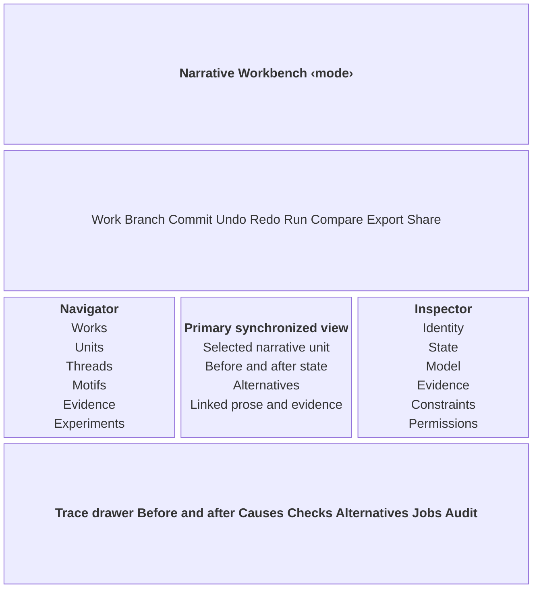

[OBS] The region order and content follow NW ADD v1.1 Figure 16 and Table 30, pp.53-54. [PRE] Exact dimensions and breakpoints are introduced by this specification.

## 6 Shared components

Screens in Section 8 compose these stable component IDs. A screen may set content and placement, but it MUST NOT redefine a component's roles, states, keyboard contract, or source provenance.

### CMP-01 Application shell

**Role.** [PRE] `application` landmark containing named regions; native desktop implementations map to the platform application role.

**Box.** [PRE] `display:grid; grid-template-rows:{dimension.role.global-bar-height} {dimension.role.command-bar-height} minmax(0,1fr) auto; box-sizing:border-box`; the content row contains the responsive region grid in Section 5.

**Type.** [PRE] `{typography.role.body}` with `{color.role.text-primary}` on `{color.role.surface-canvas}`.

**Content.** [OBS] Persistent mode, work, branch, commit, synchronization, job, authority, and provenance context. Source: v1.1 pp.53-54.

**States.**

| **State**  | **Change from default**                                                                                        |
|------------|----------------------------------------------------------------------------------------------------------------|
| default    | [PRE] All five wide-screen regions visible.                                                                  |
| rebuilding | [OBS] Retain prior content, show projection version and busy state; selection identity remains stable.       |
| offline    | [PRE] Show visible offline reason and disable commands that require remote providers.                        |
| error      | [PRE] Keep navigation available and expose recovery in the trace drawer.                                     |
| narrow     | [OBS] Replace navigator, primary view, inspector, and trace with explicit tabs while keeping context labels. |

**Behaviour.** [OBS] `ready --viewportCrossesBreakpoint / preserveContextAndReflow--> ready`; reflow MUST NOT change canonical state. Source: v1.1 p.58.

**Keyboard.** [OBS] Focus order is global bar, navigator, primary view, inspector, trace drawer. [PRE] `F6` cycles regions; `Shift+F6` reverses.

**Accept.**

```gherkin
@pre
Scenario: shell focus order
  Given the wide shell is ready
  When the user presses F6 four times
  Then focus visits Navigator, Primary view, Inspector, and Trace drawer in that order without changing `selectedId`

@pre
Scenario: offline shell keeps local work
  Given the remote model provider is unreachable
  When the shell enters the offline state
  Then visible text names the offline reason, commands that need remote providers expose `aria-disabled=true` with that reason, and Navigator remains operable

@pre
Scenario: shell error keeps navigation
  Given a projection request fails
  When the shell enters the error state
  Then Navigator remains operable and the Trace drawer exposes a recovery action for the failed request
```

*State coverage (part of Accept):*

| **State** | **Covered by** |
|---|---|
| default | Deferred: visual only; verified by §10 checks 2 and 3 |
| rebuilding | Screen 1: projection lag is explicit |
| offline | Scenario: offline shell keeps local work |
| error | Scenario: shell error keeps navigation |
| narrow | Screen 1: narrow responsive transformation |

**Source.** [OBS] v1.1 §25.1, pp.53-54, and §25.5, p.58. [PRE] Exact tracks and F6 command.

### CMP-02 Global context bar

**Role.** [PRE] `banner` with a labeled `toolbar` for context and status controls.

**Box.** [PRE] `display:flex; min-width:0; height:{dimension.role.global-bar-height}; padding:0 {dimension.role.space-region}; gap:{dimension.role.space-stack}; align-items:center`.

**Type.** [PRE] Title uses `{typography.role.app-title}` and `{color.role.text-on-strong}` on `{color.role.surface-strong}`.

**Content.** [OBS] ‹work›, ‹branch›, ‹commit›, ‹mode›, ‹sync state›, ‹job state›, and ‹authority state›. Source: v1.1 pp.53-54.

**States.**

| **State**  | **Change from default**                                                                              |
|------------|------------------------------------------------------------------------------------------------------|
| clean      | [PRE] Show “Committed” with commit identifier.                                                     |
| dirty      | [OBS] Show provisional status; do not imply persistence.                                           |
| validating | [OBS] Show validation state and job provenance.                                                    |
| conflict   | [OBS] Show a text label and icon; color alone is insufficient.                                     |
| overflow   | [PRE] Preserve mode, branch, commit, and authority; move lower-priority actions to “More actions”. |
| focus-visible | [PRE] Controls on `{color.role.surface-strong}` use a `{dimension.role.focus-width}` `{color.role.focus-ring-on-strong}` ring with `{dimension.role.focus-offset}` offset. |

**Behaviour.** [OBS] Context selections synchronize other regions without mutating canonical narrative state.

**Keyboard.** [PRE] Toolbar uses roving `tabindex`; Left and Right Arrow move between actions; Enter or Space invokes.

**Accept.**

```gherkin
@pre
Scenario: context remains visible
  Given a proposal is dirty
  When the primary view selection changes
  Then the bar continues to expose the same work, branch, commit, mode, and “Provisional” state

Scenario: validating state shows job provenance
  Given a submitted proposal is being validated
  When the global context bar renders
  Then it shows the validation state in text and names the validation job and its provenance

Scenario: conflict is not color-only
  Given the parent commit changed after the proposal was accepted
  When the bar enters the conflict state
  Then a text label and an icon name the conflict, and both remain perceivable with color removed
```

*State coverage (part of Accept):*

| **State** | **Covered by** |
|---|---|
| clean | Deferred: visual only; verified by §10 checks 2 and 3 |
| dirty | Scenario: context remains visible |
| validating | Scenario: validating state shows job provenance |
| conflict | Scenario: conflict is not color-only |
| overflow | Deferred: visual only; verified by §10 checks 2 and 3 |
| focus-visible | Deferred: visual only; verified by §10 checks 2 and 3 |

**Source.** [OBS] v1.1 §25.1 and Table 30, pp.53-54. [PRE] Toolbar semantics and overflow.

### CMP-03 Command bar

**Role.** [PRE] `toolbar` named “Workbench commands”.

**Box.** [PRE] `display:flex; height:{dimension.role.command-bar-height}; padding:0 {dimension.role.space-stack}; gap:{dimension.role.space-tight}; border-bottom:{dimension.role.separator-width} solid {color.role.border-default}`.

**Type.** [PRE] `{typography.role.label}` and `{color.role.text-primary}`.

**Content.** [OBS] “Work”, “Branch”, “Commit”, “Undo”, “Redo”, “Run”, “Compare”, “Export”, and “Share”. Source: v1.1 Figures 16-19, pp.53, 55-57.

**States.**

| **State**     | **Change from default**                                                                                                 |
|---------------|-------------------------------------------------------------------------------------------------------------------------|
| default       | [PRE] Commands available according to mode and authority.                                                             |
| hover         | [PRE] Use `{color.role.surface-subtle}`.                                                                            |
| focus-visible | [PRE] `{dimension.role.focus-width}` `{color.role.focus-ring}` with `{dimension.role.focus-offset}` offset.          |
| disabled      | [PRE] Keep command focusable only when needed to expose the visible reason; otherwise pair with adjacent reason text. |
| running       | [OBS] “Run” reports queued, running, partial, failed, cancelled, or complete.                                         |

**Behaviour.** [OBS] Undo edits a draft proposal; rewind after commit moves or creates a branch pointer. Source: v1.1 p.58.

**Keyboard.** [PRE] APG toolbar pattern; `Ctrl/Cmd+Z` applies only to the current draft; `Ctrl/Cmd+Shift+P` opens command search.

**Accept.**

```gherkin
@pre
Scenario: disabled command explains why
  Given the actor lacks commit authority
  When focus reaches Commit
  Then the control exposes `aria-disabled=true` and visible text “Commit requires narrative designer authority”

Scenario: Run reports job lifecycle
  Given a simulation job was started from Run
  When jobState moves from `queued` to `running` to `complete`
  Then the Run command reports each state in text as it happens
```

*State coverage (part of Accept):*

| **State** | **Covered by** |
|---|---|
| default | Deferred: visual only; verified by §10 checks 2 and 3 |
| hover | Deferred: visual only; verified by §10 checks 2 and 3 |
| focus-visible | Deferred: visual only; verified by §10 checks 2 and 3 |
| disabled | Scenario: disabled command explains why |
| running | Scenario: Run reports job lifecycle |

**Source.** [OBS] v1.1 Figures 16-19 and Table 34. [PRE] Shortcuts and disabled-reason presentation.

### CMP-04 Navigator

**Role.** [PRE] `navigation` containing an APG `tree` for units, threads, motifs, evidence sets, experiments, and saved views.

**Box.** [PRE] Wide track `{dimension.role.navigator-wide}`; `display:flex; flex-direction:column; min-width:0; overflow:auto; border-right:{dimension.role.separator-width} solid {color.role.border-default}`.

**Type.** [PRE] `{typography.role.body}`; selected row uses `{color.role.surface-selection}` and `{color.role.text-primary}`.

**Content.** [OBS] Scope varies by mode: architecture hierarchy, frozen source outline, or experiments and lineage. Source: v1.1 pp.54-57.

**States.**

| **State**        | **Change from default**                                                                  |
|------------------|------------------------------------------------------------------------------------------|
| empty            | [PRE] Show a mode-specific explanation and permitted creation/import action.           |
| loading          | [PRE] Preserve expanded nodes and mark the tree `aria-busy=true`.                    |
| selected         | [OBS] Selection updates synchronized projections but does not mutate narrative state.  |
| broken-reference | [OBS] Name the unresolved item and provide realignment when an evidence anchor breaks. |
| overflow         | [PRE] Ellipsize labels visually; full value remains in accessible name and tooltip.    |

**Behaviour.** [OBS] `selection --chooseNode / setSelectedId; rebuildProjections--> selection`.

**Keyboard.** [PRE] APG tree pattern: Arrow keys navigate, Right expands, Left collapses, Home/End move to first/last visible node, type-ahead searches.

**Accept.**

```gherkin
@pre
Scenario: navigator selection is non-mutating
  Given commitId is `c42`
  When the user selects a scene node
  Then selectedId changes and every rebuilt view continues to label commit `c42`

@pre
Scenario: empty navigator offers the next action
  Given mode is Composition Studio and the work has no units
  When the Navigator renders
  Then it shows a mode-specific explanation and the permitted creation or import action

@pre
Scenario: loading keeps expanded nodes
  Given two tree nodes are expanded
  When the Navigator reloads
  Then the tree has `aria-busy=true` while loading and both nodes are still expanded when loading ends
```

*State coverage (part of Accept):*

| **State** | **Covered by** |
|---|---|
| empty | Scenario: empty navigator offers the next action |
| loading | Scenario: loading keeps expanded nodes |
| selected | Scenario: navigator selection is non-mutating |
| broken-reference | Screen 3: broken anchor prevents publication |
| overflow | Deferred: visual only; verified by §10 checks 2 and 3 |

**Source.** [OBS] v1.1 Table 30 and Figures 17-19, pp.54-57. [PRE] Tree semantics and overflow.

### CMP-05 Primary synchronized view

**Role.** [PRE] Named `main` region containing one mode-specific view and a non-spatial list or table equivalent.

**Box.** [PRE] `min-width:0; overflow:auto; padding:{dimension.role.space-region}`; flexible wide-screen track `minmax({dimension.role.primary-min},1fr)`.

**Type.** [PRE] `{typography.role.body}`; headers use `{typography.role.pane-header}`.

**Content.** [OBS] Table, graph, timeline, architecture, prose, evidence, or comparison projection over the same selected context. Source: v1.1 pp.22, 53-54.

**States.**

| **State**  | **Change from default**                                                              |
|------------|--------------------------------------------------------------------------------------|
| ready      | [PRE] Label commit and projection version.                                         |
| rebuilding | [OBS] Views may lag; show represented commit and projection version.               |
| empty      | [PRE] Explain which scope or filter produced no items.                             |
| partial    | [OBS] Partial job output MUST NOT appear committed.                                |
| error      | [PRE] Keep last valid projection visible when safe and name the failed projection. |

**Behaviour.** [OBS] Direct manipulation creates a proposal preview; it does not commit immediately.

**Keyboard.** [OBS] Every spatial action has a named keyboard command and non-spatial equivalent. [PRE] `Ctrl/Cmd+1` focuses the primary view.

**Accept.**

```gherkin
@pre
Scenario: direct manipulation opens preview
  Given the user may propose changes
  When the user connects two narrative objects
  Then proposalState becomes `draft`, canonicalCommitId is unchanged, and CMP-09 opens

@pre
Scenario: empty projection names its filter
  Given the active filter matches no items
  When the primary view renders
  Then visible text names the scope or filter that produced no items

Scenario: partial projection is not committed
  Given a long job has returned partial output
  When the primary view renders that output
  Then the output is labelled “Partial” and no Accepted or Committed state is shown

@pre
Scenario: failed rebuild keeps the last valid projection
  Given a valid projection is shown and its rebuild fails
  When the primary view enters the error state
  Then the last valid projection stays visible with its commit and projection version, and visible text names the failed projection
```

*State coverage (part of Accept):*

| **State** | **Covered by** |
|---|---|
| ready | Deferred: visual only; verified by §10 checks 2 and 3 |
| rebuilding | Screen 1: projection lag is explicit |
| empty | Scenario: empty projection names its filter |
| partial | Scenario: partial projection is not committed |
| error | Scenario: failed rebuild keeps the last valid projection |

**Source.** [OBS] v1.1 Table 30 p.54 and Table 34 p.58. [PRE] Track size and shortcut.

### CMP-06 Inspector

**Role.** [PRE] `complementary` region named “Inspector” with native controls grouped by concept.

**Box.** [PRE] Wide track `{dimension.role.inspector-wide}`; `overflow:auto; padding:{dimension.role.space-stack}; border-left:{dimension.role.separator-width} solid {color.role.border-default}`. Medium view uses a resizable modeless drawer that opens at `min({dimension.role.inspector-drawer}, 90vw)`.

**Type.** [PRE] `{typography.role.body}` with `{typography.role.label}` field labels.

**Content.** [OBS] Identity, state, model, evidence, constraints, alternatives, permissions, and provenance labels; mode-specific fields follow Figures 17-19.

**States.**

| **State**        | **Change from default**                                                                                      |
|------------------|--------------------------------------------------------------------------------------------------------------|
| nothing-selected | [PRE] Show “Select an item to inspect” and no editable fields.                                             |
| read-only        | [OBS] Source evidence stays immutable and the reason is visible.                                           |
| editable         | [OBS] Only fields permitted by mode and authority allow proposal creation.                                 |
| validation-error | [PRE] Inline message names field, failed rule, and recovery.                                               |
| drawer           | [OBS] On medium screens, focus moves to the drawer heading when opened and returns to invoker when closed. |

**Behaviour.** [OBS] Edit, assert, challenge, accept, reject, or branch actions create explicit proposals governed by authority.

**Keyboard.** [PRE] Tab follows visual order; `Esc` closes drawer and restores focus; field groups use native keyboard behavior.

**Accept.**

```gherkin
@pre
Scenario: source field remains immutable
  Given mode is Criticism Parlor and a source span is selected
  When the user opens Inspector
  Then source text controls expose read-only state and visible text “Fingerprint source edition cannot be edited”

@pre
Scenario: nothing selected
  Given no item is selected
  When the Inspector renders
  Then visible text reads “Select an item to inspect” and no editable fields are present

Scenario: editing creates a proposal
  Given the actor may propose changes to the selected object
  When the user edits a permitted field
  Then proposalState becomes `draft`, canonicalCommitId is unchanged, and fields outside the actor's authority stay read-only

@pre
Scenario: inline validation error
  Given an Inspector field value breaks a hard rule
  When focus leaves the field
  Then an inline message names the field, the failed rule, and a recovery step

Scenario: medium-screen drawer manages focus
  Given the viewport is 1024px wide
  When the user opens the Inspector drawer and then presses Escape
  Then focus moves to the drawer heading on open and returns to the invoking control on close
```

*State coverage (part of Accept):*

| **State** | **Covered by** |
|---|---|
| nothing-selected | Scenario: nothing selected |
| read-only | Scenario: source field remains immutable |
| editable | Scenario: editing creates a proposal |
| validation-error | Scenario: inline validation error |
| drawer | Scenario: medium-screen drawer manages focus |

**Source.** [OBS] v1.1 Table 30 p.54, Figures 17-19 pp.55-57, and Table 34 p.58. [PRE] Exact width and empty copy.

### CMP-07 Trace and validation drawer

**Role.** [PRE] `region` with disclosure control; content uses `tablist` for Trace, Validation, Jobs, and Provenance.

**Box.** [PRE] Default open height `{dimension.role.trace-default}`; user-resizable from `{dimension.role.trace-min}` to `{dimension.role.trace-max-viewport-ratio}` of viewport height; `border-top:{dimension.role.separator-width} solid {color.role.border-strong}`.

**Type.** [PRE] `{typography.role.data}` for identifiers and trace values; `{typography.role.body}` elsewhere.

**Content.** [OBS] Before/after state, causes, checks, alternatives, jobs, and audit/provenance. Source: v1.1 pp.53-54.

**States.**

| **State**         | **Change from default**                                              |
|-------------------|----------------------------------------------------------------------|
| closed            | [PRE] Disclosure button exposes count and highest-severity status. |
| open              | [OBS] Focus moves to its heading.                                  |
| validation-failed | [OBS] Name violation, rule, scope, and alternatives.               |
| job-running       | [OBS] Show lifecycle and provenance.                               |
| empty             | [PRE] Show “No trace entries for the current selection”.           |

**Behaviour.** [OBS] Step, rewind, inspect, retry, and explain. Rewind moves or creates a branch pointer and MUST NOT delete accepted history.

**Keyboard.** [PRE] `Ctrl/Cmd+J` toggles; APG tabs; `Esc` closes and returns focus.

**Accept.**

```gherkin
@pre
Scenario: drawer restores focus
  Given the drawer was opened from Validation
  When the user presses Escape
  Then the drawer closes and focus returns to the Validation disclosure control

Scenario: validation failure is explained
  Given validation of the current proposal failed
  When the user opens the Validation tab
  Then it names the violation, rule, scope, and alternatives

Scenario: running job shows lifecycle
  Given a simulation job is running
  When the user opens the Jobs tab
  Then it shows the job's lifecycle state and provenance

@pre
Scenario: empty trace
  Given the current selection has no trace entries
  When the Trace tab renders
  Then visible text reads “No trace entries for the current selection”
```

*State coverage (part of Accept):*

| **State** | **Covered by** |
|---|---|
| closed | Deferred: visual only; verified by §10 checks 2 and 3 |
| open | Scenario: drawer restores focus |
| validation-failed | Scenario: validation failure is explained |
| job-running | Scenario: running job shows lifecycle |
| empty | Scenario: empty trace |

**Source.** [OBS] v1.1 Table 30 p.54 and Table 34 p.58. [PRE] Tabs, dimensions, and shortcut.

### CMP-08 Provenance and lifecycle badge

**Role.** [PRE] Status text with icon; where interactive, a `button` opens provenance details.

**Box.** [PRE] `display:inline-flex; min-height:{dimension.role.badge-height}; padding:{dimension.role.badge-padding-block} {dimension.role.space-inline}; gap:{dimension.role.space-tight}; border-radius:{radius.role.control}`.

**Type.** [PRE] `{typography.role.label}` and status-specific role tokens.

**Content.** [OBS] Labels distinguish source, human assertion, machine proposal, derived projection, validated result, and accepted state.

**States.**

| **State** | **Change from default**                                 |
|-----------|---------------------------------------------------------|
| source    | [OBS] Text “Source” plus source icon.                 |
| human     | [OBS] Text “Human proposal” plus proposer.            |
| machine   | [OBS] Text “Machine proposal” and generator metadata. |
| validated | [OBS] Text “Validated” without implying acceptance.   |
| accepted  | [OBS] Text “Accepted” and authority record.           |
| broken    | [OBS] Text “Broken anchor” and blocking status.       |

**Behaviour.** [PRE] Activating an interactive badge opens the Provenance tab of CMP-07 for the same stable identity.

**Keyboard.** [PRE] Interactive badges use native button behavior; noninteractive badges are skipped in tab order.

**Accept.**

```gherkin
@pre
Scenario: color-independent lifecycle
  Given a machine proposal is shown
  When color is removed
  Then the visible text still reads “Machine proposal” and an icon plus accessible label communicates the same state

Scenario: human proposal names its proposer
  Given a proposal authored by a person
  When its badge renders
  Then the text reads “Human proposal” and names the proposer

Scenario: validated is not accepted
  Given a proposal has passed validation but has not been approved
  When its badge renders
  Then the text reads “Validated” and no “Accepted” text is present

Scenario: accepted badge shows authority
  Given a proposal has been approved
  When its badge renders
  Then the text reads “Accepted” and the badge exposes the authority record
```

*State coverage (part of Accept):*

| **State** | **Covered by** |
|---|---|
| source | Deferred: visual only; verified by §10 checks 2 and 3 |
| human | Scenario: human proposal names its proposer |
| machine | Scenario: color-independent lifecycle |
| validated | Scenario: validated is not accepted |
| accepted | Scenario: accepted badge shows authority |
| broken | Screen 3: broken anchor prevents publication |

**Source.** [OBS] v1.1 §14.3 p.22, §25 p.53, Table 32 p.56, and Table 34 p.58. [PRE] Exact badge geometry.

### CMP-09 Proposal preview

**Role.** [PRE] Modal `dialog` named “Review proposed change” with initial focus on the heading.

**Box.** [PRE] `width:min({dimension.role.dialog-width},calc(100vw - {dimension.role.space-section})); max-height:calc(100vh - {dimension.role.dialog-inset}); overflow:auto; padding:{dimension.role.space-loose}`.

**Type.** [PRE] `{typography.role.body}`; changes use explicit added, removed, changed, and invariant labels.

**Content.** [OBS] Proposed delta, affected models, hard checks, soft goals, authority requirement, uncertainty, and alternatives before commit.

**States.**

| **State**         | **Change from default**                                                    |
|-------------------|----------------------------------------------------------------------------|
| draft             | [OBS] Editable proposal, not frozen.                                     |
| validating        | [OBS] Controls show deterministic validation in progress.                |
| rejected          | [OBS] Mutation blocked; show rule, scope, explanation, and alternatives. |
| awaiting-approval | [OBS] Show required authority and reviewer action.                       |
| accepted          | [OBS] Acceptance remains distinct from persistence.                      |
| committing        | [PRE] Prevent duplicate submission and show parent commit.               |

**Behaviour.** [OBS] `draft --submit [schemaComplete] / freeze--> validating`; `validating --hardFail--> rejected`; `validating --checksPass--> awaitingApproval`; `awaitingApproval --approve [authorized]--> accepted`; `accepted --commit [parentUnchangedOrResolved]--> committing`; `committing --persistSucceeded--> committed`; `committing --persistFailed--> accepted`.

**Keyboard.** [PRE] APG modal dialog pattern; Tab is trapped; Escape cancels only before acceptance; focus returns to invoking control.

**Accept.**

```gherkin
@pre
Scenario: acceptance does not imply commit
  Given proposalState is `awaitingApproval` and the actor is authorized
  When the actor chooses Accept
  Then proposalState becomes `accepted` while canonicalCommitId remains unchanged until Commit completes

Scenario: draft stays editable
  Given a draft proposal is open in the preview
  When the user edits the delta
  Then the edit is applied and the proposal is not frozen

Scenario: validation in progress
  Given a proposal has been submitted
  When deterministic validation is running
  Then the dialog controls show that validation is in progress

Scenario: approval names required authority
  Given validation passed and approval is required
  When the preview renders
  Then it names the required authority and the reviewer action

@pre
Scenario: committing blocks duplicate submission
  Given an accepted proposal whose parent commit is unchanged
  When the user requests Commit
  Then proposalState is `committing`, the Commit control is disabled with a visible reason, and the parent commit is shown
  And proposalState becomes `committed` only after persistSucceeded
```

*State coverage (part of Accept):*

| **State** | **Covered by** |
|---|---|
| draft | Scenario: draft stays editable |
| validating | Scenario: validation in progress |
| rejected | Screen 5: hard validation failure |
| awaiting-approval | Scenario: approval names required authority |
| accepted | Scenario: acceptance does not imply commit |
| committing | Scenario: committing blocks duplicate submission |

**Source.** [OBS] v1.1 Figure 10 and Table 26 p.45 plus Table 34 p.58. [PRE] Dialog geometry and focus trap.

### CMP-10 Narrative object and relationship canvas

**Role.** [PRE] Composite `group` with keyboard-operable object list, relation list, and optional spatial canvas marked as a synchronized projection.

**Box.** [PRE] Canvas fills CMP-05; object cards have minimum width `{dimension.role.card-min}`, padding `{dimension.role.space-stack}`, and gaps `{dimension.role.space-inline}`. Non-spatial list is always available.

**Type.** [PRE] `{typography.role.body}`; object kind and model state use `{typography.role.label}`.

**Content.** [OBS] Actors, objects, relationships, inciting event/formal disturbance, and candidate trajectories. Source: v1.1 p.55 and NSM pp.12-15.

**States.**

| **State**   | **Change from default**                                                                      |
|-------------|----------------------------------------------------------------------------------------------|
| default     | [PRE] Card exposes stable identity and type.                                               |
| selected    | [OBS] Synchronized selection highlights corresponding models, events, prose, and evidence. |
| provisional | [OBS] Show proposal badge and affected constraints.                                        |
| invalid     | [PRE] Name failed invariant in text.                                                       |
| overflow    | [PRE] Semantic zoom clusters objects; outline and search preserve access.                  |

**Behaviour.** [OBS] Place/connect creates a provisional object or typed relation; inject disturbance generates candidate changes; no commit occurs until acceptance.

**Keyboard.** [OBS] Named keyboard command and non-spatial alternative for place and connect. [PRE] `Shift+F10` opens object actions; Connect command chooses source then target from searchable lists.

**Accept.**

```gherkin
@pre
Scenario: canvas action has list equivalent
  Given focus is on a narrative object
  When the user invokes Connect from the keyboard
  Then a searchable target list opens and completing it creates a draft proposal without changing canonicalCommitId

Scenario: provisional object shows its constraints
  Given the user placed a new object that is not yet accepted
  When the canvas renders it
  Then the card shows a proposal badge and lists the affected constraints

@pre
Scenario: invalid relation names the invariant
  Given a relation breaks an invariant
  When the canvas validates it
  Then the card names the failed invariant in text
```

*State coverage (part of Accept):*

| **State** | **Covered by** |
|---|---|
| default | Deferred: visual only; verified by §10 checks 2 and 3 |
| selected | Deferred: visual only; verified by §10 checks 2 and 3 |
| provisional | Scenario: provisional object shows its constraints |
| invalid | Scenario: invalid relation names the invariant |
| overflow | Deferred: visual only; verified by §10 checks 2 and 3 |

**Source.** [OBS] v1.1 Figure 17 and Table 31 p.55; NSM pp.12-15. [PRE] Card dimensions and command details.

### CMP-11 Candidate trajectory tray

**Role.** [PRE] `listbox` of trajectory `option` records with a comparison `table` alternative.

**Box.** [PRE] `display:flex; flex-direction:column; gap:{dimension.role.space-inline}`; each option uses `padding:{dimension.role.space-stack}; border:{dimension.role.separator-width} solid {color.role.border-control}`.

**Type.** [PRE] `{typography.role.body}` plus `{typography.role.data}` for transition identifiers.

**Content.** [OBS] Candidate A/B/C shape, changed states, propagation frontier, before/after trace, rejected alternatives, and actions “Accept”, “Revise”, “Forbid”, “Branch”.

**States.**

| **State** | **Change from default**                                       |
|-----------|---------------------------------------------------------------|
| loading   | [PRE] Mark list `aria-busy=true` and expose job state.    |
| available | [OBS] Show candidates without implying validation.          |
| validated | [OBS] Show hard-check result and warnings.                  |
| selected  | [PRE] `aria-selected=true`; selection updates trace only. |
| accepted  | [OBS] Show accepted authority but wait for commit.          |
| empty     | [PRE] Explain failed constraints or missing disturbance.    |

**Behaviour.** [OBS] Accept produces an explicit authority decision; Revise returns an editable successor; Forbid creates a constraint proposal; Branch creates a new lineage.

**Keyboard.** [PRE] APG listbox pattern; Up/Down select, Enter inspects, action buttons remain reachable by Tab.

**Accept.**

```gherkin
@pre
Scenario: trajectory selection is reversible
  Given three candidates are available
  When the user selects Trajectory B
  Then `candidateId` becomes B and trace updates while proposalState and canonicalCommitId remain unchanged

@pre
Scenario: generation in progress
  Given trajectory generation is running
  When the tray renders
  Then the list has `aria-busy=true` and shows the job state

@pre
Scenario: no candidates explains why
  Given no inciting event or formal disturbance is defined
  When the tray renders
  Then visible text explains the missing disturbance and no candidates are listed
```

*State coverage (part of Accept):*

| **State** | **Covered by** |
|---|---|
| loading | Scenario: generation in progress |
| available | Scenario: trajectory selection is reversible |
| validated | Screen 2: generate and accept a trajectory |
| selected | Scenario: trajectory selection is reversible |
| accepted | Screen 2: generate and accept a trajectory |
| empty | Scenario: no candidates explains why |

**Source.** [OBS] v1.1 Figure 17 and Table 31 p.55; proposal lifecycle p.45. [PRE] Listbox pattern.

### CMP-12 Evidence span

**Role.** [PRE] Read-only `article` or `row` with linkable edition and region metadata.

**Box.** [PRE] `padding:{dimension.role.space-stack}; border:{dimension.role.separator-width} solid {color.role.border-control}; border-radius:{radius.role.control}`; source text is selectable but not editable.

**Type.** [PRE] `{typography.role.body}`; identifiers use `{typography.role.data}`.

**Content.** [OBS] Immutable passage/image, edition identifier, page or region anchor, fingerprint, and source icon.

**States.**

| **State** | **Change from default**                                                     |
|-----------|-----------------------------------------------------------------------------|
| resolved  | [OBS] Anchor opens the exact source region.                               |
| selected  | [OBS] Supporting and contradicting assertions synchronize.                |
| broken    | [OBS] Label “Broken anchor”, block publication, and offer realignment.    |
| loading   | [PRE] Preserve anchor metadata while content loads.                       |
| error     | [PRE] Name retrieval failure without converting it into missing evidence. |

**Behaviour.** [OBS] Selecting evidence updates claims and models; source content never accepts mutation in criticism mode.

**Keyboard.** [PRE] Enter opens the source region; `Shift+F10` opens permitted citation and realignment actions.

**Accept.**

```gherkin
@pre
Scenario: broken anchor blocks publication
  Given an evidence anchor no longer resolves
  When the branch enters review
  Then the span shows “Broken anchor”, publicationStatus is `blocked`, and a “Realign anchor” action is present

@pre
Scenario: anchor metadata shows while loading
  Given an evidence span's source content is loading
  When the span renders
  Then the edition identifier, anchor, and fingerprint are visible before the content arrives

@pre
Scenario: retrieval failure is not missing evidence
  Given the source region cannot be retrieved
  When the span renders
  Then visible text names the retrieval failure and the span is not labelled “Broken anchor”
```

*State coverage (part of Accept):*

| **State** | **Covered by** |
|---|---|
| resolved | Deferred: visual only; verified by §10 checks 2 and 3 |
| selected | Deferred: visual only; verified by §10 checks 2 and 3 |
| broken | Scenario: broken anchor blocks publication |
| loading | Scenario: anchor metadata shows while loading |
| error | Scenario: retrieval failure is not missing evidence |

**Source.** [OBS] v1.1 Table 32 p.56 and criticism sequence p.48. [PRE] Geometry and keys.

### CMP-13 Interpretive assertion card

**Role.** [PRE] `article` grouped by assertion kind; competing assertions may be presented as `list` items.

**Box.** [PRE] `padding:{dimension.role.space-stack}; gap:{dimension.role.space-inline}; border-left:{dimension.role.accent-border-width} solid {color.role.border-strong}`; border color is redundant with kind text and icon.

**Type.** [PRE] `{typography.role.body}` with `{typography.role.label}` metadata.

**Content.** [OBS] Kind “Observation”, “Finding”, or “Claim”; proposer, acceptance state, evidence coverage, uncertainty, lens, support, contradiction, and branch identity as applicable.

**States.**

| **State**        | **Change from default**                                            |
|------------------|--------------------------------------------------------------------|
| machine-proposed | [OBS] Label generator and proposal state.                        |
| human-proposed   | [OBS] Label proposer.                                            |
| validated        | [OBS] Show link and classification checks.                       |
| contested        | [OBS] Show supporting and contradicting evidence.                |
| accepted         | [OBS] Show branch and authority; do not relabel as source fact.  |
| overflow         | [PRE] Collapse evidence list after three items with exact count. |

**Behaviour.** [OBS] Accepting an assertion commits it to an interpretation branch after validation; it never alters the frozen edition.

**Keyboard.** [PRE] Card actions use native buttons; `E` opens evidence list only when focus is within the card and no text field is active.

**Accept.**

```gherkin
@pre
Scenario: accepted claim stays interpretive
  Given a claim has been accepted
  When the card renders
  Then it shows kind “Claim”, its interpretation branch, and an Accepted badge without a Source badge

Scenario: machine-proposed claim names its generator
  Given a claim proposed through the AI gateway
  When the card renders
  Then it labels the generator and the proposal state

Scenario: human-proposed claim names its proposer
  Given a claim proposed by a critic
  When the card renders
  Then it labels the proposer

Scenario: validated claim shows its checks
  Given a claim's evidence links passed validation
  When the card renders
  Then it shows the link and classification check results

Scenario: contested claim shows both sides
  Given a claim has supporting and contradicting evidence
  When the card renders
  Then it shows the supporting evidence and the contradicting evidence
```

*State coverage (part of Accept):*

| **State** | **Covered by** |
|---|---|
| machine-proposed | Scenario: machine-proposed claim names its generator |
| human-proposed | Scenario: human-proposed claim names its proposer |
| validated | Scenario: validated claim shows its checks |
| contested | Scenario: contested claim shows both sides |
| accepted | Scenario: accepted claim stays interpretive |
| overflow | Deferred: visual only; verified by §10 checks 2 and 3 |

**Source.** [OBS] v1.1 Figure 18 and Table 32 p.56; criticism sequence p.48. [PRE] Card geometry and shortcut.

### CMP-14 Counterfactual comparison matrix

**Role.** [PRE] Accessible `table` with row headers for dimensions and column headers for Baseline, Intervention, Deterministic effects, Generated hypotheses, and Invariants.

**Box.** [PRE] `width:100%; border-collapse:collapse`; sticky row/column headers; cells use `padding:{dimension.role.space-inline} {dimension.role.space-stack}`.

**Type.** [PRE] `{typography.role.body}`; identifiers and values use `{typography.role.data}`.

**Content.** [OBS] World, epistemic, affective, structural, formal, reader model, and provenance dimensions.

**States.**

| **State**  | **Change from default**                                                    |
|------------|----------------------------------------------------------------------------|
| ready      | [OBS] Separate deterministic consequences from generated hypotheses.     |
| changed    | [OBS] Label Added, Removed, Changed, or Invariant; do not rely on color. |
| unresolved | [OBS] Name unmet control or constraint.                                  |
| partial    | [OBS] Mark incomplete job output and never show it as committed.         |
| empty      | [PRE] Explain that no intervention has been declared.                    |
| overflow   | [PRE] Allow horizontal table scroll while keeping first column visible.  |

**Behaviour.** [OBS] Changing an intervention creates or updates an experiment proposal; preserved variables define simulation controls.

**Keyboard.** [PRE] APG grid navigation is not used for static results; normal table reading order applies. Editable controls sit outside the table in Inspector.

**Accept.**

```gherkin
@pre
Scenario: hypothesis is distinct from consequence
  Given a comparison completes with both kinds of output
  When the matrix renders
  Then every result is placed under either “Deterministic effects” or “Generated hypotheses” and provenance remains visible

Scenario: unmet control is named
  Given a preserved variable could not be held constant
  When the matrix renders
  Then the affected row names the unmet control or constraint

Scenario: partial comparison is marked
  Given the comparison job returned partial output
  When the matrix renders
  Then the incomplete output is marked as partial and no committed state is shown

@pre
Scenario: no intervention declared
  Given no intervention has been declared
  When the matrix renders
  Then visible text explains that no intervention has been declared
```

*State coverage (part of Accept):*

| **State** | **Covered by** |
|---|---|
| ready | Scenario: hypothesis is distinct from consequence |
| changed | Deferred: visual only; verified by §10 checks 2 and 3 |
| unresolved | Scenario: unmet control is named |
| partial | Scenario: partial comparison is marked |
| empty | Scenario: no intervention declared |
| overflow | Deferred: visual only; verified by §10 checks 2 and 3 |

**Source.** [OBS] v1.1 Figure 19 and Table 33 pp.57-58. [PRE] Exact columns and sticky behavior.

### CMP-15 Long job status

**Role.** [PRE] `status` for nonblocking updates and `alert` only for actionable failure; progress uses native `progressbar` semantics when determinate.

**Box.** [PRE] Inline compact status in Global bar; full job record in CMP-07 Jobs tab.

**Type.** [PRE] `{typography.role.label}` and status role tokens.

**Content.** [OBS] Extraction, simulation, realization, or comparison; queued, running, partial, failed, cancelled, or complete; retry and provenance.

**States.**

| **State** | **Change from default**                                                             |
|-----------|-------------------------------------------------------------------------------------|
| queued    | [OBS] Label “Queued”.                                                             |
| running   | [OBS] Label “Running”; show measured progress only when event source provides it. |
| partial   | [OBS] Label “Partial”; output remains uncommitted.                                |
| failed    | [OBS] Label “Failed”, reason, retry eligibility, and provenance.                  |
| cancelled | [OBS] Label “Cancelled”.                                                          |
| complete  | [OBS] Label “Complete” and resulting projection version.                          |

**Behaviour.** [OBS] State changes come from real job events, never a simulated timer. Retry creates a new job attempt linked to the prior failure.

**Keyboard.** [PRE] Status itself is not focusable; available Cancel, Retry, and Open details controls use native buttons.

**Accept.**

```gherkin
@pre
Scenario: partial output is not committed
  Given jobState is `partial`
  When the result preview renders
  Then it shows “Partial”, has no Accepted badge, and canonicalCommitId is unchanged

Scenario Outline: job status follows real job events
  Given a job receives the `<event>` event
  When the status renders
  Then the status text reads “<label>”

  Examples:
    | event         | label     |
    | enqueue       | Queued    |
    | workerStarted | Running   |
    | cancel        | Cancelled |

Scenario: failed job is actionable
  Given a running job fails
  When the status renders
  Then it reads “Failed” with the reason, retry eligibility, and provenance, and the failure is announced as an alert

Scenario: complete job names its projection
  Given a running job completes
  When the status renders
  Then it reads “Complete” and names the resulting projection version
```

*State coverage (part of Accept):*

| **State** | **Covered by** |
|---|---|
| queued | Scenario Outline: job status follows real job events |
| running | Scenario Outline: job status follows real job events |
| partial | Scenario: partial output is not committed |
| failed | Scenario: failed job is actionable |
| cancelled | Scenario Outline: job status follows real job events |
| complete | Scenario: complete job names its projection |

**Source.** [OBS] v1.1 Table 34 p.58 and §18 AI boundary pp.30-31. [PRE] Live-region policy.

### CMP-16 Semantic conflict resolver

**Role.** [PRE] Modal `dialog` named “Resolve semantic conflict”.

**Box.** [PRE] Same dialog geometry as CMP-09; conflict records use a two-column comparison at wide widths and a stacked layout below `{dimension.role.breakpoint-medium}`.

**Type.** [PRE] `{typography.role.body}`; incompatible identifiers use `{typography.role.data}`.

**Content.** [OBS] Incompatible assertions, scopes, models, commits, reason, and permitted actions “Fork”, “Revise”, “Override with reason”, or “Cancel”.

**States.**

| **State**  | **Change from default**                                        |
|------------|----------------------------------------------------------------|
| unresolved | [OBS] Commit remains blocked.                                |
| forking    | [OBS] New branch preserves both parents and conflict record. |
| revising   | [OBS] Return editable successor proposal.                    |
| override   | [OBS] Require authority and nonempty rationale.              |
| resolved   | [OBS] Record chosen action and actor.                        |
| error      | [PRE] Preserve entered rationale and show failed operation.  |

**Behaviour.** [OBS] `unresolved --chooseFork--> forking`; `unresolved --chooseRevise--> revising`; `unresolved --override [authorized && reasonPresent]--> resolved`; otherwise no transition.

**Keyboard.** [PRE] APG modal dialog; initial focus on conflict heading; destructive/authority action is not the default button.

**Accept.**

```gherkin
@pre
Scenario: override requires a reason
  Given the actor has override authority and the conflict is unresolved
  When the actor invokes Override with an empty reason
  Then conflictState remains `unresolved` and visible text reads “Reason is required”

Scenario: fork preserves both parents
  Given the conflict is unresolved
  When the actor chooses Fork
  Then a new branch is created whose parents include both conflicting commits, the conflict record is attached, and conflictState becomes `resolved` with the chosen action and actor recorded

Scenario: revise returns a successor
  Given the conflict is unresolved
  When the actor chooses Revise
  Then an editable successor proposal opens and the original proposal is unchanged

@pre
Scenario: failed override keeps the reason
  Given the actor entered an override reason
  When the override operation fails
  Then the reason text is preserved and visible text names the failed operation
```

*State coverage (part of Accept):*

| **State** | **Covered by** |
|---|---|
| unresolved | Scenario: override requires a reason |
| forking | Scenario: fork preserves both parents |
| revising | Scenario: revise returns a successor |
| override | Scenario: override requires a reason |
| resolved | Scenario: fork preserves both parents |
| error | Scenario: failed override keeps the reason |

**Source.** [OBS] v1.1 §17.2 p.28 and Table 34 p.58. [PRE] Dialog layout and default focus.

### CMP-17 Responsive region tabs

**Role.** [PRE] APG `tablist` with tabs “Navigator”, “Work”, “Inspector”, and “Trace”.

**Box.** [PRE] Visible below `{dimension.role.breakpoint-medium}`; `height:{dimension.role.control-height}; display:grid; grid-template-columns:repeat(4,minmax(0,1fr))`.

**Type.** [PRE] `{typography.role.label}`; active tab uses strong selection distinct from list-row tint.

**Content.** [OBS] Explicit tabs preserve the four synchronized regions on narrow screens and retain context labels.

**States.**

| **State**     | **Change from default**                                                                                |
|---------------|--------------------------------------------------------------------------------------------------------|
| default       | [PRE] First visit opens Work.                                                                        |
| active        | [PRE] `aria-selected=true` and strong visual selection.                                            |
| focus-visible | [PRE] Focus ring remains distinct from active state; the active tab, which uses strong selection, uses `{color.role.focus-ring-on-strong}`. |
| badge         | [PRE] Trace may show actionable count in text.                                                       |
| overflow      | [PRE] Labels MUST NOT truncate below their accessible names; at 360px labels use `{typography.role.tab-label-narrow}`. |

**Behaviour.** [OBS] Changing tabs changes only the visible region, not the shared selection or commit context.

**Keyboard.** [PRE] APG tabs: Left/Right Arrow move and activate; Home/End first/last; Tab enters active panel.

**Accept.**

```gherkin
@pre
Scenario: narrow tab preserves context
  Given viewport width is 390px and Inspector is active
  When the user activates Trace
  Then Trace is visible and selectedId, branchId, and commitId retain their prior values

@pre
Scenario: first narrow visit opens Work
  Given the user has not used the narrow layout before
  When the viewport narrows to 390px
  Then the Work tab is active and its panel is visible
```

*State coverage (part of Accept):*

| **State** | **Covered by** |
|---|---|
| default | Scenario: first narrow visit opens Work |
| active | Scenario: narrow tab preserves context |
| focus-visible | Deferred: visual only; verified by §10 checks 2 and 3 |
| badge | Deferred: visual only; verified by §10 checks 2 and 3 |
| overflow | Deferred: visual only; verified by §10 checks 2 and 3 |

**Source.** [OBS] v1.1 responsive rule p.58. [PRE] Breakpoint, labels, and tab behavior.

### CMP-18 Pane state message

**Role.** [PRE] `status`, `alert`, or plain explanatory region selected according to urgency.

**Box.** [PRE] `max-width:{dimension.role.message-max}; margin:{dimension.role.space-section} auto; padding:{dimension.role.space-region}`; no decorative card or blocking overlay unless the entire operation is modal.

**Type.** [PRE] `{typography.role.body}` with `{typography.role.pane-header}` title.

**Content.** [PRE] State-specific title, reason, preserved context, primary recovery action, and secondary details link.

**States.**

| **State**     | **Change from default**                                                 |
|---------------|-------------------------------------------------------------------------|
| loading       | [PRE] “Loading ‹projection›” and `aria-busy=true`.                  |
| empty         | [PRE] Explain scope/filter and next permitted action.                 |
| error         | [PRE] Name failed action and whether prior valid content remains.     |
| disabled      | [PRE] Visible reason and condition needed to enable.                  |
| no-permission | [PRE] Name required authority without exposing inaccessible data.     |
| offline       | [PRE] Name unavailable dependency and local capabilities that remain. |

**Behaviour.** [PRE] Retry uses the original validated inputs where safe and records a new attempt; changing scope dismisses obsolete messages.

**Keyboard.** [PRE] Focus moves only for blocking errors or user-invoked drawers/dialogs; passive loading updates do not steal focus.

**Accept.**

```gherkin
@pre
Scenario: empty state names scope
  Given a filter returns zero evidence spans
  When the pane renders its empty state
  Then visible text names the active filter and offers “Clear filter” without reporting an error

@pre
Scenario: loading names the projection
  Given a projection is loading
  When the pane renders
  Then it reads “Loading ‹projection›”, the pane has `aria-busy=true`, and focus does not move

@pre
Scenario: error says whether prior content remains
  Given an action fails while prior content is valid
  When the pane renders its error state
  Then the message names the failed action and states that the prior valid content remains

@pre
Scenario: disabled names the enabling condition
  Given a pane action is unavailable
  When the pane renders its disabled state
  Then the message shows the reason and the condition needed to enable the action

@pre
Scenario: no permission hides the data
  Given the actor lacks read authority for a branch
  When the pane renders its no-permission state
  Then the message names the required authority and shows no content from that branch

@pre
Scenario: offline lists local capabilities
  Given the model provider is unreachable
  When the pane renders its offline state
  Then the message names the unavailable dependency and lists the capabilities that still work locally
```

*State coverage (part of Accept):*

| **State** | **Covered by** |
|---|---|
| loading | Scenario: loading names the projection |
| empty | Scenario: empty state names scope |
| error | Scenario: error says whether prior content remains |
| disabled | Scenario: disabled names the enabling condition |
| no-permission | Scenario: no permission hides the data |
| offline | Scenario: offline lists local capabilities |

**Source.** [PRE] Design-source gap filled for loading, empty, error, disabled, permission, and offline states.

## 7 Global interaction model

[OBS] The global model preserves selection, lineage, authority, provenance, and validation across mode-specific projections. The state variables below are the minimum observable contract; implementation names MAY differ if tests expose equivalent values.

### Application state variables

| **Variable**         | **Type**                                                                                                                             | **Initial** | **Readers**                                    |
|----------------------|--------------------------------------------------------------------------------------------------------------------------------------|-------------|------------------------------------------------|
| mode                 | composition \| criticism \| counterfactual                                                                                           | composition | Global bar, Navigator, Primary view, Inspector |
| workId               | stable identifier \| null                                                                                                            | null        | All regions                                    |
| branchId             | stable identifier \| null                                                                                                            | null        | Global bar, Navigator, Trace                   |
| commitId             | immutable identifier \| null                                                                                                         | null        | All projections                                |
| projectionVersion    | identifier \| null                                                                                                                   | null        | Primary view, Trace                            |
| selectedId           | stable identity \| null                                                                                                              | null        | Navigator, Primary view, Inspector, Trace      |
| selectedKind         | domain kind \| null                                                                                                                  | null        | Inspector and contextual commands              |
| proposalState        | none \| draft \| submitted \| validating \| rejected \| awaitingApproval \| revisionRequested \| accepted \| committing \| committed | none        | Global bar, Proposal preview, Trace            |
| conflictState        | none \| unresolved \| forking \| revising \| resolved \| error | none | Conflict resolver, Global bar |
| inspectorState       | docked \| closed \| open | docked | Inspector, Application shell |
| activeRegionTab      | navigator \| work \| inspector \| trace \| null | null | Responsive region tabs |
| proposalId           | identifier \| null                                                                                                                   | null        | Proposal preview and Trace                     |
| validationState      | idle \| running \| passed \| failed                                                                                                  | idle        | Global bar, Proposal preview, Trace            |
| authorityState       | allowed \| approvalRequired \| denied                                                                                                | denied      | Global bar, Inspector, Proposal preview        |
| branchState          | active \| inReview \| mergeReady \| published \| archived                                                                            | active      | Global bar, Navigator, Trace                   |
| jobState             | idle \| queued \| running \| partial \| failed \| cancelled \| complete                                                              | idle        | Global bar and Jobs tab                        |
| syncState            | current \| rebuilding \| stale \| failed                                                                                             | current     | Global bar and each projection                 |
| drawerState          | closed \| trace \| validation \| jobs \| provenance                                                                                  | closed      | Trace drawer                                   |
| viewportClass        | wide \| medium \| narrow                                                                                                             | wide        | Application shell                              |
| criticalLensId       | identifier \| null                                                                                                                   | null        | Criticism canvas and Inspector                 |
| baselineCommitId     | identifier \| null                                                                                                                   | null        | Counterfactual comparison                      |
| interventionId       | identifier \| null                                                                                                                   | null        | Counterfactual Inspector and matrix            |
| preservedVariableIds | set of identifiers                                                                                                                   | empty       | Counterfactual Inspector and simulation        |
| sourceEditionId      | fingerprinted identifier \| null                                                                                                     | null        | Criticism source outline and Evidence span     |

### Global navigation statechart

```text
composition --freezeEdition / createFrozenSourceAndInterpretiveBranch--> criticism
criticism --copyToLaboratory / setBaselineCommit; createExperimentBranch--> counterfactual
counterfactual --forkToOwnedComposition [authorized] / createOwnedCreativeWork--> composition
anyMode --selectMode [transitionPermitted] / preserveSelectionWhereResolvable--> targetMode
anyMode --selectMode [transitionNotPermitted] / showVisibleReason--> anyMode
```

```mermaid
stateDiagram-v2
    composition --> criticism : freezeEdition / createFrozenSourceAndInterpretiveBranch
    criticism --> counterfactual : copyToLaboratory / setBaselineCommit; createExperimentBranch
    counterfactual --> composition : forkToOwnedComposition [authorized] / createOwnedCreativeWork
    anyMode --> targetMode : selectMode [transitionPermitted] / preserveSelectionWhereResolvable
    anyMode --> anyMode : selectMode [transitionNotPermitted] / showVisibleReason
```

### Proposal lifecycle statechart

```text
none --mutatingGesture / createDraftProposal--> draft
draft --submit [schemaComplete && mayPropose] / freezePayload--> submitted
submitted --contextResolved / runChecks--> validating
validating --hardInvariantFails / recordViolationAndAlternatives--> rejected
validating --hardChecksPass / calculateImpactAndAuthority--> awaitingApproval
awaitingApproval --requestRevision / createEditableSuccessor--> revisionRequested
revisionRequested --edit / updateSuccessor--> draft
awaitingApproval --approve [authorized] / bindDecision--> accepted
accepted --commit [parentUnchanged || conflictResolved] / freezeAndPersist--> committing
accepted --commit [parentChanged && !conflictResolved] / openConflictResolver--> accepted
committing --persistSucceeded / recordDeltaAndProvenance--> committed
committing --persistFailed / keepAcceptedAndExposeRecovery--> accepted
```

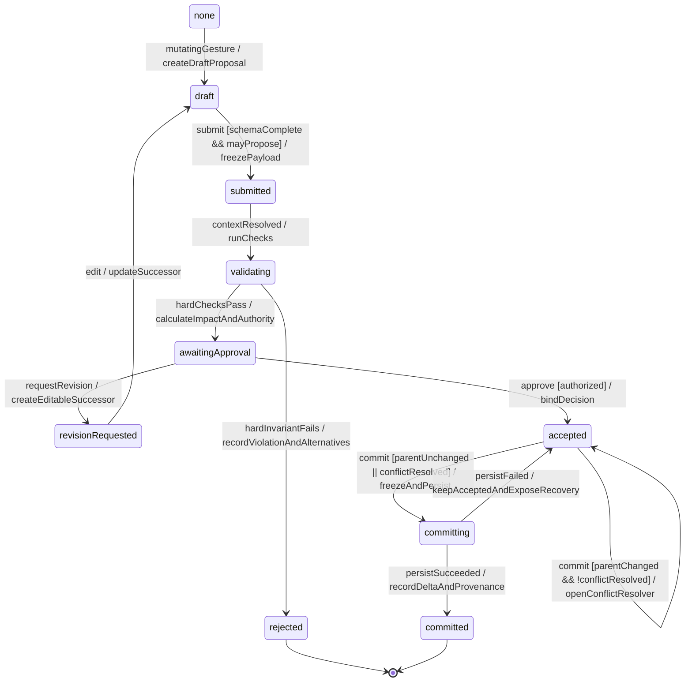

[OBS] `rejected` and `committed` are final states. Rework after a rejection starts a new draft proposal linked to the rejected one; the rejected record is not reopened. Source: NW ADD v1.1 Figure 10, “Terminal records retain the proposal, checks, decision, alternatives, and provenance.” [PRE] The `committing` state and its failed-save path (PRE-25).

### Branch lifecycle statechart

```text
active --requestReview--> inReview
inReview --changesRequested--> active
inReview --approveMerge [authorityAllowsMerge]--> mergeReady
mergeReady --merge [semanticChecksPass] / createMergeCommit--> active
inReview --publishIndependent [publicationChecksPass]--> published
active --archive / preserveLineageAndHideFromDefault--> archived
archived --restore--> active
```

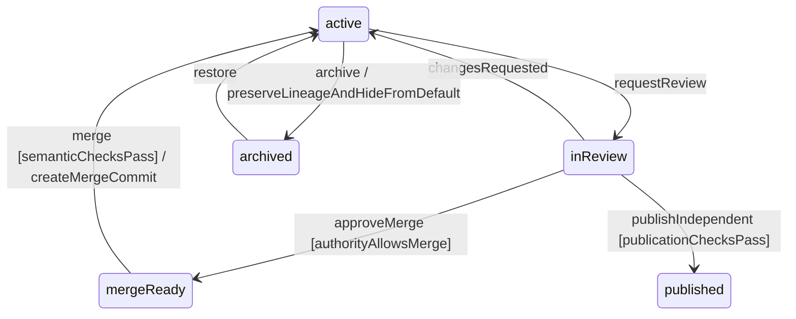

### Selection and projection statechart

```text
current --select(stableId) / selectedId:=stableId; requestProjectionRebuild--> rebuilding
rebuilding --projectionReady(commitId,version) [commitMatches] / projectionVersion:=version--> current
rebuilding --projectionReady(otherCommit,version) [!commitMatches] / discardStaleProjection--> rebuilding
rebuilding --projectionFailed / preserveLastValid; exposeRecovery--> failed
failed --retry / requestProjectionRebuild--> rebuilding
```

```mermaid
stateDiagram-v2
    current --> rebuilding : select(stableId) / selectedId≔stableId; requestProjectionRebuild
    rebuilding --> current : projectionReady(commitId,version) [commitMatches] / projectionVersion≔version
    rebuilding --> rebuilding : projectionReady(otherCommit,version) [!commitMatches] / discardStaleProjection
    rebuilding --> failed : projectionFailed / preserveLastValid; exposeRecovery
    failed --> rebuilding : retry / requestProjectionRebuild
```

### Long job statechart

```text
idle --enqueue / recordInputsAndProvenance--> queued
queued --workerStarted--> running
running --partialResult / markUncommittedPartial--> partial
partial --moreWork--> running
running --completed / publishProjectionVersion--> complete
running --failed / recordFailureAndRetryPolicy--> failed
queued --cancel--> cancelled
running --cancelAcknowledged--> cancelled
failed --retry / createLinkedAttempt--> queued
```

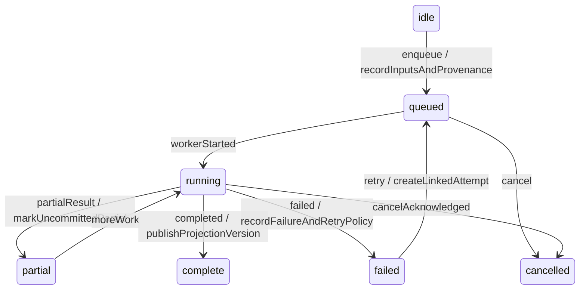

### Trace drawer statechart

[PRE] Region: CMP-07. Added by PRE-26.

```text
closed --toggle / openLastTabAndFocusHeading--> open
closed --openTab(tab) / drawerState:=tab; focusHeading--> open
open --selectTab(tab) / drawerState:=tab--> open
open --toggle / closeAndRestoreFocus--> closed
open --escape / closeAndRestoreFocus--> closed
```

```mermaid
stateDiagram-v2
    closed --> open : toggle / openLastTabAndFocusHeading
    closed --> open : openTab(tab) / drawerState≔tab; focusHeading
    open --> open : selectTab(tab) / drawerState≔tab
    open --> closed : toggle / closeAndRestoreFocus
    open --> closed : escape / closeAndRestoreFocus
```

### Inspector drawer statechart

[PRE] Region: CMP-06 (`inspectorState`). Added by PRE-26.

```text
docked --viewportBecomesMedium / undockInspector--> closed
closed --openInspector / openDrawerAndFocusHeading--> open
open --escape / closeAndRestoreFocus--> closed
open --viewportBecomesWide / dockInspector--> docked
closed --viewportBecomesWide / dockInspector--> docked
```

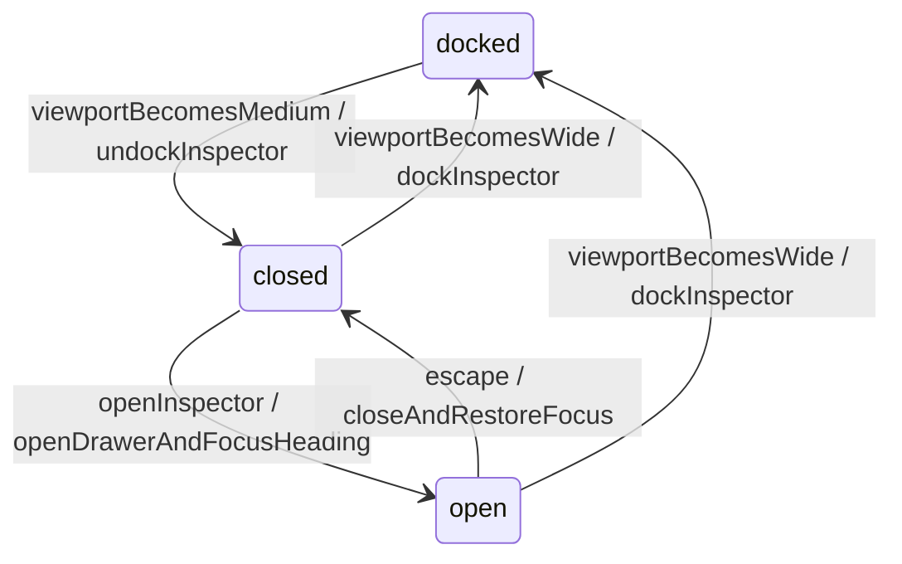

### Conflict resolver statechart

[PRE] Region: CMP-16 (`conflictState`). Added by PRE-26.

```text
unresolved --chooseFork / createBranchWithBothParents--> forking
unresolved --chooseRevise / createEditableSuccessor--> revising
unresolved --override [authorized && reasonPresent] / recordOverride--> resolved
forking --forkCreated / recordChosenActionAndActor--> resolved
forking --forkFailed / preserveReason; showFailedOperation--> error
revising --successorCreated / recordChosenActionAndActor--> resolved
error --retry / reuseReason--> unresolved
```

```mermaid
stateDiagram-v2
    unresolved --> forking : chooseFork / createBranchWithBothParents
    unresolved --> revising : chooseRevise / createEditableSuccessor
    unresolved --> resolved : override [authorized && reasonPresent] / recordOverride
    forking --> resolved : forkCreated / recordChosenActionAndActor
    forking --> error : forkFailed / preserveReason; showFailedOperation
    revising --> resolved : successorCreated / recordChosenActionAndActor
    error --> unresolved : retry / reuseReason
```

### Region tabs statechart

[PRE] Region: CMP-17 (`activeRegionTab`). Added by PRE-26.

```text
hidden --viewportBecomesNarrow [firstVisit] / activeRegionTab:=work--> showing
hidden --viewportBecomesNarrow [!firstVisit] / restoreLastTab--> showing
showing --selectTab(region) / activeRegionTab:=region; preserveScroll--> showing
showing --viewportBecomesMedium / restoreRegions--> hidden
```

```mermaid
stateDiagram-v2
    hidden --> showing : viewportBecomesNarrow [firstVisit] / activeRegionTab≔work
    hidden --> showing : viewportBecomesNarrow [!firstVisit] / restoreLastTab
    showing --> showing : selectTab(region) / activeRegionTab≔region; preserveScroll
    showing --> hidden : viewportBecomesMedium / restoreRegions
```

### Global invariants

-   [OBS] Changing selection or projection MUST NOT change canonical narrative state.

-   [OBS] Source evidence in Criticism Parlor MUST remain immutable after fingerprinted import.

-   [OBS] A validated proposal MUST NOT be represented as accepted; an accepted proposal MUST NOT be represented as committed until persistence succeeds.

-   [OBS] Rewind and undo MUST NOT silently delete accepted history. Post-commit rewind moves or creates a branch pointer.

-   [OBS] Counterfactual results MUST retain the baseline, intervention, controls, versions, generators, and unresolved constraints.

-   [OBS] Partial job output MUST NOT display an Accepted or Committed state.

-   [OBS] Mode transitions MUST preserve authority boundaries: criticism cannot mutate frozen source, and laboratory results cannot replace source or canonical history.

-   [PRE] If an event has no transition from the current state, the UI performs no state mutation and announces a visible reason when the user initiated the event.

### Global keyboard model

| **Key**           | **Effect**                                                                   | **Origin**                          |
|-------------------|------------------------------------------------------------------------------|-------------------------------------|
| Tab and Shift Tab | Move through interactive elements in reading order; no hidden focus targets. | [PRE]                             |
| F6 and Shift F6   | Cycle global regions forward and backward.                                   | [PRE]                             |
| Ctrl Cmd K        | Open global search and command entry.                                        | [PRE]                             |
| Ctrl Cmd J        | Toggle trace drawer and restore focus on close.                              | [PRE]                             |
| Ctrl Cmd Z        | Undo current draft operation only; unavailable after commit.                 | [OBS] semantics, [PRE] shortcut |
| Escape            | Close the topmost noncommitted dialog or drawer and restore focus.           | [PRE]                             |
| Arrow keys        | Follow the active APG tree, listbox, tab, or toolbar pattern.                | [PRE]                             |

### Pointer hover and focus

[PRE] Pointer hover MAY expose secondary actions but MUST NOT be required to discover or invoke them. Focus-visible styling MUST remain present during drag, selection, and active states. A drag operation MUST have a keyboard command and non-spatial equivalent. Cursor changes MUST NOT be the only indication of mutability.

## 8 Screens

The screen records below compose shared components and add only mode-specific placement, content, behavior, and acceptance. All wireframes are Mermaid block diagrams and represent the reference wide-screen layout at 1440 x 900px.

### Screen 1 Shared workbench shell

[OBS] Reference: NW ADD v1.1 Figure 16 and Table 30, pp.53-54. [PRE] Exact dimensions follow Section 5.

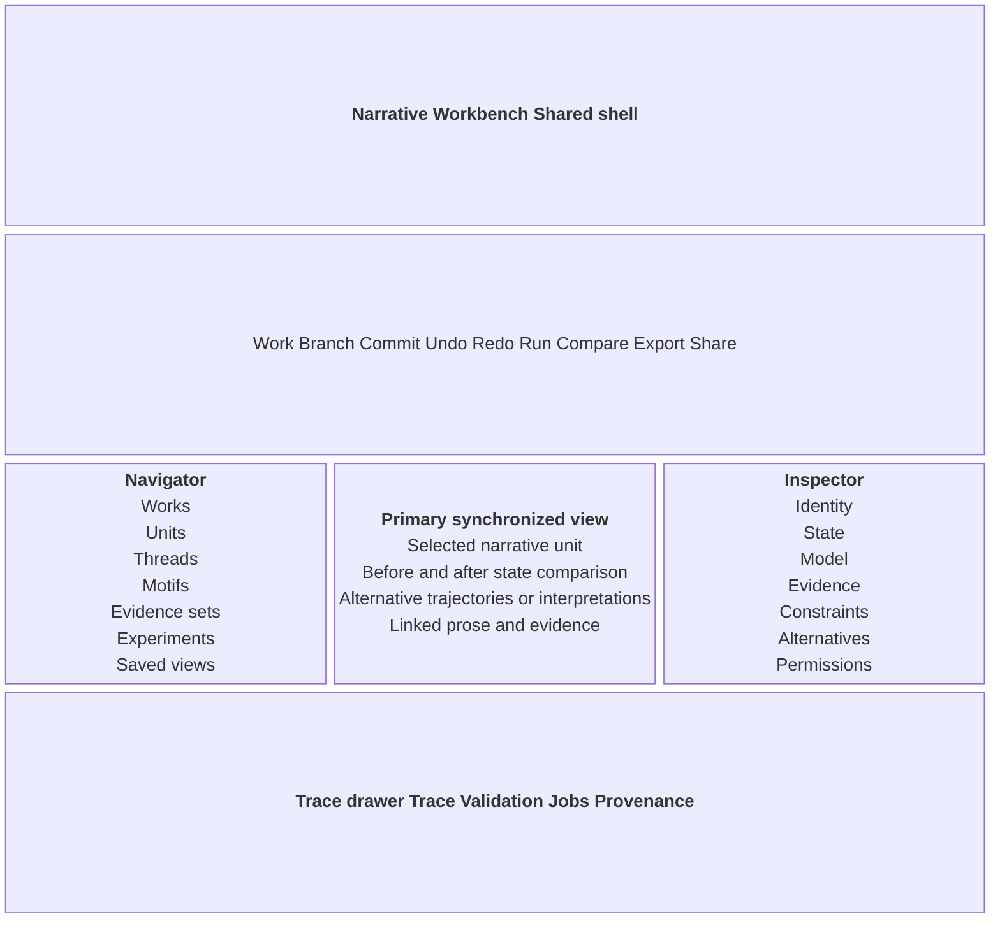

#### Layout

[PRE] The screen uses the global wide-screen grid `252px minmax(520px,1fr) 320px`, with CMP-07 below. It collapses according to the medium and narrow contracts in Section 5.

#### Region composition

| **Region**     | **Component** | **Content**                                                              |
|----------------|---------------|--------------------------------------------------------------------------|
| Global context | CMP-02        | Work, branch, commit, mode, sync, job, authority                         |
| Commands       | CMP-03        | Work, Branch, Commit, Undo, Redo, Run, Compare, Export, Share            |
| Navigator      | CMP-04        | Units, threads, motifs, evidence sets, experiments, saved views          |
| Primary        | CMP-05        | Current synchronized projection                                          |
| Inspector      | CMP-06        | Identity, state, model, evidence, constraints, alternatives, permissions |
| Drawer         | CMP-07        | Trace, validation, jobs, provenance                                      |

#### Behavior

-   [OBS] Selecting a stable identity in any region synchronizes all projections without changing canonical state.

-   [OBS] Every region labels the commit and projection version it represents while rebuilding.

-   [OBS] Mode, branch, commit, authority, provenance, and job status remain visible.

#### Acceptance scenarios

```gherkin
Scenario: synchronized selection
  Given workId, branchId, and commitId are visible
  When the user selects an actor in Navigator
  Then the same selectedId appears in Primary view, Inspector, and Trace and canonicalCommitId is unchanged
Scenario: projection lag is explicit
  Given the primary projection is rebuilding
  When the previous content remains visible
  Then the region labels its represented commit and projection version and exposes syncState `rebuilding`
@pre
Scenario: narrow responsive transformation
  Given viewport width becomes 390px
  When the layout reflows
  Then Navigator, Work, Inspector, and Trace appear as tabs and context labels remain visible
```

### Screen 2 Composition Studio

[OBS] Reference: NW ADD v1.1 Figure 17 and Table 31, p.55; NSM pp.12-15. [PRE] Exact dimensions follow Section 5.

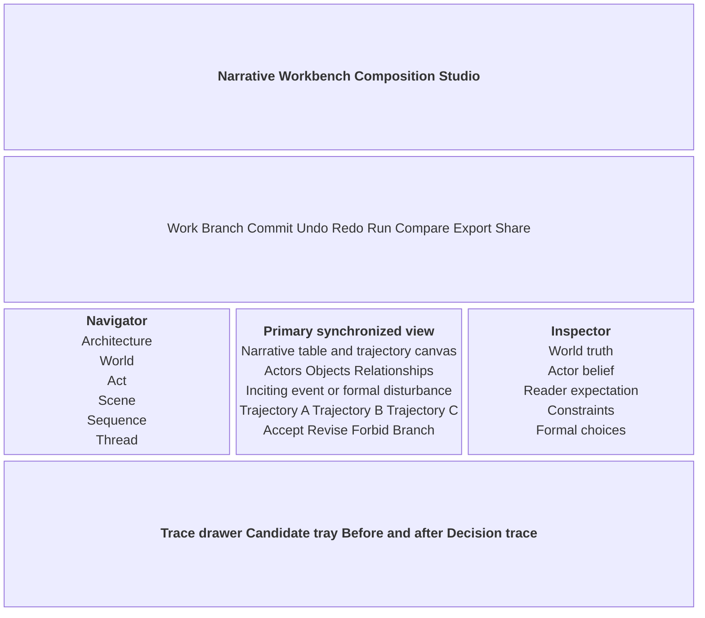

#### Layout

[PRE] The screen uses the global wide-screen grid `252px minmax(520px,1fr) 320px`, with CMP-07 below. It collapses according to the medium and narrow contracts in Section 5.

#### Region composition

| **Region** | **Component**   | **Content**                                              |
|------------|-----------------|----------------------------------------------------------|
| Navigator  | CMP-04          | Architecture scale and narrative units                   |
| Canvas     | CMP-05 + CMP-10 | Narrative objects, typed relationships, disturbance      |
| Candidates | CMP-11          | Trajectories and actions                                 |
| Inspector  | CMP-06          | Truth, belief, reader model, constraints, formal choices |
| Drawer     | CMP-07          | Candidate comparison and decision trace                  |
| Status     | CMP-08 + CMP-15 | Provenance and job lifecycle                             |

#### Behavior

-   [OBS] Place or connect produces a provisional object or typed relation and affected constraints.

-   [OBS] Injecting a disturbance generates candidates; it has no commit effect until acceptance.

-   [OBS] Editing belief or possibility shows world, actor, and reader model differences and proposes an ordinary or model transition.

-   [OBS] Prose realization follows an accepted commit; prose edits that introduce new facts create reconciliation proposals.

#### Acceptance scenarios

```gherkin
Scenario: generate and accept a trajectory
  Given an inciting event and constraints are defined
  When the user runs generation and accepts a validated candidate
  Then proposalState becomes accepted and canonicalCommitId changes only after Commit succeeds
Scenario: forbid a transition
  Given a candidate transition is selected
  When the user chooses Forbid
  Then a draft constraint proposal opens and the current candidate remains preserved
Scenario: reconcile prose fact
  Given edited prose introduces an assertion absent from the model
  When the discrepancy detector completes
  Then a reconciliation proposal identifies the assertion and lets the author choose language or model authority
```

### Screen 3 Criticism Parlor

[OBS] Reference: NW ADD v1.1 Figure 18 and Table 32, p.56. [PRE] Exact dimensions follow Section 5.

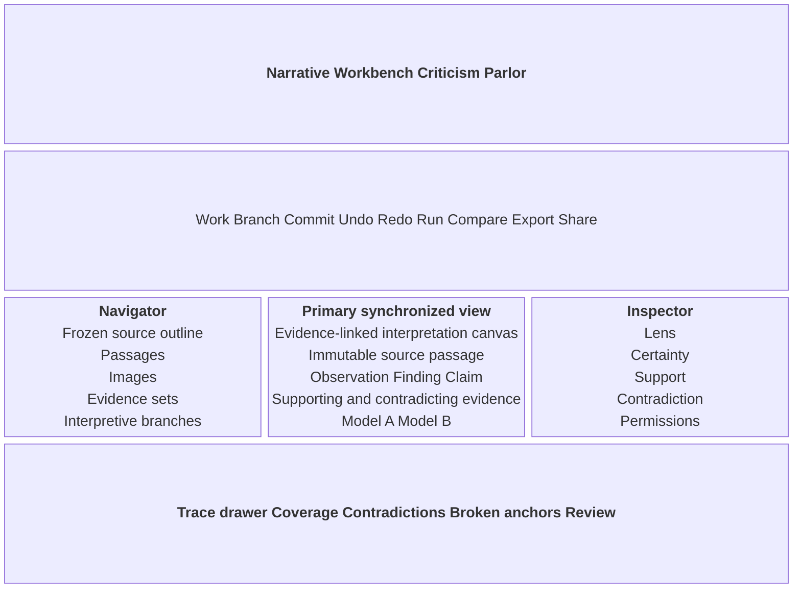

#### Layout

[PRE] The screen uses the global wide-screen grid `252px minmax(520px,1fr) 320px`, with CMP-07 below. It collapses according to the medium and narrow contracts in Section 5.

#### Region composition

| **Region** | **Component** | **Content**                                          |
|------------|---------------|------------------------------------------------------|
| Navigator  | CMP-04        | Frozen source outline and interpretation branches    |
| Evidence   | CMP-12        | Immutable source passage or region                   |
| Assertions | CMP-13        | Observation, finding, claim, competing models        |
| Inspector  | CMP-06        | Lens, certainty, support, contradiction, permissions |
| Drawer     | CMP-07        | Coverage, disagreements, broken anchors, review      |
| Status     | CMP-08        | Source, proposal, validation, acceptance             |

#### Behavior

-   [OBS] Source spans remain immutable and carry edition and region anchors.

-   [OBS] Machine extraction returns proposals; critics accept classifications and evidence links before interpretation commit.

-   [OBS] Claims display supporting and contradicting evidence, branch identity, and lens dependence.

-   [OBS] Broken anchors block publication until realigned.

#### Acceptance scenarios

```gherkin
Scenario: accept evidence-backed claim
  Given a claim has at least one resolved supporting anchor
  When the critic accepts its classification and evidence links
  Then validation checks the links and a committed interpretation remains on its named branch
Scenario: compare competing models
  Given Model A and Model B share a frozen source edition
  When the user selects Compare
  Then the view lists lens assumptions, differences, unresolved conflicts, and supporting or contradicting anchors
Scenario: broken anchor prevents publication
  Given one required source anchor is broken
  When the user requests publication
  Then publicationStatus remains blocked and “Realign anchor” is available
```

### Screen 4 Counterfactual Laboratory

[OBS] Reference: NW ADD v1.1 Figure 19 and Table 33, pp.57-58. [PRE] Exact dimensions follow Section 5.

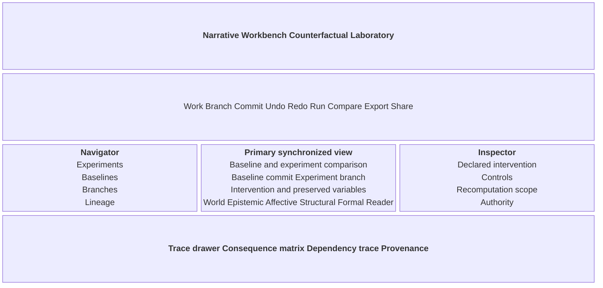

#### Layout

[PRE] The screen uses the global wide-screen grid `252px minmax(520px,1fr) 320px`, with CMP-07 below. It collapses according to the medium and narrow contracts in Section 5.

#### Region composition

| **Region** | **Component**   | **Content**                                      |
|------------|-----------------|--------------------------------------------------|
| Navigator  | CMP-04          | Experiments, baseline, lineage                   |
| Comparison | CMP-05 + CMP-14 | Paired baseline and experiment branch            |
| Inspector  | CMP-06          | Declared intervention and preserved variables    |
| Drawer     | CMP-07          | Consequence matrix, dependency trace, provenance |
| Status     | CMP-08 + CMP-15 | Lifecycle and job state                          |

#### Behavior

-   [OBS] The baseline commit remains immutable. Every intervention creates or updates an experiment branch.

-   [OBS] Preserved variables and recomputation scope remain visible before simulation.

-   [OBS] The matrix separates deterministic consequences from generated hypotheses across seven dimensions.

-   [OBS] Results retain lineage and MUST NOT be presented as empirical proof or source replacement.

#### Acceptance scenarios

```gherkin
Scenario: run a controlled experiment
  Given a baseline commit, intervention, and preserved variables are declared
  When the user runs simulation
  Then the experiment record retains those inputs and the matrix separates deterministic effects from generated hypotheses
Scenario: preserve baseline
  Given an experiment branch is active
  When the user edits the intervention
  Then baselineCommitId remains unchanged and the edit creates a draft experiment proposal
Scenario: distinguish intended reader response
  Given reader-model results exist without measured reader data
  When the matrix renders Reader model
  Then the label reads “Intended response” and no empirical effect is asserted
```

### Screen 5 Proposal review

[OBS] Reference: NW ADD v1.1 Figure 10 and Table 26, p.45; Table 34 p.58. [PRE] Exact dimensions follow Section 5.

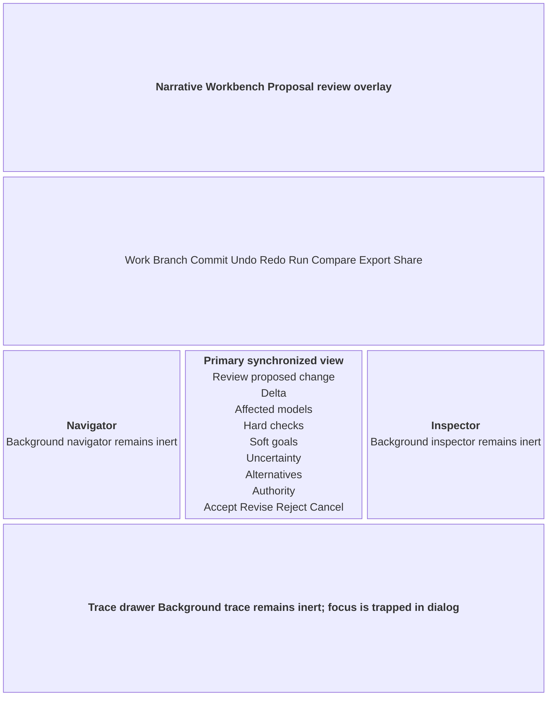

#### Layout

[PRE] CMP-09 overlays and renders the background inert. The modal is centered, 720px maximum width, and 48px minimum viewport inset. Background region state and scroll positions remain unchanged.

#### Region composition

| **Region** | **Component** | **Content**                               |
|------------|---------------|-------------------------------------------|
| Overlay    | CMP-09        | Proposal lifecycle and review             |
| Provenance | CMP-08        | Origin, validation, authority, acceptance |
| Conflict   | CMP-16        | Conditional semantic conflict resolution  |
| Background | CMP-01        | Inert; state preserved                    |

#### Behavior

-   [OBS] The preview exposes the proposed delta, affected models, checks, authority, uncertainty, and alternatives.

-   [OBS] Reject preserves proposal and reasons. Revision creates an editable successor. Acceptance precedes commit.

-   [PRE] Closing a draft preview restores focus and leaves the draft available from Trace. Closing is unavailable during the atomic commit step.

#### Acceptance scenarios

```gherkin
Scenario: hard validation failure
  Given a submitted proposal violates a hard invariant
  When validation completes
  Then proposalState is rejected and the dialog lists the violated rule, scope, explanation, and alternatives
Scenario: revision preserves predecessor
  Given a reviewer requests a change
  When the author opens the successor
  Then proposalState is revisionRequested and the predecessor proposal remains linked and unchanged
Scenario: semantic conflict opens resolver
  Given the parent commit changed after acceptance
  When the user requests Commit
  Then canonical state remains unchanged and CMP-16 names incompatible assertions, scopes, models, and commits
```

## 9 Known differences between design sources

| **No** | **Topic**            | **Source A**                                                                                    | **Source B**                                                                    | **Specification follows**                                    | **Reason**                                                                  |
|--------|----------------------|-------------------------------------------------------------------------------------------------|---------------------------------------------------------------------------------|--------------------------------------------------------------|-----------------------------------------------------------------------------|
| 1      | Document authority   | NW ADD v1.0 defines conceptual and technical architecture.                                      | NW ADD v1.1 adds UML and GUI specifications and declares version 1.1.           | v1.1                                                         | The user requested v1.1 priority and it is the later, more specific source. |
| 2      | Primary interface    | NSM pp.12-15 centers a Scene Workbench narrative table.                                         | v1.1 pp.53-57 defines a shared shell with mode-specific primary surfaces.       | v1.1 shared shell; narrative table within Composition Studio | Preserves the source concept while honoring later consolidation.            |
| 3      | Mode names           | NSM describes composition, criticism, and counterfactual uses with provisional workspace names. | v1.1 names Composition Studio, Criticism Parlor, and Counterfactual Laboratory. | v1.1 names                                                   | These are the latest explicit UI labels.                                    |
| 4      | Brand and dimensions | Source sketches show restrained navy linework but do not define tokens.                         | v1.1 p.58 explicitly leaves brand styling and detailed dimensions open.         | Section 4 and 5 [PRE] values                               | Implementation needs testable values; owners must confirm them.             |
| 5      | Example content      | NSM includes named sample actors, stories, and frameworks.                                      | v1.1 treats examples as conceptual records and projections.                     | Runtime data placeholders                                    | Examples define data shape and MUST NOT ship as fixed copy.                 |
| 6      | Undo and rewind      | NSM describes stopping, choosing, and changing simulation possibilities.                        | v1.1 p.58 separates precommit undo from postcommit rewind.                      | v1.1                                                         | The later rule protects append-only lineage.                                |
| 7      | Reader response      | NSM distinguishes intended from measured reader response.                                       | v1.1 Table 33 requires the same distinction in comparison output.               | Both                                                         | The sources agree; the rule is repeated in the UI.                          |
| 8      | Technology target    | Neither architecture version selects a front-end framework.                                     | The GUI prototype boundary repeats that the framework is open.                  | Tauri, Rust, JS, and Python sidecar (PRE-01)                 | Repository and toolkit were bound before readiness.                         |
| 9      | Critical assertions  | NSM warns that theory-dependent inference is not textual fact.                                  | v1.1 p.56 defines observation, finding, claim, and competing model cues.        | v1.1 visual semantics                                        | The later source operationalizes the conceptual warning.                    |

### Prescribed rule register

| **ID** | **Rule**                                                                                           | **Location**  | **Owner**                          | **Status** |
|--------|----------------------------------------------------------------------------------------------------|---------------|------------------------------------|------------|
| PRE-01 | Bind repository, module, UI framework, platform, and accessibility API.                            | §1-2          | Developer lead                     | Confirmed  |
| PRE-02 | Confirm DTCG palette, typography, spacing, status, focus, and motion tokens.                       | §4            | Lead UX designer                   | Confirmed  |
| PRE-03 | Confirm Inter and IBM Plex Mono or approve replacements and loaded weights.                        | §4            | Lead UX designer                   | Confirmed  |
| PRE-04 | Confirm reference, default, and minimum viewport sizes and breakpoints.                            | §5            | Lead UX designer                   | Confirmed  |
| PRE-05 | Confirm 252px Navigator, 320px Inspector, 220px Trace, and 520px primary minimum.                  | §5            | Lead UX designer                   | Confirmed  |
| PRE-06 | Confirm internal-pane scrolling and no outer scroll at wide and medium sizes.                      | §5            | Lead UX designer                   | Confirmed  |
| PRE-07 | Confirm ARIA or native accessibility roles for CMP-01 through CMP-18.                              | §6            | Information architect              | Confirmed  |
| PRE-08 | Confirm global region-cycle, command search, trace, and undo shortcuts.                            | §7            | Product manager and developer lead | Confirmed  |
| PRE-09 | Confirm empty, loading, error, disabled, permission, and offline copy patterns.                    | CMP-18        | Product manager                    | Confirmed  |
| PRE-10 | Confirm visible disabled reasons and when disabled controls remain focusable.                      | CMP-03 CMP-18 | Information architect              | Confirmed  |
| PRE-11 | Confirm tree, listbox, toolbar, tabs, and modal-dialog APG keyboard patterns.                      | §6-7          | Information architect              | Confirmed  |
| PRE-12 | Confirm Proposal preview and Conflict resolver dialog geometry and focus behavior.                 | CMP-09 CMP-16 | Lead UX designer                   | Confirmed  |
| PRE-13 | Confirm graph object size, semantic zoom, list alternative, and connect workflow.                  | CMP-10        | Lead UX designer                   | Confirmed  |
| PRE-14 | Confirm comparison-matrix columns, sticky headers, and horizontal overflow.                        | CMP-14        | Lead UX designer                   | Confirmed  |
| PRE-15 | Confirm live-region policy for job lifecycle and failures.                                         | CMP-15        | Information architect              | Confirmed  |
| PRE-16 | Confirm narrow-screen labels, active-tab default, and 360px behavior.                              | CMP-17        | Lead UX designer                   | Confirmed  |
| PRE-17 | Confirm selection synchronization behavior during projection failures.                             | §7            | Developer lead                     | Confirmed  |
| PRE-18 | Confirm that unhandled events produce no mutation and a visible reason for user-initiated actions. | §7            | Developer lead                     | Confirmed  |
| PRE-19 | Confirm shipped copy introduced by this specification.                                             | §6-8          | Product manager                    | Confirmed  |
| PRE-20 | Confirm WCAG 2.2 AA as the web target or equivalent native criteria.                               | §4 §10        | Product manager                    | Confirmed  |
| PRE-21 | Confirm `focus-ring-on-strong` and its usage rule. | §4 CMP-02 CMP-17 | Lead UX designer | Confirmed  |
| PRE-22 | Confirm the darker `ink-500` value (`#5B6875`). | §4 | Lead UX designer | Confirmed  |
| PRE-23 | Confirm `border-control` and the separator-only rule for `border-default`. | §4 CMP-11 CMP-12 | Lead UX designer | Confirmed  |
| PRE-24 | Confirm the new dimension and typography role tokens and the breakpoint rule. | §4-6 | Lead UX designer and developer lead | Confirmed  |
| PRE-25 | Confirm the `committing` state, failed-save path, and final states. | §7 CMP-09 | Developer lead | Confirmed  |
| PRE-26 | Confirm the trace drawer, inspector drawer, conflict resolver, and region tab statecharts. | §7 | Information architect and developer lead | Confirmed  |
| PRE-27 | Confirm the scenario-or-deferral rule and the per-state dispositions. | §6 §10 | Product manager | Confirmed  |

Sign-offs (signer and date) are recorded in [pre-register.md](pre-register.md).

## 10 Verification procedure

Implementation acceptance requires all five checks below against the packaged application. Development-server screenshots are useful during implementation but do not satisfy the final screenshot gate.

### 1 Token test

Parse the DTCG JSON, resolve every alias, verify generated properties, and fail on literal colors, spacing, dimensions, font families, or motion durations in component code. Components MUST reference role tokens only. The layout keywords listed in Section 4 token rules and build-time breakpoint media queries are allowed.

### 2 Computed style

At wide, medium, and narrow reference sizes, read computed or toolkit-equivalent values for every property named in each component record and every component state.

### 3 Packaged screenshots

Capture Screens 1-5 from the packaged application at matching state and reference size. Compare side by side with the editable wireframes and source figures. Record each exact difference.

### 4 Scenarios

Run every Gherkin scenario in Sections 6 and 8. Map one automated or manual test to each scenario and record result, environment, and evidence. States marked “Deferred” in a component's state coverage table are verified by checks 2 and 3 instead.

### 5 PRE confirmation

List every delivered [PRE] item with owner confirmation or override. A Proposed item prevents acceptance if the implementation depends on it.

### Accessibility verification

-   [PRE] Keyboard-only pass covers every action, region cycle, dialog, drawer, tree, listbox, toolbar, tabs, and non-spatial alternative.

-   [PRE] Screen-reader pass confirms region names, roles, lifecycle labels, source and authority cues, table headers, focus restoration, and live job updates.

-   [PRE] Zoom pass at 200 percent confirms that functions remain available without two-dimensional page scrolling at a 1280 CSS px viewport.

-   [PRE] Color-independence pass removes color and confirms source status, authority, lifecycle, confidence, and diff direction remain perceivable through text and icons.

-   [PRE] Reduced-motion pass confirms panels and feedback transition instantly without losing state information.

### Deviation record

| **No** | **Screen** | **Deviation with exact values** | **Rule** | **Disposition**                                      |
|--------|------------|---------------------------------|----------|------------------------------------------------------|
| 1      |            |                                 |          | Fixed or Deferred with reason and tracking reference |
| 2      |            |                                 |          |                                                      |
| 3      |            |                                 |          |                                                      |

### Readiness gate

Checked 25 October 2026 after change list CL-01 to CL-10 was applied.

-   [x] Header table and exact source ranges are complete.

-   [x] Token JSON is valid; aliases resolve; every prose token reference exists.

-   [x] Reference, default, and minimum sizes are stated.

-   [x] Every shared component uses the fixed record order and has state coverage.

-   [x] State variables and statecharts cover each interactive region.

-   [x] Every screen cites a reference and composes stable component IDs.

-   [x] Every state has scenario coverage or an explicit deferral.

-   [x] The [PRE] register has owners and dispositions.

-   [x] Known differences and verification procedure are complete.

### Acceptance gate

-   [ ] Token and literal-value tests pass.

-   [ ] Computed-style tests pass.

-   [ ] Packaged-application screenshot comparisons and deviation records are complete.

-   [ ] All scenarios pass or have explicit tracked deferrals.

-   [ ] Every delivered [PRE] item is Confirmed or Overridden.

## 11 References

### Design sources

-   Briggs, Matt. Narrative Workbench Architectural Design Document UML GUI. Version 1.1, 23 October 2026, pp.1-61. Governing architectural, UML, GUI, accessibility, and responsive source.

-   Briggs, Matt. Narrative Workbench Architectural Design Document. Version 1.0, 23 October 2026, pp.1-40. Historical architectural baseline.

-   Narrative State Model. Source conversation PDF, 23 October 2026, pp.1-32. Conceptual source for narrative state, table interaction, composition, criticism, counterfactual use, and multiscale structure.

### Specification framework and standards

-   Visual Specification Framework. Version 1.0, 3 October 2026.

-   IETF BCP 14, RFC 2119 and RFC 8174. Requirement keywords.

-   W3C Design Tokens Community Group. Design Tokens Format Module 2025.10 or later.

-   W3C. WAI ARIA 1.2.

-   W3C WAI. ARIA Authoring Practices Guide patterns.

-   W3C. CSS Grid Layout Module Level 1.

-   W3C. CSS Flexible Box Layout Module Level 1.

-   W3C. CSS Box Model Module Level 3.

-   W3C. State Chart XML SCXML.

-   Harel, David. Statecharts A Visual Formalism for Complex Systems. Science of Computer Programming 8.3, 1987, pp.231-274.

-   Cucumber. Gherkin Reference.

-   W3C. Web Content Accessibility Guidelines WCAG 2.2.

### Source traceability summary

| **Requirement area**              | **Primary source**                         | **Specification location**     |
|-----------------------------------|--------------------------------------------|--------------------------------|
| Shared synchronized shell         | NW ADD v1.1 pp.53-54                       | §5, CMP-01 to CMP-08, Screen 1 |
| Composition workflow              | NW ADD v1.1 pp.21-23 and 55; NSM pp.12-15  | CMP-09 to CMP-11, Screen 2     |
| Criticism evidence and assertions | NW ADD v1.1 pp.21, 48, 56; NSM pp.16-19    | CMP-12 to CMP-13, Screen 3     |
| Counterfactual comparison         | NW ADD v1.1 pp.21, 49, 57-58; NSM pp.20-21 | CMP-14, Screen 4               |
| Proposal and branch lifecycle     | NW ADD v1.1 pp.45-46                       | CMP-09, CMP-16, §7, Screen 5   |
| Responsive and accessibility      | NW ADD v1.1 p.58                           | §4-8 and §10                   |
| Provenance and AI boundary        | NW ADD v1.1 pp.22-23, 30-31, 53-58         | CMP-08, CMP-15, §7-10          |

### End of specification

Readiness status: Ready for implementation planning (readiness gate passed 25 October 2026). Every prescribed rule is Confirmed. Acceptance requires completion of the five verification checks against the packaged application.
